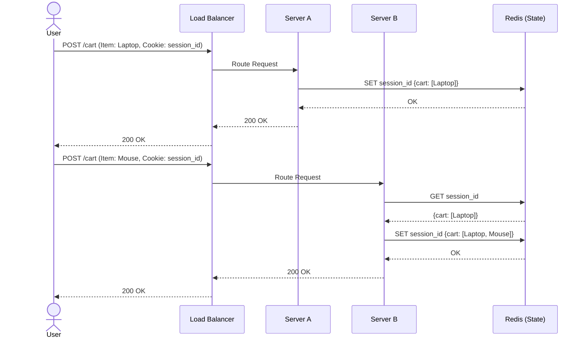
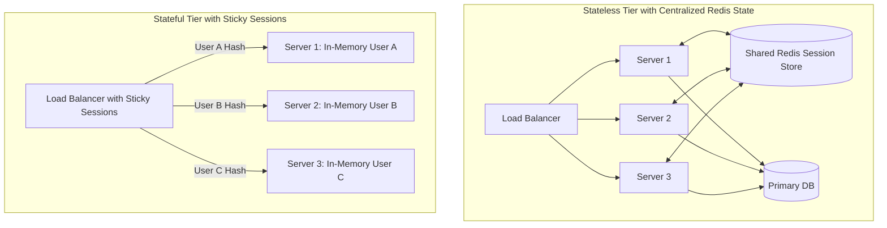

# Stateless vs Stateful Services

Understanding state management is crucial for designing scalable, maintainable distributed systems.

## Beginner Intuition

Imagine ordering food at two different types of restaurants.
- **Stateless (Fast Food):** You walk up to the counter, give your order, pay, and get a receipt with a number. Any employee can hand you your food when your number is called. They don't need to remember who you are.
- **Stateful (Fine Dining):** You are seated by a host and assigned a specific waiter. This waiter remembers your dietary restrictions, which courses you've finished, and your drink preferences throughout the night. If that waiter leaves mid-meal, another waiter would need to completely catch up on your table's state.

---

## 🔄 Stateless Services

> **A stateless service doesn't retain any information between requests. Each request is independent.**

```
Request 1 → Server A → Response 1
Request 2 → Server B → Response 2  (Any server can handle any request)
Request 3 → Server C → Response 3
```

### Characteristics

```java
// Stateless REST API
@RestController
class OrderController {
    @Autowired
    private OrderRepository repo;  // External database
    
    @GetMapping("/orders/{id}")
    public Order getOrder(@PathVariable String id) {
        return repo.findById(id);  // All state in external DB
    }
    
    @PostMapping("/orders")
    public Order createOrder(@RequestBody Order order) {
        return repo.save(order);   // No local state stored
    }
}
```

```python
# Stateless REST API
import http.server
import json
import urllib.parse

class OrderHandler(http.server.BaseHTTPRequestHandler):
    def __init__(self, request, client_address, server, repo):
        self.repo = repo # External database reference
        super().__init__(request, client_address, server)

    def do_GET(self):
        # All state in external DB
        parsed_path = urllib.parse.urlparse(self.path)
        order_id = parsed_path.path.split('/')[-1]
        order = self.repo.find_by_id(order_id)
        # ... response handling ...

    def do_POST(self):
        # No local state stored
        content_length = int(self.headers['Content-Length'])
        post_data = json.loads(self.rfile.read(content_length))
        order = self.repo.save(post_data)
        # ... response handling ...
```

### Benefits

| Benefit | Explanation |
|---------|-------------|
| **Easy Scaling** | Add/remove instances freely |
| **High Availability** | Any instance can handle requests |
| **Simple Load Balancing** | No sticky sessions needed |
| **Easy Recovery** | No state to restore |
| **Container Friendly** | Perfect for Kubernetes |

---

## 📦 Stateful Services

> **A stateful service maintains information about client sessions or data across requests.**

```
Request 1 → Server A → (saves state)
Request 2 → Server A → (uses saved state)  ← Must go to same server!
Request 3 → Server A → (uses saved state)
```

### Characteristics

```java
// Stateful - Session stored locally
class ChatServer {
    private Map<String, WebSocketSession> connections = new HashMap<>();
    private Map<String, List<Message>> chatHistory = new HashMap<>();
    
    public void onConnect(String userId, WebSocketSession session) {
        connections.put(userId, session);  // Local state
    }
    
    public void sendMessage(String userId, Message msg) {
        chatHistory.get(userId).add(msg);   // Local state
        connections.get(userId).send(msg);
    }
}
```

```python
# Stateful - Session stored locally
import socket
from typing import Dict, List, Any

class ChatServer:
    def __init__(self):
        self.connections: Dict[str, socket.socket] = {}
        self.chat_history: Dict[str, List[Any]] = {}

    def on_connect(self, user_id: str, client_socket: socket.socket):
        self.connections[user_id] = client_socket  # Local state

    def send_message(self, user_id: str, msg: Any):
        if user_id not in self.chat_history:
            self.chat_history[user_id] = []
        self.chat_history[user_id].append(msg)   # Local state
        
        if user_id in self.connections:
            # Assuming msg can be converted to bytes
            self.connections[user_id].sendall(str(msg).encode()) 
```

### Use Cases

| Use Case | Why Stateful |
|----------|--------------|
| **WebSocket connections** | Persistent connection to specific server |
| **Gaming servers** | Game state in memory for speed |
| **Database clusters** | Data locality matters |
| **Caching layers** | Local cache for performance |

---

## Worked Trace
**Premise**: User is adding items to an e-commerce shopping cart.
1. **User request**: Add "Laptop" to cart via Load Balancer.
2. **Stateless path**: Load Balancer routes to Server A. Server A receives session cookie, updates cart in Redis (external state).
3. **Subsequent request**: User adds "Mouse". Load balancer routes to Server B.
4. **Stateless verification**: Server B reads session cookie, fetches cart from Redis (containing Laptop), and adds Mouse to Redis. Both requests succeeded without relying on local server state.



## Boundary / Counterexample
**Counterexample**: Real-time Multiplayer Gaming (e.g., FPS game).
- **Why stateless fails**: A 60-tick game server requires sub-millisecond response times to calculate player movements, collisions, and hit registrations. Fetching and persisting this game state (positions of all players and projectiles) from an external database like Redis 60 times a second per match would introduce unacceptable network latency and bottleneck the external store. 
- **Stateful boundary**: The game match is pinned to a specific stateful server instance in memory. Clients maintain a persistent UDP connection to that exact instance for the duration of the match.

---

## ⚖️ Comparison

| Aspect | Stateless | Stateful |
|--------|-----------|----------|
| **Scaling** | Easy (horizontal) | Complex (sticky sessions) |
| **Load Balancing** | Round-robin works | Need session affinity |
| **Failure Recovery** | Seamless | State may be lost |
| **Memory Usage** | Low | Higher |
| **Performance** | Network calls for state | Can be faster (local state) |
| **Complexity** | External state management | Internal state management |

---

## 🔧 Making Services Stateless

### Step 1: Externalize Session State

```java
// ❌ Stateful - Session in memory
class UserController {
    private HttpSession session;  // Tied to this server
}

// ✅ Stateless - Session in Redis
class UserController {
    @Autowired
    private RedisSessionStore sessionStore;
    
    public User getUser(String sessionId) {
        return sessionStore.get(sessionId);  // Any server can access
    }
}
```

```python
# ❌ Stateful - Session in memory
class UserController:
    def __init__(self):
        self.local_session = {}  # Tied to this server

# ✅ Stateless - Session in external store (represented abstractly via standard library)
class UserControllerStateless:
    def __init__(self, external_session_store):
        self.session_store = external_session_store
        
    def get_user(self, session_id: str):
        # Any server can access the external store via network calls (e.g., urllib)
        return self.session_store.get(session_id)
```

### Step 2: Use Tokens Instead of Sessions

#### Java
```java
// ✅ JWT - Self-contained token
@GetMapping("/protected")
public Response protectedEndpoint(@RequestHeader("Authorization") String token) {
    Claims claims = jwtService.verify(token);  // No server state needed
    return processRequest(claims.getUserId());
}
```

#### Python
```python
# ✅ JWT - Self-contained stateless verification
import hmac
import hashlib
import json
import base64

def verify_jwt_stateless(token: str, secret_key: str) -> dict:
    parts = token.split(".")
    if len(parts) != 3:
        raise ValueError("Invalid JWT format")
    header_b64, payload_b64, sig_b64 = parts
    expected_sig = base64.urlsafe_b64encode(
        hmac.new(secret_key.encode(), f"{header_b64}.{payload_b64}".encode(), hashlib.sha256).digest()
    ).decode().rstrip("=")
    if not hmac.compare_digest(sig_b64, expected_sig):
        raise PermissionError("Token signature mismatch")
    payload = json.loads(base64.urlsafe_b64decode(payload_b64 + "=="))
    return payload  # Entire session state is self-contained in claims
```

### Step 3: Externalize Caches

```java
// ❌ Local cache - Different on each server
private Map<String, Data> localCache = new HashMap<>();

// ✅ Distributed cache - Shared across servers
@Autowired
private RedisTemplate<String, Data> redis;
```

```python
import typing

# ❌ Local cache - Different on each server
local_cache: typing.Dict[str, typing.Any] = {}

# ✅ Distributed cache - Shared across servers
# Uses an injected network client (e.g., standard library socket wrapper) 
# to communicate with external cache cluster
class DistributedCacheClient:
    def __init__(self, host: str, port: int):
        self.host = host
        self.port = port
        
    def get(self, key: str):
        pass # Implementation sends network request
```

---

## 🏗️ Architecture Patterns



### Stateless Web Tier + Stateful Data Tier

---

## 🎯 Interview Questions

### Q1: "How do you handle user sessions in a stateless architecture?"

**Answer**:
"Three main approaches:
1. **Redis/Memcached**: Store sessions externally, share across servers
2. **JWT tokens**: Self-contained tokens, no server storage needed
3. **Database**: For persistence, but slower

I'd choose Redis for most cases - fast, reliable, supports expiration."

### Q2: "When would you choose a stateful design?"

**Answer**:
"Stateful makes sense when:
1. **WebSockets**: Need persistent connections (chat, real-time games)
2. **Performance critical**: Local state is faster than network calls
3. **Complex state**: Gaming servers with intricate game state
4. **Databases**: Data locality is essential

But I'd minimize stateful components and use sticky sessions or consistent hashing."

### Q3: "How do you handle stateful service failures?"

**Answer**:
"Several strategies:
1. **Replication**: State copied to backup (Redis cluster, DB replicas)
2. **Checkpointing**: Periodic state snapshots
3. **Event Sourcing**: Rebuild state from event log
4. **Graceful degradation**: Client reconnects to new server, rebuilds state

The approach depends on how critical the state is and cost of rebuilding."

---

## 📋 Decision Framework

```
Can state be externalized?
├── Yes (most web apps) ────────▶ Go Stateless
└── No (WebSocket, games) ──────▶ Stateful with:
                                   ├── Sticky sessions
                                   ├── State replication
                                   └── Graceful failover
```

---

## Staff Extension
In high-scale architectures, the line between stateless and stateful often blurs. Modern systems frequently employ **stateful edge caching** combined with stateless core services. For example, a service might be stateless regarding business logic but maintain a local L1 cache (state) backed by an external L2 cache (Redis). To prevent stale reads without violating horizontal scalability, these nodes subscribe to a real-time invalidation broadcast (e.g., Kafka pub/sub), marrying the performance of local state with the consistency guarantees of a stateless architecture.

---

## Primary Citations
- Kleppmann, M. (2017). *Designing Data-Intensive Applications*. O'Reilly Media. (Chapter 2: Data Models and Query Languages - State).
- Fowler, M. (2011). *Patterns of Enterprise Application Architecture*. Addison-Wesley Professional. (Stateless Server).

---

## 🔗 Cross-References

- **Horizontal Scaling**: Requires stateless services
- **Caching**: External vs local cache trade-offs
- **Load Balancing**: Round-robin vs session affinity
- **HLD Projects**: Most use stateless with external state

---

*💡 Pro Tip: Default to stateless. It's easier to scale, deploy, and maintain. Only use stateful when there's a compelling reason (performance, WebSockets, etc.).*
