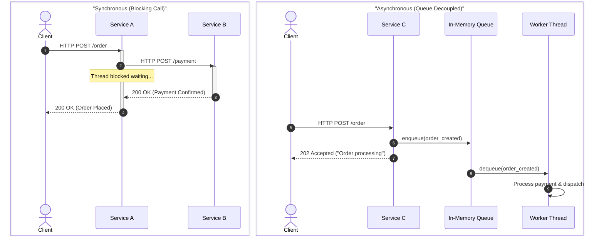

# Synchronous vs Asynchronous Communication

Understanding when to use sync vs async patterns is essential for building scalable, resilient systems.

> **Beginner Intuition**:
> - **Sync**: Drive-thru window. You order, wait at the window until they hand you the food, then drive away.
> - **Async**: Restaurant buzzer. You order, they give you a buzzer, you sit down and talk (do other things). The buzzer goes off later when the food is ready.

---

## 🔄 Synchronous Communication

> **Caller waits for the response before continuing.**

```
Client ──Request──▶ Server
          │
    (waiting...)
          │
Client ◀─Response─ Server
          │
    (continues)
```

### Characteristics

```java
// Synchronous HTTP call (Java 11 java.net.http)
public Order getOrder(String orderId) throws Exception {
    HttpRequest request = HttpRequest.newBuilder()
        .uri(URI.create("/orders/" + orderId))
        .build();
    // Thread blocks here until response received
    HttpResponse<String> response = httpClient.send(request, BodyHandlers.ofString());
    return processOrder(response.body());  // Only continues after response
}
```

```python
# Synchronous HTTP call (Python 3.8 urllib.request)
import urllib.request
import json

def get_order(order_id: str) -> dict:
    # Thread blocks here until response received
    with urllib.request.urlopen(f"/orders/{order_id}") as response:
        order = json.loads(response.read())
    return process_order(order)  # Only continues after response
```

| Aspect | Description |
|--------|-------------|
| **Behavior** | Caller waits (blocking) |
| **Latency** | Cumulative (sum of all calls) |
| **Coupling** | Tight (caller depends on receiver availability) |
| **Error Handling** | Immediate feedback |
| **Complexity** | Lower |

---

## ⚡ Asynchronous Communication

> **Caller doesn't wait; continues immediately.**

```
Client ──Message──▶ Queue ──▶ Consumer
   │                            │
(continues                (processes later)
immediately)
```

### Characteristics

```java
// Asynchronous - Thread Pool (Java 11 java.util.concurrent)
ExecutorService executor = Executors.newFixedThreadPool(4);

public void processOrderAsync(Order order) {
    // Returns immediately, doesn't wait
    executor.submit(() -> {
        // Processes in a background thread
        orderService.process(order);
    });
    // Continues without waiting for processing
}
```

```python
# Asynchronous - Thread Pool (Python 3.8 concurrent.futures)
from concurrent.futures import ThreadPoolExecutor

executor = ThreadPoolExecutor(max_workers=4)

def process_order_async(order: dict) -> None:
    # Returns immediately, doesn't wait
    executor.submit(order_service.process, order)
    # Continues without waiting for processing
```

| Aspect | Description |
|--------|-------------|
| **Behavior** | Caller continues immediately (non-blocking) |
| **Latency** | Independent (parallelized) |
| **Coupling** | Loose (queue buffers between services) |
| **Error Handling** | Delayed (retry queues, dead letter) |
| **Complexity** | Higher |

---

## ⚖️ Comparison Table

| Aspect | Synchronous | Asynchronous |
|--------|-------------|--------------|
| **Response Time** | Immediate (blocking) | Delayed |
| **User Experience** | Real-time feedback | "Processing..." messages |
| **Failure Handling** | Cascading failures possible | Isolated, retryable |
| **Scalability** | Limited by slowest service | Better (buffering) |
| **Debugging** | Easier (stack traces) | Harder (distributed) |
| **Consistency** | Immediate | Eventually consistent |
| **Resource Usage** | Threads blocked waiting | Efficient use of threads |

---

## 🏗️ Architecture Patterns



### Worked Trace: Hybrid Order Pipeline
**Premise**: User submits an order. We want fast acknowledgment (sync) but payment takes 5 seconds (async).

1. **Client Request**: `POST /order` is made by the user.
2. **Synchronous Validation**: The API server immediately checks if the payload is valid (e.g., all fields present).
3. **Async Enqueue**: The API server places the valid order into an in-memory queue (e.g., `BlockingQueue` in Java) and immediately returns `202 Accepted`.
4. **Client Response**: The user sees "Order processing" on the UI within 50ms.
5. **Background Processing**: A worker thread pulls the order from the queue and spends 5 seconds processing the payment.

### Synchronous - Request-Response

### Hybrid - Common Pattern

```
┌────────────────────────────────────────────────────────┐
│                    User Request                        │
└────────────────────────┬───────────────────────────────┘
                         │
                         ▼
┌────────────────────────────────────────────────────────┐
│  API Server (Sync response: "Order received")         │
└────────────────────────┬───────────────────────────────┘
                         │ Publish event
                         ▼
┌────────────────────────────────────────────────────────┐
│                   Message Queue                        │
└────────────────────────┬───────────────────────────────┘
            ┌────────────┼────────────┐
            ▼            ▼            ▼
      ┌──────────┐ ┌──────────┐ ┌──────────┐
      │ Payment  │ │ Inventory│ │  Email   │
      │ Service  │ │ Service  │ │ Service  │
      └──────────┘ └──────────┘ └──────────┘
                  (Async processing)
```

---

## 🎯 When to Use Each

### Use Synchronous When:

1. **User needs immediate response**
   - Login verification
   - Real-time search results
   - Form validation

2. **Strong consistency required**
   - Bank transfers (account balance)
   - Inventory check before purchase

3. **Simple operations**
   - CRUD operations
   - Quick database lookups

### Use Asynchronous When:

1. **Long-running tasks**
   - Report generation
   - Video processing
   - Large file uploads

2. **Decoupling services**
   - Microservices communication
   - External service integration

3. **Handling traffic spikes**
   - Buffer requests during peak
   - Rate limiting

4. **Fire-and-forget operations**
   - Logging
   - Analytics
   - Notifications

---

## 🔧 Implementation Patterns

### Async with Callback (JavaScript Style)

```javascript
// Non-blocking
fetchData(url, (data) => {
    process(data);  // Called when data arrives
});
console.log("Continues immediately");
```

### Async with Promise/Future

```java
// Java 11 CompletableFuture
CompletableFuture<Order> future = orderService.getOrderAsync(orderId);
future.thenAccept(order -> processOrder(order));
// Continues without waiting
```

```python
# Python 3.8 asyncio
import asyncio

async def handle_order(order_id: str):
    # Returns control to event loop while waiting
    order = await order_service.get_order_async(order_id)
    process_order(order)
```

### In-Memory Queue Pattern (Standard Library)

#### Java (java.util.concurrent)
```java
// Bounded queue to prevent OutOfMemoryError
BlockingQueue<Order> queue = new ArrayBlockingQueue<>(1000);

public void createOrder(Order order) {
    orderRepo.save(order);
    // Non-blocking offer, fails if full
    boolean accepted = queue.offer(order);
    if (!accepted) throw new ServerOverloadException();
}

public void workerLoop() {
    while (true) {
        try {
            // Blocks if empty
            Order order = queue.take();
            processOrder(order);
        } catch (InterruptedException e) {
            Thread.currentThread().interrupt();
            break;
        }
    }
}
```

#### Python (queue)
```python
import queue
import threading

# Bounded queue to prevent memory explosion
order_queue = queue.Queue(maxsize=1000)

def create_order(order: dict) -> None:
    order_repo.save(order)
    try:
        # Non-blocking put, raises exception if full
        order_queue.put_nowait(order)
    except queue.Full:
        raise ServerOverloadException()

def worker_loop() -> None:
    while True:
        # Blocks if empty
        order = order_queue.get()
        if order is None: break # Poison pill
        try:
            process_order(order)
        finally:
            order_queue.task_done()
```

### ⚠️ Counterexample / Boundary Condition: Queue Overflow
If a burst of traffic overwhelms the consumer workers, an unbounded queue will eventually exhaust available memory (OOM crash). **Boundary design**: Always use bounded queues (like `ArrayBlockingQueue(1000)` or `queue.Queue(maxsize=1000)`). If the queue is full, the producer must exert **backpressure**—either by blocking, dropping messages, or returning a `503 Service Unavailable` to the client.

### 🌟 Staff Extension: Thread Pools vs Event Loops
While Java traditionally achieves async using Thread Pools (assigning one OS thread per concurrent task, which consumes significant memory per thread context), Python's `asyncio` (and newer Java features like Virtual Threads) use a single-threaded Event Loop. 
- **Java `ExecutorService`**: Excellent for CPU-bound or mixed workloads where threads can safely block without halting the entire application.
- **Python `asyncio`**: Highly efficient for I/O-bound tasks (like 10,000 concurrent network requests) because it yields execution cooperatively on a single thread without OS context switching overhead. The runtime gap here is fundamental: Python's GIL makes multi-threading less effective for CPU work, pushing the ecosystem toward async I/O loops.

---

## 🎯 Interview Questions

### Q1: "How would you design an order processing system - sync or async?"

**Answer**:
"Hybrid approach:
1. **Synchronous**: Validate order, check inventory, create order record → immediate feedback to user
2. **Asynchronous**: Payment processing, inventory update, email notification, analytics

User gets 'Order Received' instantly. Background tasks complete independently."

### Q2: "What happens if an async message fails?"

**Answer**:
"Multiple strategies:
1. **Retry with backoff**: Exponential retry (1s, 2s, 4s, 8s...)
2. **Dead Letter Queue**: Failed messages go to DLQ for investigation
3. **Idempotency**: Design consumers to handle duplicates safely
4. **Alerting**: Monitor DLQ size, alert on failures

Example: Kafka consumer retries 3 times, then sends to DLQ."

### Q3: "How do you maintain data consistency with async communication?"

**Answer**:
"Accept eventual consistency with patterns like:
1. **Saga pattern**: Compensating transactions for rollback
2. **Outbox pattern**: Atomically write to DB + outbox table
3. **Event sourcing**: State from event stream
4. **Two-phase commit**: When strong consistency is essential (rarely)

For most cases, eventual consistency + good monitoring is sufficient."

---

## 📋 Decision Framework

```
Need immediate response? ──────────────────▶ Sync
Long-running operation? ───────────────────▶ Async
Traffic spikes expected? ──────────────────▶ Async (buffer)
Decoupling services? ──────────────────────▶ Async
Strong consistency needed? ────────────────▶ Sync
Fire-and-forget? ──────────────────────────▶ Async
```

---

## 🔗 Cross-References

- **Message Queues**: Kafka, RabbitMQ, SQS
- **HLD Patterns**: Event-driven architecture, CQRS
- **Related**: Stateless services, Microservices communication

---

*💡 Pro Tip: Start with synchronous for simplicity. Introduce async when you have clear scalability or decoupling needs. Premature async adds complexity.*
