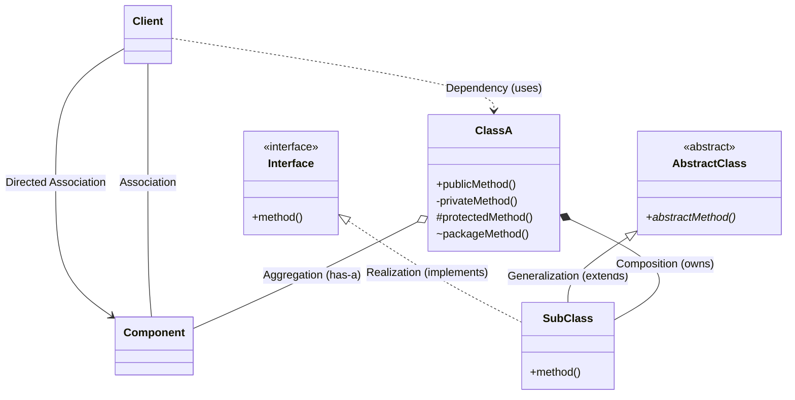

# Pattern Comparisons

This document provides a matrix of frequently confused patterns, a UML cheat sheet, and a matrix indicating patterns commonly combined together.

## Confusing Pattern Groups

The following tables clarify the differences between eight common groups of patterns.

### 1. Abstract Factory vs. Builder

| Aspect | Abstract Factory | Builder |
| :--- | :--- | :--- |
| **Focus** | Families of related objects | Step-by-step construction of complex objects |
| **Returns** | Immediately | After all steps are completed |
| **Complexity** | Simple objects | Complex objects |
| **Use Case** | Cross-platform UI components | Constructing a house or meal |

### 2. State vs. Strategy

| Aspect | State | Strategy |
| :--- | :--- | :--- |
| **Focus** | Object changes behavior when internal state changes | Interchangeable algorithms |
| **Awareness** | States are often aware of each other (transitions) | Strategies are completely independent |
| **Trigger** | Automatic or contextual | Client explicitly selects strategy |
| **Use Case** | Vending machine, TCP Connection | Sorting algorithms, Payment methods |

### 3. Factory Method vs. Abstract Factory

| Aspect | Factory Method | Abstract Factory |
| :--- | :--- | :--- |
| **Focus** | Single product | Family of related products |
| **Mechanism** | Inheritance (subclasses override creation method) | Object composition |
| **Complexity** | Simpler | More complex |
| **Use Case** | Document creator | Cross-platform UI components |

### 4. Adapter vs. Decorator vs. Proxy

| Aspect | Adapter | Decorator | Proxy |
| :--- | :--- | :--- | :--- |
| **Focus** | Interface conversion (makes incompatible interfaces work) | Add responsibilities dynamically | Control access |
| **Interface** | Changes interface | Keeps interface same | Keeps interface same |
| **Use Case** | Legacy system integration | Adding scrollbars to windows | Lazy loading, access control |

### 5. Bridge vs. Strategy

| Aspect | Bridge | Strategy |
| :--- | :--- | :--- |
| **Focus** | Decouple abstraction from implementation (structural) | Interchangeable algorithms (behavioral) |
| **Hierarchy** | Two orthogonal hierarchies | Single interface with multiple implementations |
| **Design Time** | Established at design time | Usually selected at runtime |
| **Use Case** | Multi-platform UI controls | Payment processing |

### 6. Facade vs. Mediator

| Aspect | Facade | Mediator |
| :--- | :--- | :--- |
| **Focus** | Simplifies interface to a complex subsystem | Centralizes complex communications between objects |
| **Direction** | Unidirectional (Facade to Subsystem) | Multidirectional (Colleagues to Mediator) |
| **Visibility** | Subsystem is unaware of the Facade | Colleagues are aware of the Mediator |
| **Use Case** | Simple API for complex library | Chat room, Air traffic control |

### 7. Decorator vs. Composite

| Aspect | Decorator | Composite |
| :--- | :--- | :--- |
| **Focus** | Add responsibilities dynamically | Treat single and composite objects uniformly |
| **Structure** | One component (wrap it) | Many components (tree structure) |
| **Intent** | Extend behavior | Build hierarchy |
| **Use Case** | Data streams | File system structure |

### 8. Iterator vs. Visitor

| Aspect | Iterator | Visitor |
| :--- | :--- | :--- |
| **Focus** | Traverse elements | Perform operations on elements |
| **State** | Maintains traversal state | Accumulates state across elements |
| **Flexibility** | Different traversals | Different operations |
| **Use Case** | Tree traversal | Report generation |

## UML Cheat Sheet

The following Mermaid diagram illustrates the common UML relationships used when modeling Design Patterns.

## Often Combined With Matrix

Patterns are rarely used in isolation. The following matrix explains how they commonly support one another.

| Pattern | Often Combined With | Why |
| :--- | :--- | :--- |
| **Abstract Factory** | Singleton, Prototype | Factory itself is often a Singleton; can use Prototypes to clone objects. |
| **Builder** | Singleton, Composite | Director can be a Singleton; builds Composite structures. |
| **Factory Method** | Template Method | Factory Method is often a step in a Template Method. |
| **Prototype** | Singleton, Memento | Prototype registry is often a Singleton; Memento uses Prototypes for state. |
| **Singleton** | Facade, Abstract Factory | Facade and Abstract Factory are often Singletons. |
| **Adapter** | Bridge | Used to make classes work with a Bridge. |
| **Bridge** | Abstract Factory | Abstract Factory creates the specific implementations for the Bridge. |
| **Composite** | Iterator, Visitor | Iterator traverses the tree; Visitor operates on the elements. |
| **Decorator** | Composite, Strategy | Decorator wraps Composite; Strategy changes behavior from inside. |
| **Facade** | Singleton, Mediator | Facade is often a Singleton; Mediator handles complex communication. |
| **Flyweight** | Composite, State | Used for small nodes in Composite; State can be shared via Flyweight. |
| **Proxy** | Decorator | Both use composition and keep the same interface. |
| **Chain of Responsibility** | Composite, Command | Applied over Composite structures; passes Command objects. |
| **Command** | Memento, Composite | Memento stores state for undo; Composite groups commands (Macros). |
| **Interpreter** | Composite, Visitor | AST is a Composite; Visitor evaluates the AST. |
| **Iterator** | Composite, Factory Method | Traverses Composites; Factory Method creates the Iterator. |
| **Mediator** | Observer, Facade | Uses Observer for communication; acts like a multidirectional Facade. |
| **Memento** | Command, Iterator | Stores state for Command undo; Iterator captures traversal state. |
| **Observer** | Mediator, Singleton | Used by Mediator; Event manager is often a Singleton. |
| **State** | Singleton, Flyweight | State objects are often Singletons or Flyweights. |
| **Strategy** | Decorator, State | Changes internals (vs Decorator changing exterior); similar to State. |
| **Template Method** | Factory Method, Strategy | Defines skeleton; Strategy changes entire algorithm. |
| **Visitor** | Composite, Iterator | Operates on Composite structures; uses Iterator to traverse. |

---

## Conclusion
Understanding these comparisons and combinations is vital for effectively designing software architecture. A pattern is not just a solution to a problem; it's a way of communicating design intent. Combining them properly enables you to solve more complex architectural challenges by leveraging their complementary strengths.
