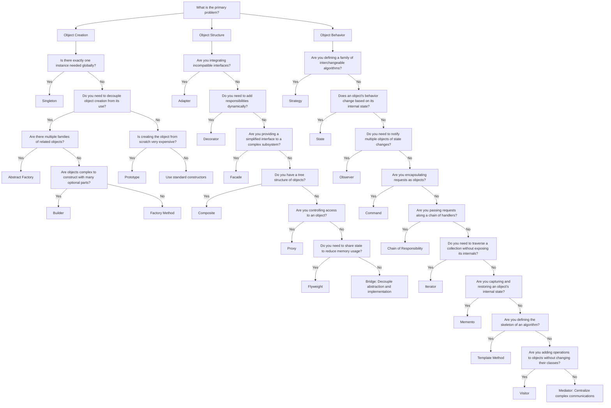

# 🎯 Pattern Selection Guide

This guide provides a structured approach to selecting the right design pattern for your architectural problems, featuring decision trees, symptom matching, look-alike resolution, real-world LLD scenario mappings, and an over-engineering checklist.

## 🌳 Decision Tree Flowchart

## 🩺 Symptom-to-Pattern Table

Identify your architectural pain point and match it to a design pattern solution. The table details 25+ specific architectural symptoms and the design pattern best suited to address each issue.

| # | Code Smell / Architectural Symptom | Recommended Pattern | Brief Justification |
|---|-----------------------------------|---------------------|---------------------|
| 1 | Global variables are causing tight coupling and testing difficulties, but you still need shared access to a resource. | **Singleton** | Ensures a single instance with global access, but controls instantiation. |
| 2 | Code is littered with complex `new` calls depending on configuration or environment. | **Factory Method** | Encapsulates the instantiation logic, deferring concrete type decisions to subclasses. |
| 3 | You need to enforce consistency among products created together (e.g., Mac UI vs Windows UI components). | **Abstract Factory**| Groups related factories to guarantee compatibility of created objects. |
| 4 | Constructors have 5+ arguments, many of which are null or default. Telescoping constructors are getting out of hand. | **Builder** | Allows step-by-step construction of complex objects. |
| 5 | Object initialization requires heavy DB or network calls, and you frequently need similar objects. | **Prototype** | Clones existing instances instead of rebuilding them from scratch. |
| 6 | You are integrating a 3rd party library, but its interface doesn't match your domain logic. | **Adapter** | Acts as a wrapper to translate between incompatible interfaces. |
| 7 | You have a Cartesian product of classes (e.g., `RedCircle`, `BlueCircle`, `RedSquare`, `BlueSquare`). | **Bridge** | Separates the abstraction (Shape) from the implementation (Color). |
| 8 | You are writing identical code to process individual items and groups of items (e.g., files and folders). | **Composite** | Treats individual objects and compositions uniformly via a common interface. |
| 9 | You have deep inheritance hierarchies just to add minor features or behaviors to a base class. | **Decorator** | Dynamically wraps objects to add behaviors without subclassing. |
| 10| Client code is interacting with dozens of low-level subsystem classes just to perform a basic operation. | **Facade** | Provides a simplified, higher-level interface to the complex subsystem. |
| 11| Your application is running out of memory because it creates millions of small, similar objects. | **Flyweight** | Extracts intrinsic, shared state to reduce memory footprint. |
| 12| You need to lazily load a heavy object, add security checks, or log access without changing the core object. | **Proxy** | Provides a surrogate or placeholder to control access to the real object. |
| 13| You have massive `if-else` or `switch` statements deciding which algorithm or business rule to apply. | **Strategy** | Encapsulates interchangeable algorithms, making them selectable at runtime. |
| 14| An object has complex conditional logic that depends on its current status (e.g., Pending, Processing, Completed). | **State** | Represents states as separate classes, allowing behavior to change dynamically. |
| 15| Many objects need to know when another object changes, but tight coupling is undesirable. | **Observer** | Establishes a one-to-many dependency for automatic event notification. |
| 16| You need to support undo/redo operations or queue requests for later execution. | **Command** | Encapsulates a request as an object, allowing parameterization and queuing. |
| 17| A request might be handled by one of several objects, and you need to decouple the sender from its receiver. | **Chain of Responsibility** | Passes the request along a chain of potential handlers until one processes it, decoupling sender and receiver. |
| 18| You are exposing the internal structure of your custom data collection just to let clients iterate over it. | **Iterator** | Extracts the traversal logic into a separate iterator object. |
| 19| You need to implement a "save game" or "draft" feature to revert an object to a previous state. | **Memento** | Captures state externally without violating encapsulation. |
| 20| Several classes share the same overall algorithm, but differ slightly in specific steps. | **Template Method** | Defines the skeleton in a base class, letting subclasses override specific steps. |
| 21| You need to perform new operations on a complex object structure, but you can't modify the objects' classes. | **Visitor** | Separates the algorithm from the object structure it operates on. |
| 22| Objects are communicating in a chaotic, tightly coupled "spiderweb" of dependencies. | **Mediator** | Centralizes complex communications and control logic between objects. |
| 23| You need to parse a simple domain-specific language (DSL) or mathematical expressions. | **Interpreter** | Maps grammar rules to classes for evaluation. |
| 24| You want to combine multiple distinct behaviors at runtime in various permutations without exploding the class count. | **Decorator** | Allows flexible, runtime composition of behaviors. |
| 25| An object represents an expensive external resource connection that must be shared and managed safely across multiple concurrent threads. | **Proxy** | A pooling proxy restricts access and manages the lifecycle of the connections, transparent to clients. |
| 26| A UI framework requires an event-driven mechanism where user interactions trigger business logic asynchronously. | **Observer** | Event listeners act as observers, reacting to interactions on components (subjects). |
| 27| You need to execute an algorithm that can vary wildly depending on the environment (e.g., local vs cloud). | **Strategy** | Enables hot-swapping algorithms without impacting the core execution context. |
| 28| A third-party logging tool expects specific formatting methods, while your application uses different ones. | **Adapter** | Converts your log events to the third-party format seamlessly. |
| 29| Creating instances manually requires repeating the same configurations all the time. | **Prototype** | Copying pre-configured templates makes creation cheaper and error-free. |

## 🪞 Look-Alike Pair Resolutions

Design patterns often look similar structurally but serve very different intents. Use this section to disambiguate.

### Adapter vs. Decorator vs. Proxy
- **Adapter**: Changes the interface of an existing object to match what a client expects. *Intent: Compatibility.*
- **Decorator**: Keeps the same interface but adds or alters behavior dynamically. *Intent: Enhancement.*
- **Proxy**: Keeps the same interface but controls access to the underlying object (lazy loading, security, caching). *Intent: Access Control.*

### Strategy vs. State
- **Strategy**: Represents interchangeable algorithms. The client usually selects the strategy. The strategies rarely know about each other. *Intent: Algorithm selection.*
- **State**: Represents internal state. The state usually changes itself or is changed by the context. States often know about specific transitions. *Intent: Managing state-dependent behavior.*

### Factory Method vs. Abstract Factory
- **Factory Method**: Uses inheritance. Relies on subclasses to implement the factory method and create one specific type of product. *Intent: Defer single object creation to subclasses.*
- **Abstract Factory**: Uses object composition. Creates families of related products. *Intent: Guarantee compatibility across a suite of objects.*

### Command vs. Strategy
- **Command**: Encapsulates a specific *action* or *request* (e.g., "Turn on TV", "Transfer $50"). Can be queued or undone. *Intent: Objectify a request.*
- **Strategy**: Encapsulates an *algorithm* or *how to do something* (e.g., "Sort by Name", "Pay via Stripe"). Usually stateless. *Intent: Interchangeable logic.*

### Mediator vs. Observer
- **Mediator**: Centralizes communication between a set of interacting objects, preventing them from referring to each other explicitly. *Intent: Centralized coordination.*
- **Observer**: Defines a one-to-many communication dependency, letting multiple observer objects listen to a subject. *Intent: Decentralized publish/subscribe.*

### Template Method vs. Strategy
- **Template Method**: Defines the skeleton of an algorithm in a base class, letting subclasses override specific steps. It uses inheritance. *Intent: Reusing algorithm structure.*
- **Strategy**: Defines a family of algorithms, encapsulates each one, and makes them interchangeable. It uses object composition. *Intent: Swapping entire algorithms.*

### Bridge vs. Adapter
- **Bridge**: Designed up-front to let the abstraction and the implementation vary independently. *Intent: Proactive decoupling.*
- **Adapter**: Often used after the fact to make unrelated classes work together. *Intent: Retroactive compatibility.*

### Composite vs. Decorator
- **Composite**: Focuses on object aggregation and treating collections and individual objects uniformly. *Intent: Hierarchical structures.*
- **Decorator**: Focuses on adding responsibilities to an object without subclassing. *Intent: Dynamic enhancement.*

### Singleton vs. Static Methods
- **Singleton**: Ensures a class has only one instance and provides a global point of access to it. It allows for inheritance and interface implementation. *Intent: Controlled instance access.*
- **Static Methods**: Provide global access to functions, but do not maintain instance state or allow for polymorphism. *Intent: Utility functions.*

### Flyweight vs. Singleton
- **Flyweight**: Focuses on minimizing memory usage by sharing as much data as possible with similar objects. There can be multiple flyweight objects of different types. *Intent: Memory optimization.*
- **Singleton**: Focuses on ensuring that a class has only one instance and providing a global point of access to it. *Intent: Single instance.*

### Builder vs. Factory Method
- **Builder**: Focuses on constructing a complex object step by step. Returns the product as a final step. *Intent: Step-by-step construction.*
- **Factory Method**: Focuses on creating a single object in one step, deferring the exact class to subclasses. *Intent: Single-step creation.*

### Facade vs. Mediator
- **Facade**: Defines a simplified interface to a subsystem of classes. The subsystem doesn't know about the facade. *Intent: Structural simplification.*
- **Mediator**: Defines an object that encapsulates how a set of objects interact. The objects know about the mediator and communicate through it. *Intent: Behavioral coordination.*

### Iterator vs. Visitor
- **Iterator**: Focuses on traversing a collection without exposing its underlying representation. *Intent: Sequential access.*
- **Visitor**: Focuses on defining a new operation on the elements of an object structure without changing their classes. *Intent: Operational separation.*

## 🗺️ LLD Scenario Mappings

Here is how common design patterns apply to actual low-level design (LLD) projects found in `02-lld-projects/`.

1. **[Elevator System](../02-lld-projects/elevator-system/)**: **State** pattern is crucial here to manage the elevator's behavior (MovingUp, MovingDown, Idle, DoorsOpen). **Strategy** can be used for the dispatch algorithm (e.g., nearest car, minimum wait time).
2. **[Parking Lot](../02-lld-projects/parking-lot/)**: **Strategy** pattern for pricing models (hourly, daily, flat rate) and spot allocation strategies.
3. **[Vending Machine](../02-lld-projects/vending-machine/)**: **State** pattern is the canonical solution to manage the machine's states (HasMoney, NoMoney, Dispensing, SoldOut).
4. **[Payment System](../02-lld-projects/payment-system/)**: **Strategy** pattern for handling different payment gateways (Stripe, PayPal). **Factory** to instantiate the correct strategy based on user input.
5. **[Message Queue](../02-lld-projects/message-queue/)**: **Observer** pattern (specifically Pub/Sub variant) for routing messages from publishers to subscribed consumers.
6. **[Tic Tac Toe](../02-lld-projects/tic-tac-toe/)**: **Strategy** pattern for winning logic evaluations or AI moves. **Factory** for creating different board sizes.
7. **[Rate Limiter](../02-lld-projects/rate-limiter/)**: **Strategy** pattern to implement interchangeable limiting algorithms (Token Bucket, Leaky Bucket, Sliding Window).
8. **[Logging Framework](../02-lld-projects/logging-framework/)**: **Chain of Responsibility** pattern for processing log messages through different handlers (Console, File, Network).
9. **[Online Shopping Cart](../02-lld-projects/online-shopping-cart/)**: **Decorator** pattern for applying dynamic, stackable discounts or taxes to an order.
10. **[Key-Value Store (LSM)](../02-lld-projects/key-value-store-lsm/)**: **Command** pattern for Write-Ahead Logs (WAL) to enable crash recovery and replication by serializing operations.

## 🛑 Over-Engineering Checklist

Before implementing a GoF design pattern, ask yourself:

- [ ] **Is the problem real or hypothetical?** Don't use a pattern for a requirement you *might* need next year (YAGNI).
- [ ] **Can a simpler language feature solve this?** (e.g., passing a function reference instead of a full Strategy class hierarchy; using standard dictionaries instead of complex Builders for simple configs).
- [ ] **Does the pattern obscure the business logic?** If tracing the code execution requires jumping through 5 interfaces, you might be over-engineering.
- [ ] **Is the team familiar with the pattern?** Introducing a Visitor pattern to a team that has never seen it might cause more maintenance headaches than it solves.
- [ ] **Have you reached the limits of simpler abstractions?** Start simple. Refactor to a pattern only when the simple approach becomes painful to maintain (e.g., when a `switch` statement grows too large, *then* introduce State/Strategy).

Remember: Patterns are a tool, not a goal. They provide a shared vocabulary to discuss proven solutions to common architectural design problems. Avoid forcing a pattern onto a simple problem where standard object-oriented principles or built-in language features would suffice. Always balance flexibility with code simplicity and readability. 

### Final Thoughts on Over-Engineering
It is often much better to wait until a refactoring becomes necessary rather than anticipating all future possibilities. A design pattern might seem like a sophisticated answer to your problem, but if a simple functional approach works perfectly and is understandable, the pattern is just added complexity.

- Are there fewer than 3 variations? Stick to simpler conditionals.
- Is the abstraction adding more boilerplate code than actual business logic? Avoid it.
- Can you achieve the same with native language constructs? Always prefer native constructs.
- Does the pattern make debugging harder by abstracting away the control flow? Weigh the pros and cons.
- Would a new team member understand the code without a tutorial on the pattern? Consider maintainability.
- Can you test the component easily without mocking complex pattern participants?
- Is performance significantly impacted by the abstraction overhead? Measure if needed.
- Is there already a standard library mechanism that solves the problem out of the box?

By keeping these points in mind, you can utilize design patterns efficiently without falling into the trap of over-engineering. And remember, when you use a design pattern, make sure to document it properly so that the next person working on the code knows exactly what pattern you used and why. It is important to remember that design patterns can add complexity to your codebase.

### Additional Considerations
When building any non-trivial application, always consider the long-term maintainability of the architectural decisions you are making.
1. Are you prioritizing short-term delivery over long-term maintainability?
2. Will this pattern scale if the application usage grows by 10x?
3. How hard will it be to remove this pattern later if it turns out to be a mistake?
4. Is there another known solution that provides 80% of the value for 20% of the effort?

Good software architecture is about making trade-offs and understanding the implications of your choices.
