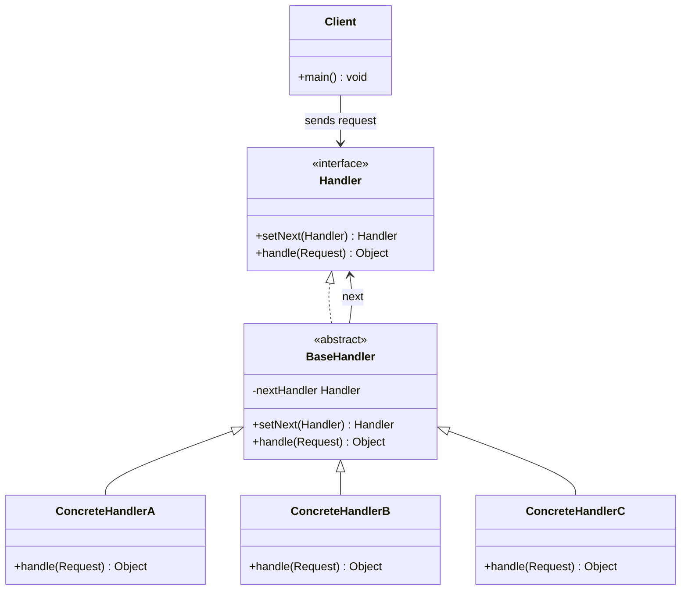

# Chain of Responsibility Pattern

> Avoid coupling the sender of a request to its receiver by giving more than one object a chance to handle the request.

## 🎯 Intent

The Chain of Responsibility pattern passes a request along a chain of handlers. Each handler decides either to process the request or to pass it to the next handler in the chain.

## 📊 Class Diagram

**Key Points:**
- **Handler** interface declares method for handling requests
- **BaseHandler** stores reference to next handler in chain
- Each **ConcreteHandler** either handles request or passes to next
- Chain can be composed and modified at runtime

## ✅ When to Use

- More than one object may handle a request
- Handler isn't known a priori
- The set of handlers should be dynamic
- You want to issue a request without specifying receiver

## 💡 Real-World Examples

- **Middleware**: HTTP request handlers
- **Logging**: DEBUG → INFO → WARN → ERROR levels
- **Event Bubbling**: DOM event propagation
- **Approval Workflows**: Manager → Director → VP

## 📁 Implementations

| Version | Description | Location |
|---------|-------------|----------|
| v1-basic | Support ticket escalation chain | [Java](./java/v1-basic/) / [Python](./python/v1-basic/) |
| v2-variant | HTTP request middleware processing pipeline | [Java](./java/v2-variant/) / [Python](./python/v2-variant/) |
| v3-advanced | Priority security filter chain with audit logging | [Java](./java/v3-advanced/) / [Python](./python/v3-advanced/) |

---

[← Back to Behavioral Patterns](../README.md)
