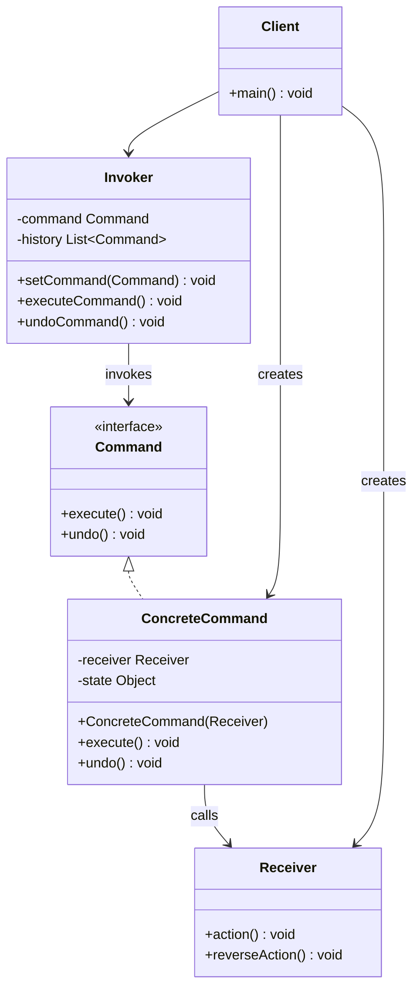

# Command Pattern

> Encapsulate a request as an object, allowing you to parameterize clients with different requests, queue or log requests, and support undoable operations.

## 🎯 Intent

The Command pattern turns a request into a stand-alone object that contains all information about the request, enabling deferred execution, queuing, and undo/redo.

## 📊 Class Diagram

**Key Points:**
- **Command** interface declares execute and optional undo methods
- **ConcreteCommand** implements Command and stores Receiver reference
- **Invoker** asks Command to carry out the request
- **Receiver** knows how to perform the actual work
- Enables undo/redo, queuing, and logging of operations

## 📋 Quick Reference

| Aspect | Description |
|--------|-------------|
| **Type** | Behavioral |
| **Also Known As** | Action, Transaction |
| **Complexity** | ⭐⭐ |
| **Frequency of Use** | High |

## ✅ When to Use

- Need undo/redo functionality
- Want to queue operations for later execution
- Need to log operations for recovery
- Want to parameterize objects with operations

## 💡 Real-World Examples

- **Text Editors**: Undo/redo operations
- **Transaction Systems**: Commit/rollback
- **Task Queues**: Job scheduling systems
- **Remote Control**: Button actions
- **Macro Recording**: Record and playback actions

## 📁 Implementations

| Version | Description | Location |
|---------|-------------|----------|
| v1-basic | Remote control | [Java](./java/v1-basic/) / [Python](./python/v1-basic/) |
| v2-variant | Text editor commands with undo/redo history | [Java](./java/v2-variant/) / [Python](./python/v2-variant/) |
| v3-advanced | Transactional macro commands with rollback | [Java](./java/v3-advanced/) / [Python](./python/v3-advanced/) |

### Progression Notes

- **v1-basic** introduces commands as remote-control button actions over receivers.
- **v2-variant** adds a history invoker so edits can be undone and redone without exposing editor internals.
- **v3-advanced** composes multiple commands into a macro and rolls back completed steps when a later step fails.

---

[← Back to Behavioral Patterns](../README.md)
