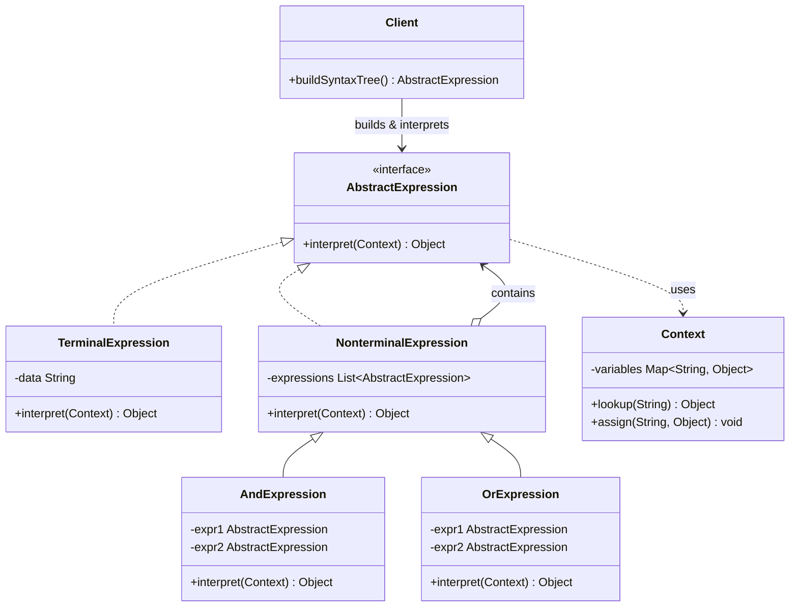

# Interpreter Pattern

> Given a language, define a representation for its grammar along with an interpreter that uses the representation to interpret sentences in the language.

## 🎯 Intent

The Interpreter pattern defines a grammatical representation for a language and provides an interpreter to deal with this grammar.

## 📊 Class Diagram

**Key Points:**
- **AbstractExpression** declares interpret() method for all nodes
- **TerminalExpression** implements interpret for terminal symbols
- **NonterminalExpression** maintains child expressions for grammar rules
- **Context** contains global information for interpreter
- Client builds abstract syntax tree and invokes interpret

## ✅ When to Use

- You have a simple language to interpret
- Statements can be represented as abstract syntax trees
- Efficiency is not critical

## 💡 Real-World Examples

- **Regular Expressions**: Pattern matching
- **SQL**: Query parsing
- **Math Expressions**: Calculator
- **Configuration Languages**: Rule engines

## 📁 Implementations

| Version | Description | Location |
|---------|-------------|----------|
| v1-basic | Math expression postfix evaluator | [Java](./java/v1-basic/) / [Python](./python/v1-basic/) |
| v2-variant | Boolean filtering rule AST interpreter | [Java](./java/v2-variant/) / [Python](./python/v2-variant/) |
| v3-advanced | Extensible math & DSL script AST interpreter | [Java](./java/v3-advanced/) / [Python](./python/v3-advanced/) |

---

[← Back to Behavioral Patterns](../README.md)
