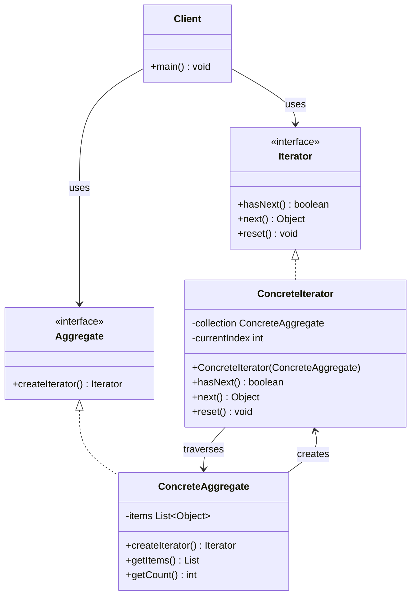

# Iterator Pattern

> Provide a way to access the elements of an aggregate object sequentially without exposing its underlying representation.

## 🎯 Intent

The Iterator pattern provides a uniform interface for traversing different data structures without exposing their internals.

## 📊 Class Diagram

**Key Points:**
- **Iterator** interface declares methods for traversal (hasNext, next)
- **Aggregate** interface declares method to create Iterator
- **ConcreteIterator** keeps track of current position in traversal
- Client code works with Iterator interface, not specific collections

## ✅ When to Use

- Need to access collection elements without exposing structure
- Want multiple traversal methods for a collection
- Want a uniform interface for traversing different collections
- Need to traverse complex data structures (trees, graphs)

## 💡 Real-World Examples

- **Database Cursors**: Row-by-row result traversal
- **File System**: Directory traversal
- **Streams**: Data stream iteration
- **Pagination**: Page-by-page data access

## 📁 Implementations

| Version | Description | Location |
|---------|-------------|----------|
| v1-basic | Custom collection forward and reverse iterator | [Java](./java/v1-basic/) / [Python](./python/v1-basic/) |
| v2-variant | Composite tree hierarchy DFS and BFS iterators | [Java](./java/v2-variant/) / [Python](./python/v2-variant/) |
| v3-advanced | Paged cursor-based chunked streaming iterator | [Java](./java/v3-advanced/) / [Python](./python/v3-advanced/) |

---

[← Back to Behavioral Patterns](../README.md)
