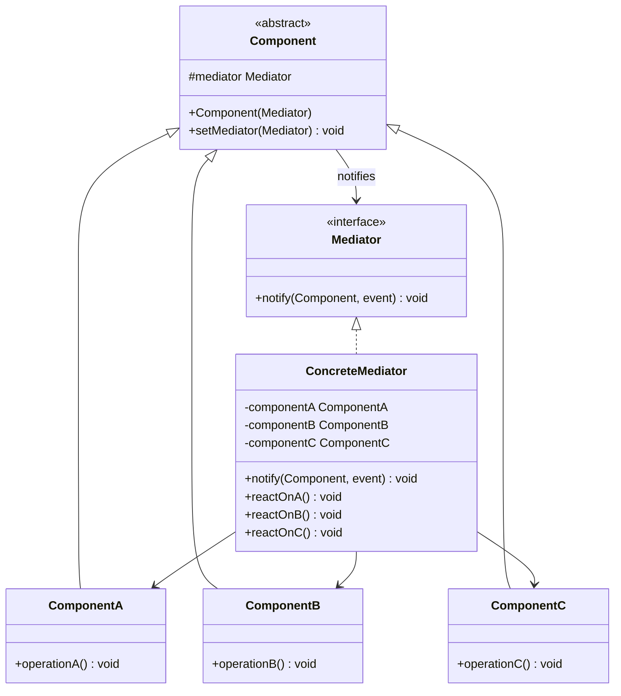

# Mediator Pattern

> Define an object that encapsulates how a set of objects interact, promoting loose coupling.

## 🎯 Intent

The Mediator pattern centralizes complex communications between objects, reducing dependencies.

## 📊 Class Diagram

**Key Points:**
- **Mediator** interface declares communication method
- **ConcreteMediator** coordinates interaction between components
- **Components** don't communicate directly, only through Mediator
- Reduces coupling: components only know about Mediator

## ✅ When to Use

- Objects communicate in complex ways
- Reusing an object is difficult due to references to others
- Behavior distributed across classes should be customizable
- You want to decouple objects that interact heavily

## 💡 Real-World Examples

- **Chat Room**: Users communicate through a room
- **Air Traffic Control**: Planes communicate via tower
- **GUI Dialog**: Components interact through dialog

## 📁 Implementations

| Version | Description | Location |
|---------|-------------|----------|
| v1-basic | Chat room mediator | [Java](./java/v1-basic/) / [Python](./python/v1-basic/) |
| v2-variant | UI dialog form validation coordinator | [Java](./java/v2-variant/) / [Python](./python/v2-variant/) |
| v3-advanced | Enterprise service broker event mediator | [Java](./java/v3-advanced/) / [Python](./python/v3-advanced/) |

---

[← Back to Behavioral Patterns](../README.md)
