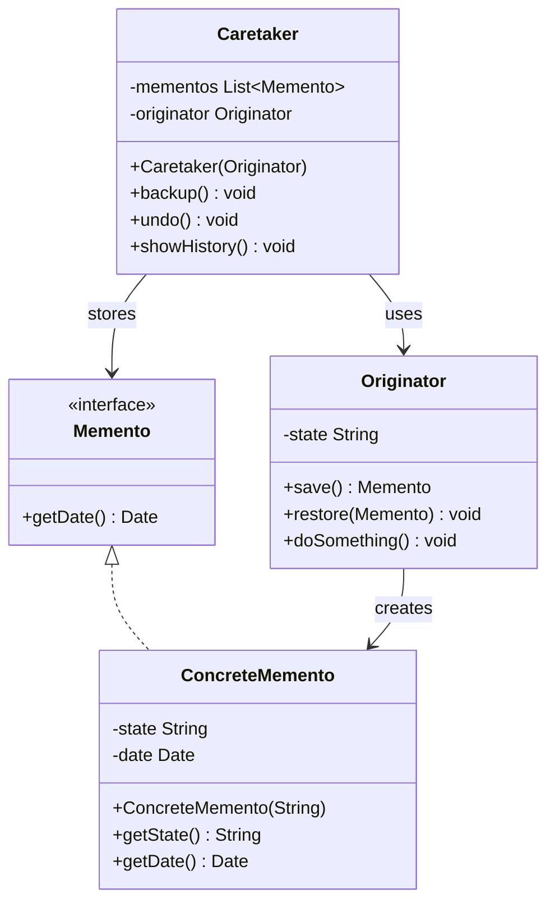

# Memento Pattern

> Without violating encapsulation, capture and externalize an object's internal state so that the object can be restored to this state later.

## 🎯 Intent

The Memento pattern provides the ability to restore an object to its previous state (undo via rollback).

## 📊 Class Diagram

**Key Points:**
- **Originator** creates mementos containing snapshots of its state
- **Memento** stores Originator's internal state (narrow interface for Caretaker)
- **Caretaker** stores mementos but never examines their contents
- Encapsulation is preserved: only Originator can access Memento's state

## ✅ When to Use

- Need to save snapshots of an object's state
- Want undo mechanism
- Direct access to state would expose implementation details

## 💡 Real-World Examples

- **Text Editor**: Undo/redo text changes
- **Game Saves**: Save/load game progress
- **Transaction Rollback**: Database rollback
- **Browser History**: Back/forward navigation

## 📁 Implementations

| Version | Description | Location |
|---------|-------------|----------|
| v1-basic | Text editor undo | [Java](./java/v1-basic/) / [Python](./python/v1-basic/) |
| v2-variant | Bounded labeled history for memory-aware undo/redo | [Java](./java/v2-variant/) / [Python](./python/v2-variant/) |
| v3-advanced | Transactional checkpoints with rollback and named restore points | [Java](./java/v3-advanced/) / [Python](./python/v3-advanced/) |

### Version Progression

- **v1-basic:** introduces `TextEditor`, immutable editor snapshots, and undo/redo stacks.
- **v2-variant:** keeps the same editor domain but adds labels and a bounded caretaker so UI history stays inspectable without exposing editor state.
- **v3-advanced:** uses mementos for transactions and named checkpoints, showing how to roll back failed multi-step edits or restore an approved document state.

---

[← Back to Behavioral Patterns](../README.md)
