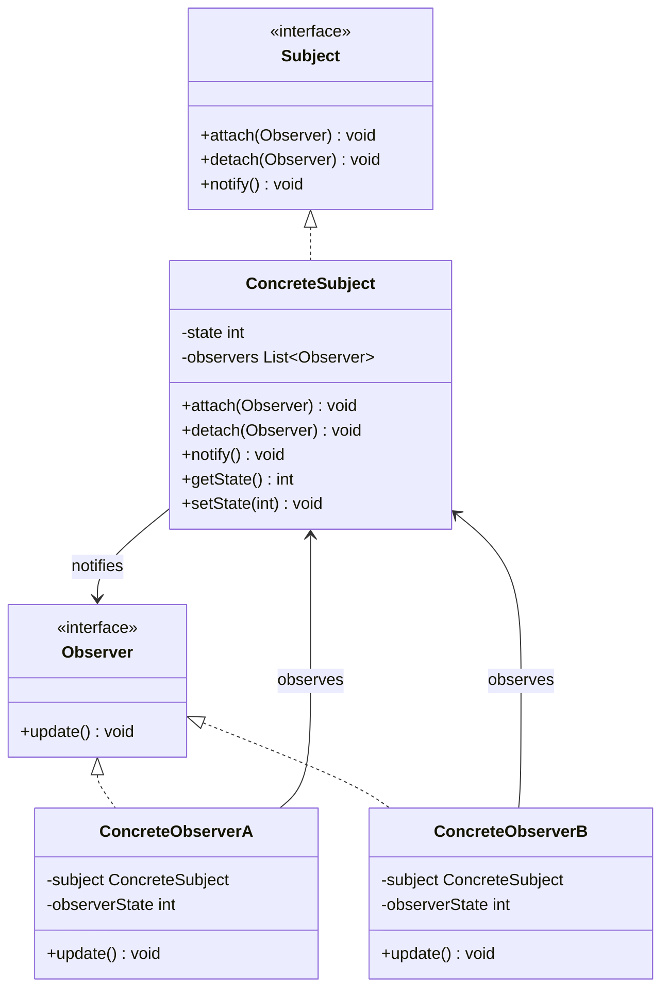

# Observer Pattern

> Define a one-to-many dependency between objects so that when one object changes state, all its dependents are notified and updated automatically.

## 🎯 Intent

The Observer pattern establishes a subscription mechanism that allows objects to be notified of changes in other objects they're observing.

## 📊 Class Diagram



**Key Points:**
- **Subject** maintains list of observers and notifies them of state changes
- **Observer** interface declares update method called when Subject changes
- **ConcreteObservers** store reference to Subject and update their state
- Observers can be added/removed dynamically at runtime

## 📋 Quick Reference

| Aspect | Description |
|--------|-------------|
| **Type** | Behavioral |
| **Also Known As** | Publish-Subscribe, Event-Subscriber, Listener |
| **Complexity** | ⭐⭐ |
| **Frequency of Use** | Very High |

## 🏗️ Structure

```
┌─────────────────┐     notifies    ┌─────────────────┐
│     Subject     │────────────────▶│    Observer     │
├─────────────────┤                 ├─────────────────┤
│ - observers[]   │                 │ + update()      │
│ + attach()      │                 └────────┬────────┘
│ + detach()      │                          │
│ + notify()      │                 ┌────────┴────────┐
└─────────────────┘                 │                 │
                           ┌────────┴──────┐  ┌──────┴────────┐
                           │ ConcreteObsA  │  │ ConcreteObsB  │
                           └───────────────┘  └───────────────┘
```

## ✅ When to Use

- Changes to one object require changing others
- An object should notify others without making assumptions about who they are
- Need to create event handling systems
- Building reactive/event-driven architectures

## ❌ When NOT to Use

- Only one observer that never changes
- Notifications need ordering guarantees
- Observers require synchronous confirmation of receipt

## 💡 Real-World Examples

- **Event Systems**: GUI button clicks, DOM events
- **Stock Market**: Price updates to multiple displays
- **Social Media**: Follower notifications
- **MVC Architecture**: View updates when Model changes
- **Message Brokers**: Pub/sub systems like Redis, Kafka

## 📁 Implementations

| Version | Description | Location |
|---------|-------------|----------|
| v1-basic | Weather station | [Java](./java/v1-basic/) / [Python](./python/v1-basic/) |
| v2-variant | Stock market ticker with portfolio and alert observers | [Java](./java/v2-variant/) / [Python](./python/v2-variant/) |
| v3-advanced | Topic event bus with wildcard subscribers | [Java](./java/v3-advanced/) / [Python](./python/v3-advanced/) |

### Progression Notes

- **v1-basic** shows the classic one-subject/many-observers shape with weather displays.
- **v2-variant** moves the same contract into interview-style market data where observers can own independent state.
- **v3-advanced** generalizes the pattern into an event bus, adding topic routing and audit-style wildcard subscriptions.

## 🔗 Related Patterns

- **Mediator**: Centralizes communication; Observer is distributed
- **Singleton**: Subject often implemented as Singleton
- **Command**: Commands can be queued in observer notifications

---

[← Back to Behavioral Patterns](../README.md)
