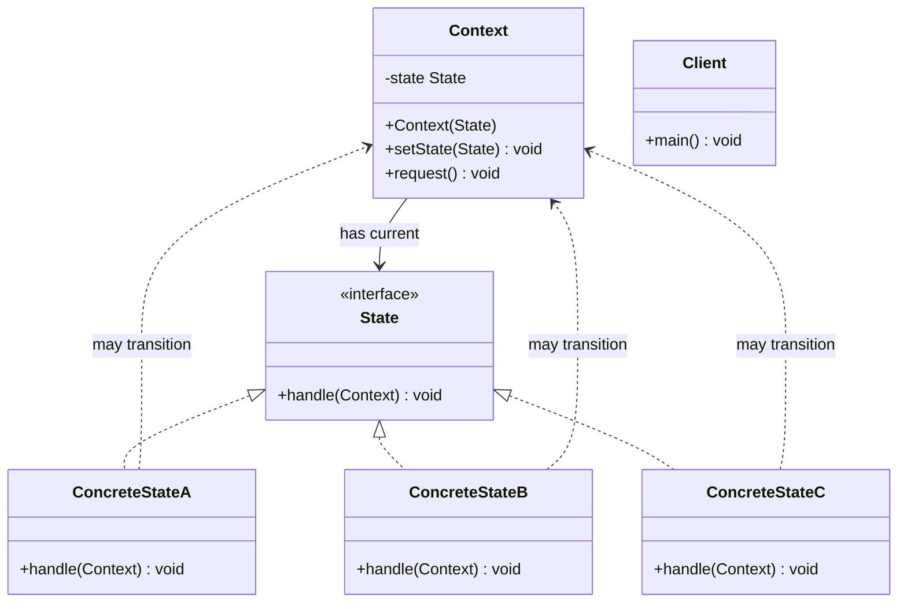

# State Pattern

> Allow an object to alter its behavior when its internal state changes. The object will appear to change its class.

## 🎯 Intent

The State pattern encapsulates state-specific behavior and delegates to the current state object, making state transitions explicit.

## 📊 Class Diagram

**Key Points:**
- **Context** maintains reference to current State and delegates behavior
- **State** interface declares state-specific methods
- **ConcreteStates** implement behavior for a particular state
- States can trigger transitions by calling Context's setState()

## 📋 Quick Reference

| Aspect | Description |
|--------|-------------|
| **Type** | Behavioral |
| **Also Known As** | Objects for States |
| **Complexity** | ⭐⭐⭐ |
| **Frequency of Use** | Medium |

## ✅ When to Use

- Object behavior depends on its state
- Operations have large conditional statements that depend on state
- State transitions are explicit and well-defined
- You have a finite state machine

## 💡 Real-World Examples

- **Vending Machine**: Idle, HasMoney, Dispensing states
- **Order Status**: Pending, Processing, Shipped, Delivered
- **TCP Connection**: Established, Listen, Closed
- **Document**: Draft, Review, Published
- **Player**: Playing, Paused, Stopped

## 📁 Implementations

| Version | Description | Java | Python | Key Learning |
|---------|-------------|------|--------|--------------|
| v1-basic | Vending machine | [Java](./java/v1-basic/) | [Python](./python/v1-basic/) | Delegate user actions to the current state |
| v2-variant | Order lifecycle | [Java](./java/v2-variant/) | [Python](./python/v2-pythonic/) | Enforce valid business transitions in state objects |
| v3-advanced | Document review workflow | [Java](./java/v3-advanced/) | [Python](./python/v3-advanced/) | Guard approvals, publication, archival, and audit history |

## 🧭 Progression Notes

- **v1-basic** keeps the finite state machine small: vending machine states handle money insertion, selection, and dispensing.
- **v2-variant** moves to an interview-friendly commerce workflow where invalid transitions, such as cancelling after shipment, are rejected by the current state.
- **v3-advanced** adds collaboration rules: documents must be reviewed before publishing, published content is locked, and archival remains an explicit transition.

---

[← Back to Behavioral Patterns](../README.md)
