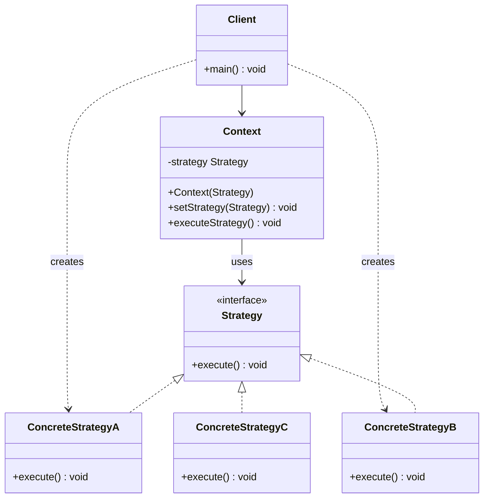

# Strategy Pattern

> Define a family of algorithms, encapsulate each one, and make them interchangeable.

## 🎯 Intent

The Strategy pattern lets the algorithm vary independently from clients that use it. It enables selecting an algorithm at runtime.

## 📊 Class Diagram



**Key Points:**
- **Context** maintains reference to a Strategy object
- **Strategy** interface declares method(s) for algorithm execution
- **ConcreteStrategies** implement different algorithm variations
- Client configures Context with desired strategy at runtime

## 📋 Quick Reference

| Aspect | Description |
|--------|-------------|
| **Type** | Behavioral |
| **Also Known As** | Policy |
| **Complexity** | ⭐⭐ |
| **Frequency of Use** | High |

## 🏗️ Structure

```
┌─────────────────┐     uses     ┌─────────────────┐
│     Context     │─────────────▶│    Strategy     │
├─────────────────┤              ├─────────────────┤
│ - strategy      │              │ + execute()     │
│ + setStrategy() │              └────────┬────────┘
│ + execute()     │                       │
└─────────────────┘              ┌────────┴────────┐
                                 │                 │
                        ┌────────┴──────┐  ┌──────┴────────┐
                        │ ConcreteA     │  │ ConcreteB     │
                        ├───────────────┤  ├───────────────┤
                        │ + execute()   │  │ + execute()   │
                        └───────────────┘  └───────────────┘
```

## ✅ When to Use

- You have multiple algorithms for a specific task
- You want to avoid conditional statements for selecting behavior
- You need to switch algorithms at runtime
- You have many related classes that differ only in behavior

## ❌ When NOT to Use

- Only a couple of algorithms that rarely change
- Clients don't need to know about different strategies
- Algorithm selection is never done at runtime

## 💡 Real-World Examples

- **Payment Processing**: Credit card, PayPal, cryptocurrency
- **Sorting**: QuickSort, MergeSort, HeapSort
- **Compression**: ZIP, GZIP, RAR
- **Pricing**: Regular, holiday discount, member discount
- **Routing**: Fastest, shortest, scenic

## 📁 Implementations

| Version | Description | Location |
|---------|-------------|----------|
| v1-basic | Payment strategies | [Java](./java/v1-basic/) / [Python](./python/v1-basic/) |
| v2-variant | Sorting algorithms | [Java](./java/v2-variant/) / [Python](./python/v2-pythonic/) |
| v3-advanced | Discount strategies with composition | [Java](./java/v3-advanced/) / [Python](./python/v3-advanced/) |

## 🔗 Related Patterns

- **State**: Similar structure but intent differs (State changes behavior based on object state)
- **Command**: Strategies define *how* to do something; Commands define *what* to do
- **Decorator**: Strategies change object guts; Decorators change object skin

---

[← Back to Behavioral Patterns](../README.md)
