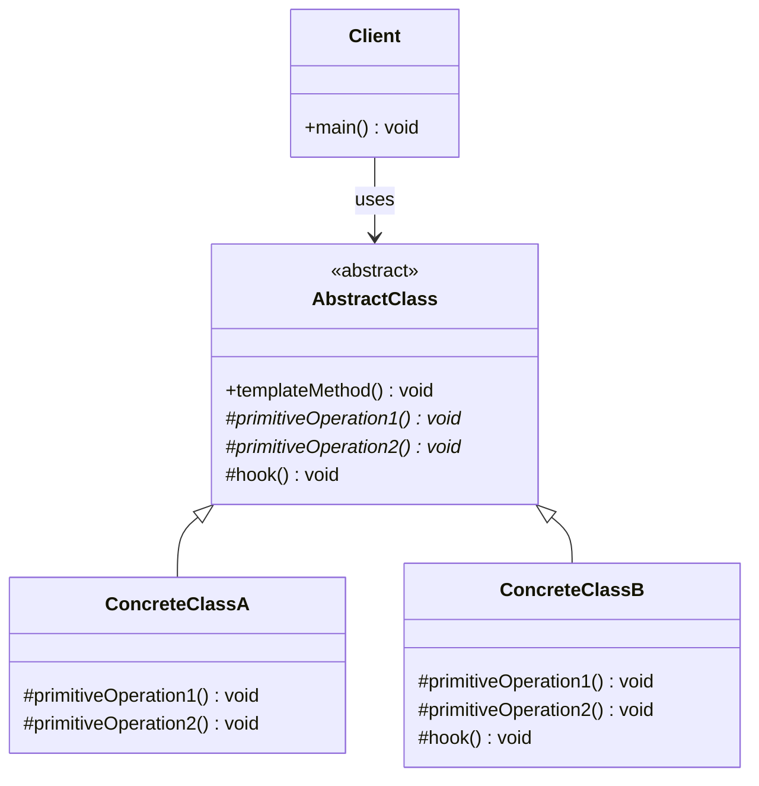

# Template Method Pattern

> Define the skeleton of an algorithm in an operation, deferring some steps to subclasses.

## 🎯 Intent

The Template Method pattern defines the program skeleton of an algorithm in a method, called template method, which defers some steps to subclasses.

## 📊 Class Diagram

**Key Points:**
- **AbstractClass** defines templateMethod() with algorithm skeleton
- **primitiveOperations** are abstract methods that subclasses must implement
- **hook** methods have default implementation but can be overridden
- Subclasses customize specific steps without changing overall structure

## ✅ When to Use

- You have an algorithm with common steps but varying implementations
- You want to control the order of steps in an algorithm
- You want to let subclasses extend specific steps without changing structure

## 💡 Real-World Examples

- **Data Mining**: Common parse → analyze → report flow
- **Web Frameworks**: Request → Process → Response lifecycle
- **Game AI**: Initialize → Play → End game structure
- **Document Generation**: Header → Content → Footer

## 📁 Implementations

| Version | Description | Location |
|---------|-------------|----------|
| v1-basic | Data processing pipeline | [Java](./java/v1-basic/) / [Python](./python/v1-basic/) |
| v2-variant | Data ETL pipeline with hooks | [Java](./java/v2-variant/) / [Python](./python/v2-variant/) |
| v3-advanced | Financial transaction processing template with compensation hooks | [Java](./java/v3-advanced/) / [Python](./python/v3-advanced/) |

---

[← Back to Behavioral Patterns](../README.md)
