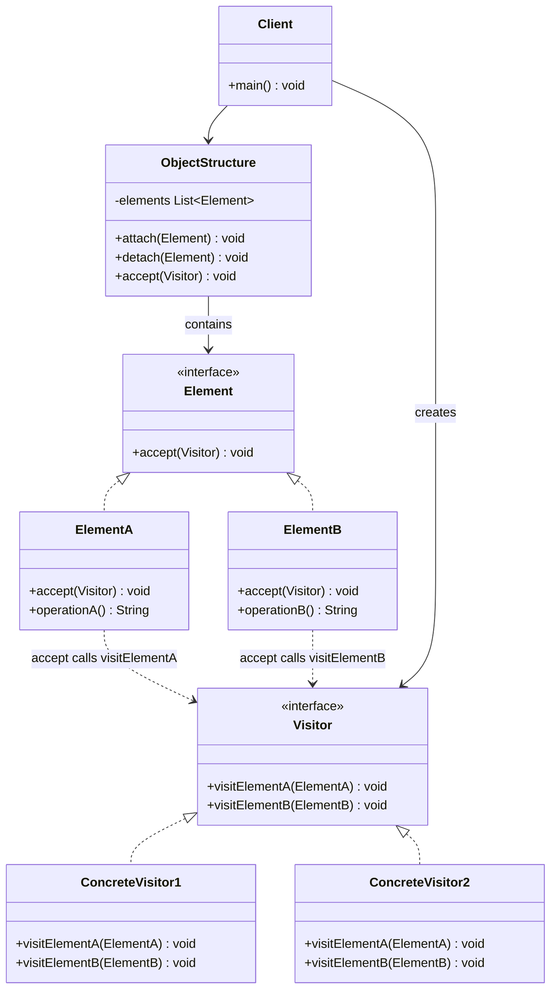

# Visitor Pattern

> Represent an operation to be performed on the elements of an object structure. Visitor lets you define a new operation without changing the classes of the elements on which it operates.

## 🎯 Intent

The Visitor pattern lets you add further operations to objects without modifying them (Open/Closed Principle).

## 📊 Class Diagram

**Key Points:**
- **Visitor** interface declares visit method for each Element type
- **Element** interface declares accept(Visitor) method
- **ConcreteVisitors** implement specific operations for each element
- Double dispatch: element calls appropriate visit method on visitor

## ✅ When to Use

- Object structure contains many classes with differing interfaces
- Many distinct and unrelated operations need to be performed
- Classes in the structure rarely change but you often add new operations

## 💡 Real-World Examples

- **AST Processing**: Compilers visiting syntax tree nodes
- **Document Export**: Export to PDF, HTML, XML
- **Tax Calculator**: Different calculations for different item types

## 📁 Implementations

| Version | Description | Location |
|---------|-------------|----------|
| v1-basic | Shape area and drawing calculator | [Java](./java/v1-basic/) / [Python](./python/v1-basic/) |
| v2-variant | Document elements multi-format exporter | [Java](./java/v2-variant/) / [Python](./python/v2-variant/) |
| v3-advanced | AST static analysis and code metrics visitor | [Java](./java/v3-advanced/) / [Python](./python/v3-advanced/) |

---

[← Back to Behavioral Patterns](../README.md)
