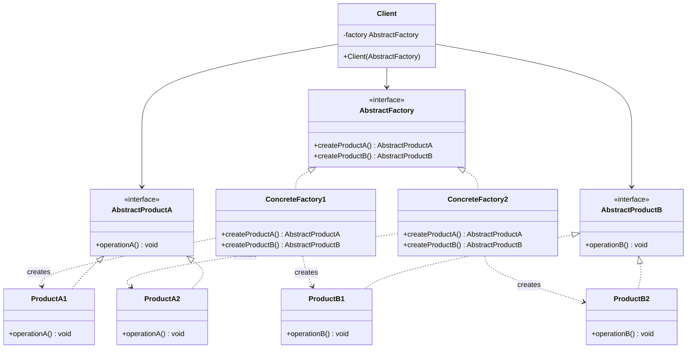

# Abstract Factory Pattern

> Provide an interface for creating families of related or dependent objects without specifying their concrete classes.

## 🎯 Intent

The Abstract Factory pattern lets you produce families of related objects without specifying their concrete classes.

## 📊 Class Diagram

**Key Points:**
- **AbstractFactory** declares interfaces for creating product families
- **ConcreteFactories** implement creation methods for specific product variants
- **AbstractProducts** declare interfaces for product types
- Products from same factory are designed to work together

## 📋 Quick Reference

| Aspect | Description |
|--------|-------------|
| **Type** | Creational |
| **Also Known As** | Kit |
| **Complexity** | ⭐⭐⭐ |
| **Frequency of Use** | Medium |

## ✅ When to Use

- System needs to be independent of how products are created
- System should work with multiple families of products
- Family of products is designed to work together
- Want to provide a library without exposing implementations

## 💡 Real-World Examples

- **Cross-Platform UI**: Windows, macOS, Linux widgets
- **Database Access**: MySQL, PostgreSQL factories
- **Document Formats**: PDF, HTML, Word exporters
- **Theme Systems**: Light, Dark theme components

## 📁 Implementations

| Version | Description | Location |
|---------|-------------|----------|
| v1-basic | Cross-platform UI widget factory | [Java](./java/v1-basic/) / [Python](./python/v1-basic/) |
| v2-variant | Database connection and transaction factory | [Java](./java/v2-variant/) / [Python](./python/v2-variant/) |
| v3-advanced | Multi-cloud resource factory with registry | [Java](./java/v3-advanced/) / [Python](./python/v3-advanced/) |

## 🔗 Related Patterns

- **Factory Method**: Abstract Factory uses Factory Methods to create products
- **Singleton**: Concrete factories often implemented as Singletons
- **Builder**: Can use Abstract Factory to build complex objects

---

[← Back to Creational Patterns](../README.md)
