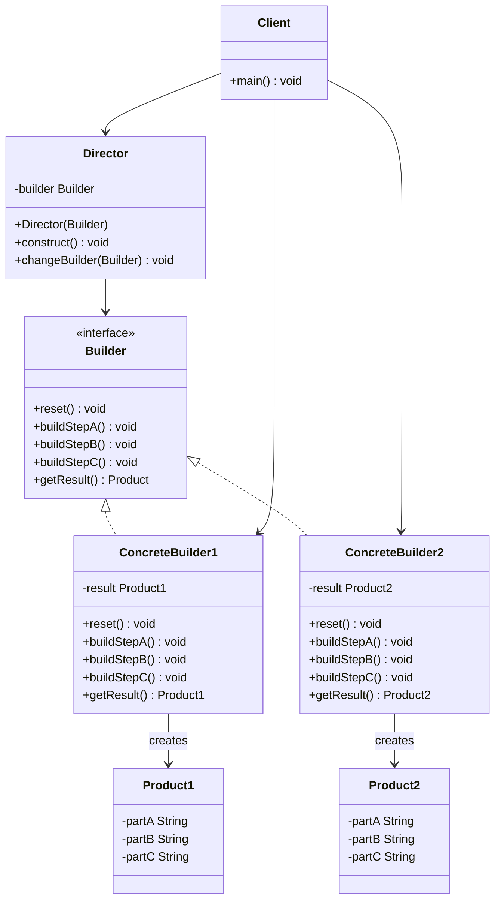

# Builder Pattern

> Separate the construction of a complex object from its representation so that the same construction process can create different representations.

## 🎯 Intent

The Builder pattern constructs complex objects step by step, allowing you to produce different types and representations using the same construction code.

## 📊 Class Diagram

**Key Points:**
- **Director** defines order to call construction steps
- **Builder** interface specifies steps for building product
- **ConcreteBuilders** provide different implementations of building steps
- **Products** are resulting objects (don't have to follow same interface)

## 📋 Quick Reference

| Aspect | Description |
|--------|-------------|
| **Type** | Creational |
| **Also Known As** | - |
| **Complexity** | ⭐⭐ |
| **Frequency of Use** | High |

## ✅ When to Use

- Object has many optional parameters (4+)
- Object needs step-by-step construction
- Same construction should create different representations
- Complex object initialization with many fields

## 💡 Real-World Examples

- **StringBuilder**: Building strings
- **HTTP Request Builders**: OkHttp, RestTemplate
- **Query Builders**: SQL query construction
- **Document Builders**: PDF, HTML generation
- **Configuration Objects**: Complex configs

## 📁 Implementations

| Version | Description | Location |
|---------|-------------|----------|
| v1-basic | Pizza builder | [Java](./java/v1-basic/) / [Python](./python/v1-basic/) |
| v2-variant | Document director with reusable builders | [Java](./java/v2-variant/) / [Python](./python/v2-variant/) |
| v3-advanced | Type-safe staged SQL query builder | [Java](./java/v3-advanced/) / [Python](./python/v3-advanced/) |

## 🔗 Related Patterns

- **Abstract Factory**: Builder focuses on step-by-step construction; Abstract Factory on families
- **Composite**: Often built using Builder
- **Singleton**: Builders are often Singletons

---

[← Back to Creational Patterns](../README.md)
