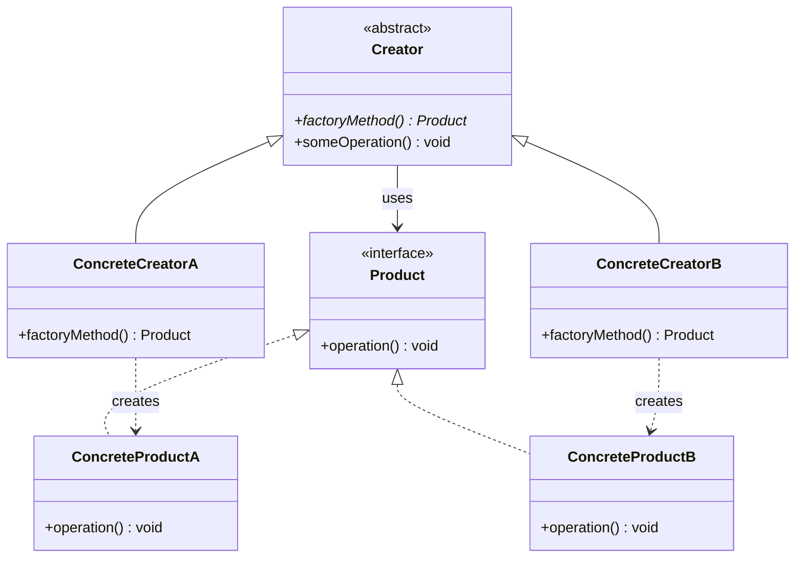

# Factory Method Pattern

> Define an interface for creating an object, but let subclasses decide which class to instantiate.

## 🎯 Intent

The Factory Method pattern provides an interface for creating objects in a superclass, but allows subclasses to alter the type of objects that will be created.

## 📊 Class Diagram

**Key Points:**
- **Creator** declares the factory method that returns Product objects
- **ConcreteCreators** override factory method to return specific product
- **Product** defines interface for objects the factory method creates
- Defers instantiation to subclasses

## 📋 Quick Reference

| Aspect | Description |
|--------|-------------|
| **Type** | Creational |
| **Also Known As** | Virtual Constructor |
| **Complexity** | ⭐⭐ |
| **Frequency of Use** | High |

## ✅ When to Use

- Don't know exact types of objects in advance
- Want to provide a way to extend internal components
- Want to save system resources by reusing existing objects
- Framework needs to standardize architectural model

## 💡 Real-World Examples

- **Logging Frameworks**: Create different loggers
- **GUI Frameworks**: Platform-specific widgets
- **Document Processing**: Different document types
- **Payment Processing**: Different payment methods

## 📁 Implementations

| Version | Description | Location |
|---------|-------------|----------|
| v1-basic | Shape factory | Coming Soon |
| v2-variant | Document factory | Coming Soon |
| v3-advanced | Plugin system | Coming Soon |

## 🔗 Related Patterns

- **Abstract Factory**: Often implemented with Factory Methods
- **Template Method**: Factory Method is often called within Template Method
- **Prototype**: Alternative when subclassing is impractical

---

[← Back to Creational Patterns](../README.md)
