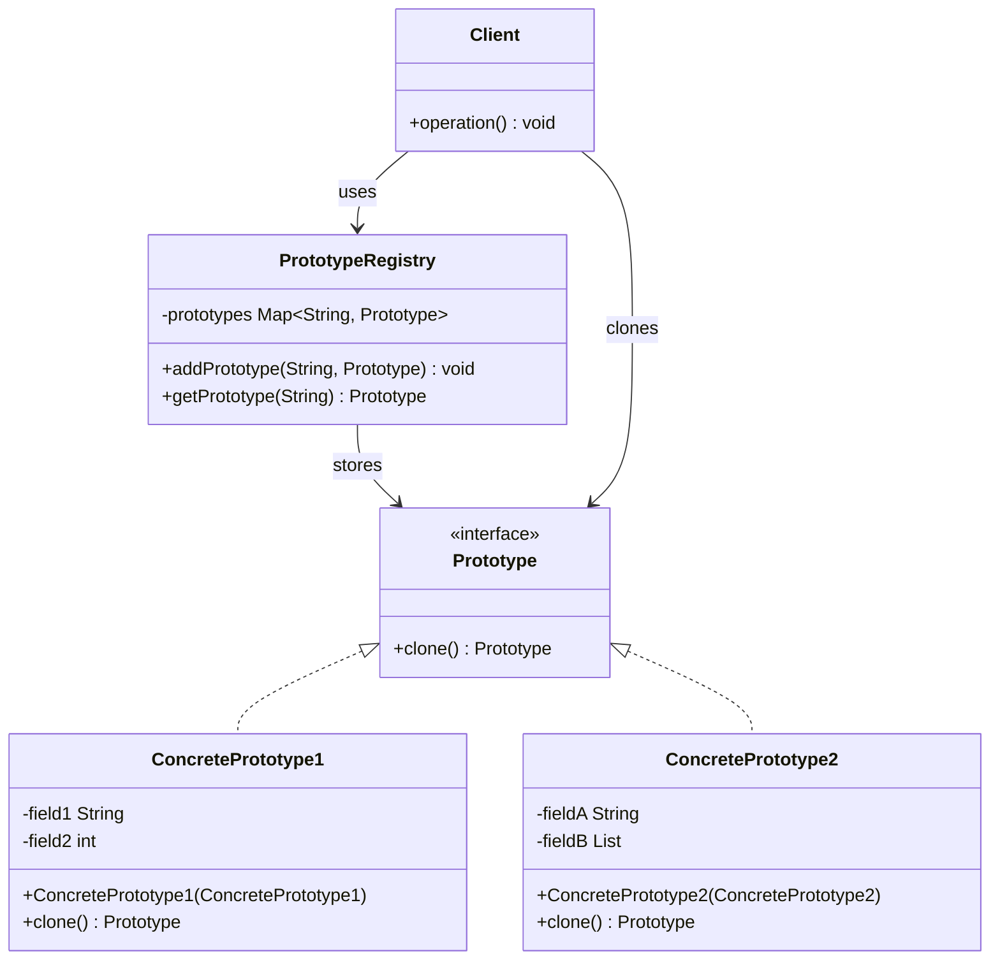

# Prototype Pattern

> Specify the kinds of objects to create using a prototypical instance, and create new objects by copying this prototype.

## 🎯 Intent

The Prototype pattern lets you copy existing objects without making your code dependent on their classes.

## 📊 Class Diagram

**Key Points:**
- **Prototype** interface declares cloning method
- **ConcretePrototypes** implement clone() with copy constructor
- **PrototypeRegistry** provides easy access to frequently-used prototypes
- Deep vs shallow copy considerations for complex objects

## 📋 Quick Reference

| Aspect | Description |
|--------|-------------|
| **Type** | Creational |
| **Also Known As** | Clone |
| **Complexity** | ⭐⭐ |
| **Frequency of Use** | Medium |

## ✅ When to Use

- Classes to instantiate are specified at runtime
- Avoid building parallel class hierarchy of factories
- Object creation is expensive (deep copy cheaper than new)
- Objects have few state variations

## 💡 Real-World Examples

- **Object Cloning**: Java's `Cloneable`
- **Game Objects**: Spawning enemies from templates
- **Graphics**: Copying shapes in design software
- **Caching**: Pre-built object templates

## 📁 Implementations

| Version | Description | Location |
|---------|-------------|----------|
| v1-basic | Graphic shape and document cloning | [Java](./java/v1-basic/) / [Python](./python/v1-basic/) |
| v2-variant | Game unit prototype with spawner registry | [Java](./java/v2-variant/) / [Python](./python/v2-variant/) |
| v3-advanced | Versioned configuration snapshot manager with rollback | [Java](./java/v3-advanced/) / [Python](./python/v3-advanced/) |

## 🔗 Related Patterns

- **Abstract Factory**: Can use Prototype to store set of prototypes
- **Composite**: Designs using Composite often use Prototype too
- **Decorator**: Similar structure but different intent

---

[← Back to Creational Patterns](../README.md)
