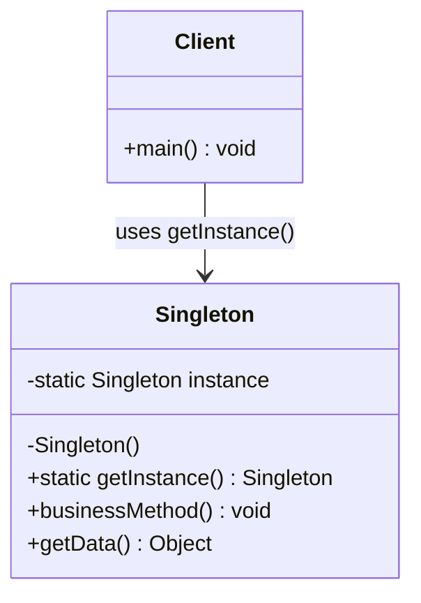

# Singleton Pattern

> Ensure a class has only one instance and provide a global point of access to it.

## 🎯 Intent

The Singleton pattern restricts instantiation of a class to a single object and provides a global access point to that instance.

## 📊 Class Diagram

**Key Points:**
- Private constructor prevents external instantiation
- Static instance holds the single object
- Public static method provides global access point
- Thread-safety considerations for lazy initialization

## 📋 Quick Reference

| Aspect | Description |
|--------|-------------|
| **Type** | Creational |
| **Also Known As** | - |
| **Complexity** | ⭐ |
| **Frequency of Use** | High |

## ✅ When to Use

- Exactly one instance of a class is required
- Controlled access to a shared resource (config, logger, connection pool)
- You need lazy initialization with thread safety
- Global state management

## ❌ When NOT to Use

- When you need multiple instances
- In heavily multithreaded applications where it becomes a bottleneck
- When it hides dependencies and makes testing harder

## 💡 Real-World Examples

- **Logging**: Single logger instance
- **Configuration**: Application settings
- **Connection Pools**: Database connection pools
- **Thread Pools**: ExecutorService
- **Caches**: Application-wide caches

## 📁 Implementations

| Version | Description | Location |
|---------|-------------|----------|
| v1-basic | Eager initialization | Coming Soon |
| v2-variant | Double-checked locking | Coming Soon |
| v3-advanced | Enum singleton | Coming Soon |

## 🔗 Related Patterns

- **Abstract Factory, Builder, Prototype**: Often implemented as Singletons
- **Facade**: Often a Singleton
- **State**: State objects are often Singletons

---

[← Back to Creational Patterns](../README.md)
