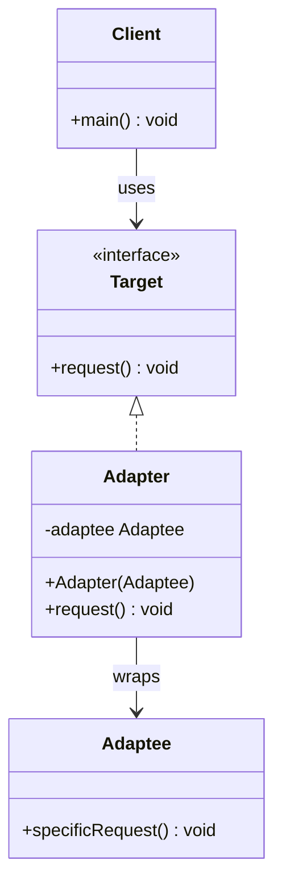

# Adapter Pattern

The Adapter pattern allows incompatible interfaces to work together by wrapping an object with a compatible interface.

---

## 📖 Overview

| Aspect | Description |
|--------|-------------|
| **Type** | Structural |
| **Also Known As** | Wrapper |
| **Intent** | Convert the interface of a class into another interface clients expect |
| **Problem** | You have a class with an incompatible interface that you can't modify |
| **Solution** | Create a wrapper class that translates calls between interfaces |

---

## 📊 Class Diagram



**Key Points:**
- **Target** defines the interface expected by the client
- **Adapter** implements Target and wraps Adaptee
- **Adaptee** has an incompatible interface that needs adapting
- `request()` in Adapter translates to `specificRequest()` in Adaptee

---

## 🎯 When to Use

1. **Legacy Integration**: Connect old code with new systems
2. **Third-Party Libraries**: Wrap external APIs with your interface
3. **Interface Mismatch**: Two classes should work together but have incompatible interfaces
4. **Reuse Existing Code**: Use a class without modifying its source

---

## 🏗️ Structure

### Object Adapter (Composition - Preferred)

```
┌─────────────┐       ┌─────────────┐
│   Client    │──────▶│   Target    │
└─────────────┘       │  Interface  │
                      └──────▲──────┘
                             │ implements
                      ┌──────┴──────┐
                      │   Adapter   │
                      │ ─────────── │       ┌─────────────┐
                      │ -adaptee    │──────▶│   Adaptee   │
                      │ +request()  │       │ +specific() │
                      └─────────────┘       └─────────────┘
```

### Class Adapter (Inheritance)

```
┌─────────────┐       ┌─────────────┐
│   Client    │──────▶│   Target    │
└─────────────┘       │  Interface  │
                      └──────▲──────┘
                             │ implements
                      ┌──────┴──────┐       ┌─────────────┐
                      │   Adapter   │◀──────│   Adaptee   │
                      │ +request()  │extends│ +specific() │
                      └─────────────┘       └─────────────┘
```

---

## ⚖️ Object Adapter vs Class Adapter

| Aspect | Object Adapter | Class Adapter |
|--------|----------------|---------------|
| **Mechanism** | Composition | Inheritance |
| **Flexibility** | Can adapt subclasses too | Only adapts specific class |
| **Language Support** | All languages | Requires multiple inheritance |
| **Access** | Only public interface | Can override protected methods |
| **Preferred** | ✅ Usually | Only in specific cases |

---

## 📁 Implementations

| Version | Description | Key Learning |
|---------|-------------|--------------|
| [v1-basic](./java/v1-basic/) | Media player adapter | Core pattern with composition |
| [v2-variant](./java/v2-variant/) | Payment gateway adapter | Multiple adaptees, real-world |
| [v3-advanced](./java/v3-advanced/) | Two-way adapter | Bidirectional adaptation |

---

## 🔗 Related Patterns

| Pattern | Relationship |
|---------|--------------|
| **Bridge** | Similar structure, different intent (decouple vs adapt) |
| **Decorator** | Wraps like Adapter but adds behavior instead of changing interface |
| **Proxy** | Same interface, controls access |
| **Facade** | Simplifies subsystem, doesn't adapt interface |

---

## 📚 Real-World Examples

- `java.util.Arrays#asList()` - Adapts array to List
- `java.io.InputStreamReader` - Adapts InputStream to Reader
- JDBC drivers - Adapt database protocols to standard interface
- Power adapters - Physical world analogy
