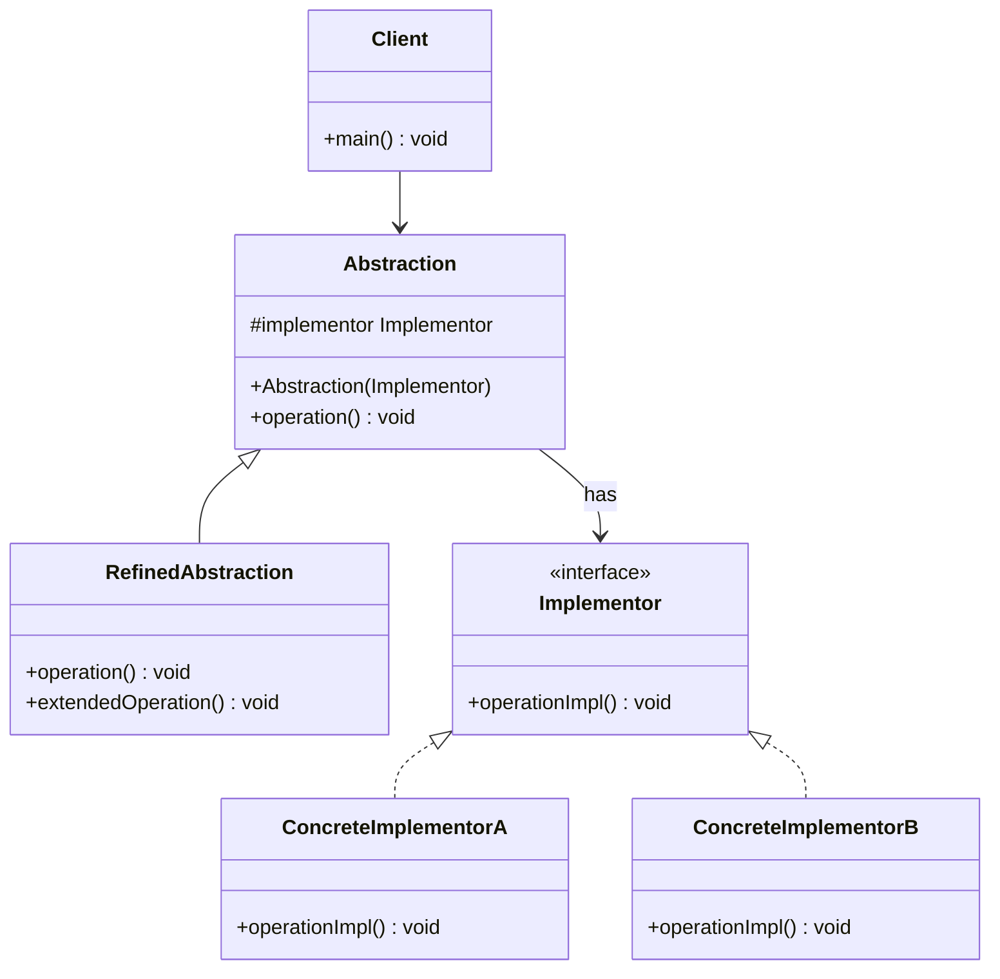

# Bridge Pattern

The Bridge pattern decouples an abstraction from its implementation so that the two can vary independently.

---

## 📖 Overview

| Aspect | Description |
|--------|-------------|
| **Type** | Structural |
| **Intent** | Separate abstraction from implementation |
| **Problem** | Class explosion from combining multiple dimensions |
| **Solution** | Use composition instead of inheritance |

---

## 📊 Class Diagram



**Key Points:**
- **Abstraction** defines the interface and maintains reference to Implementor
- **RefinedAbstraction** extends Abstraction with additional operations
- **Implementor** defines interface for implementation classes
- Both hierarchies can vary independently

---

## 🏗️ Structure

```
      ┌────────────────┐           ┌────────────────┐
      │  Abstraction   │──────────▶│ Implementation │
      │ ──────────────│           │   (Interface)  │
      │ +operation()   │           └───────┬────────┘
      └───────┬────────┘                   │
              │                    ┌───────┴───────┐
      ┌───────┴───────┐            │               │
      │               │    ┌───────┴───┐   ┌───────┴───┐
┌─────┴─────┐  ┌──────┴────┐│ ConcreteA │   │ ConcreteB │
│RefinedAbs1│  │RefinedAbs2│└───────────┘   └───────────┘
└───────────┘  └───────────┘
```

---

## 🎯 When to Use

1. **Two dimensions of variation**: Shape × Color, Device × Remote
2. **Avoid permanent binding**: Bind abstraction to implementation at runtime
3. **Both should be extensible**: Add new abstractions AND implementations
4. **Hide implementation from clients**

---

## 📁 Implementations

| Version | Description | Java | Python | Key Learning |
|---------|-------------|------|--------|--------------|
| v1-basic | Remote control + Devices | [Java](./java/v1-basic/) | [Python](./python/v1-basic/) | Classic bridge example |
| v2-variant | Shapes + Rendering | [Java](./java/v2-variant/) | [Python](./python/v2-pythonic/) | Two-dimensional variation |
| v3-advanced | Message + Sender | [Java](./java/v3-advanced/) | [Python](./python/v3-advanced/) | Notification system |

## 🧭 Progression Notes

- **v1-basic** separates remotes from devices so either hierarchy can grow independently.
- **v2-variant** makes the second axis more visible: shapes own geometry while renderers own SVG, raster, or recording output.
- **v3-advanced** maps the pattern to notification systems where message policy and delivery channels evolve separately.

---

## ⚖️ Bridge vs Strategy

| Bridge | Strategy |
|--------|----------|
| Decouples abstraction from impl | Swaps algorithm |
| Designed upfront | Often retrofitted |
| Abstraction layer present | No abstraction layer |

---

## 📚 Real-World Examples

- JDBC (abstraction) and database drivers (implementation)
- AWT (Java Abstract Window Toolkit)
- Logging frameworks with multiple backends
