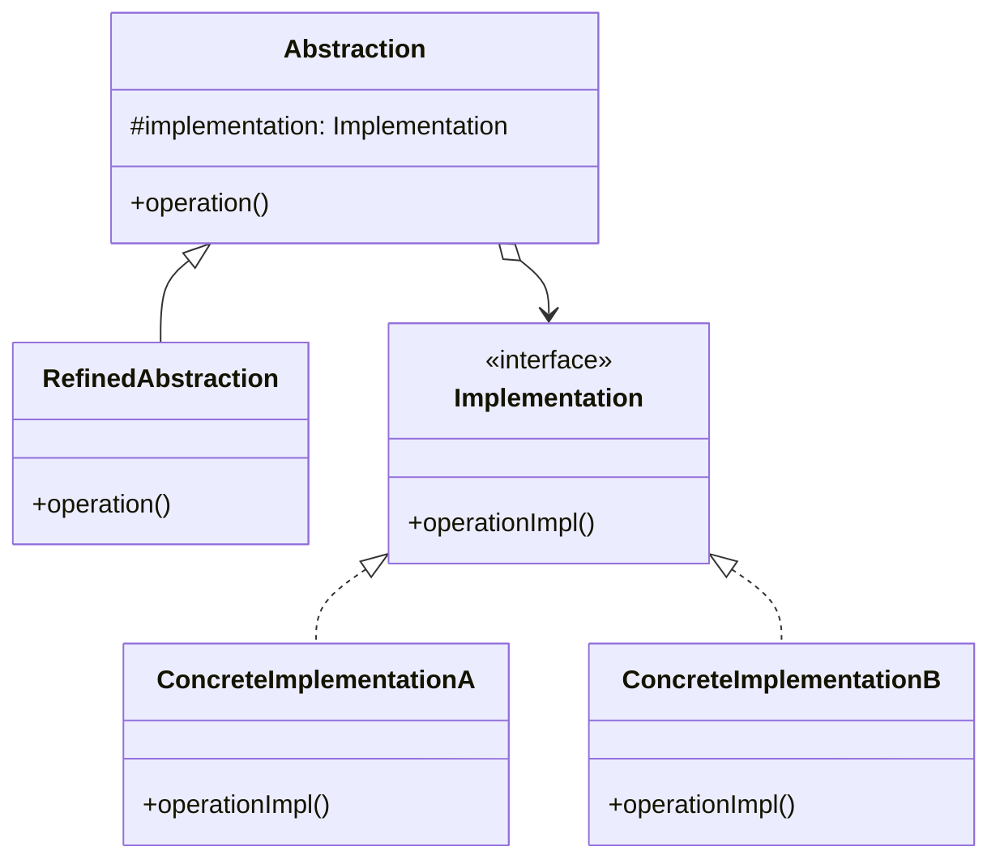
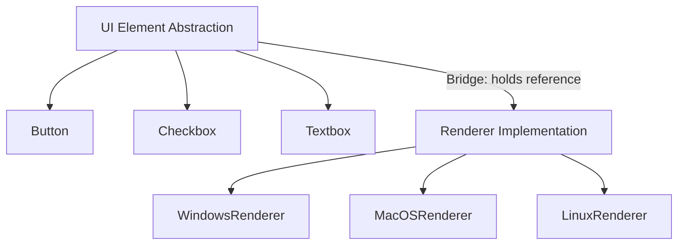

# Bridge Pattern - Theory

## 📚 Core Concept

The Bridge pattern is a structural design pattern that lets you split a large class or a set of closely related classes into two separate hierarchies—abstraction and implementation—which can be developed independently of each other.

The term "Bridge" refers to the separation of these two dimensions by using composition over inheritance. The abstraction holds a reference to the implementation and delegates work to it, acting as a bridge between the two hierarchies.

### Key Components

1. **Abstraction (also called interface)**: High-level control layer for some entity. This layer isn't supposed to do any real work on its own. It should delegate the work to the implementation layer.
2. **Refined Abstraction**: Extends the control logic defined by the base abstraction.
3. **Implementation**: The interface that's common for all concrete implementations. An abstraction can only communicate with an implementation object via methods declared here.
4. **Concrete Implementations**: Contain platform-specific code.



## 🎯 Problem

You have two independent dimensions of variation:
- Without Bridge: `n × m` classes (explosion!)
- With Bridge: `n + m` classes

Example: You have a geometric `Shape` class with a pair of subclasses: `Circle` and `Square`. You want to extend this class hierarchy to incorporate colors, so you plan to create `Red` and `Blue` shape subclasses. However, since you already have two subclasses, you'll need to create four class combinations such as `BlueCircle` and `RedSquare`.

Adding new shape types and colors to the hierarchy will grow it exponentially. For example, to add a triangle shape you'd need to introduce two subclasses, one for each color. And after that, adding a new color would require creating three subclasses, one for each shape type. The further we go, the worse it becomes.

## 💡 Solution

This problem occurs because we're trying to extend the shape classes in two independent dimensions: by form and by color. That's a very common issue with class inheritance.

The Bridge pattern attempts to solve this problem by switching from inheritance to the object composition. What this means is that you extract one of the dimensions into a separate class hierarchy, so that the original classes will reference an object of the new hierarchy, instead of having all of its state and behaviors within one class.

1. Identify two dimensions (abstraction + implementation)
2. Create interface for implementation dimension (e.g., `Color`)
3. Abstraction (e.g., `Shape`) holds reference to implementation
4. Both can vary independently

```java
interface Color { 
    String fill(); 
}
class Red implements Color { 
    public String fill() { return "Red"; }
}
class Blue implements Color { 
    public String fill() { return "Blue"; }
}

abstract class Shape {
    protected Color color;  // Bridge!
    Shape(Color c) { this.color = c; }
    abstract void draw();
}

class Circle extends Shape {
    Circle(Color c) { super(c); }
    void draw() { System.out.println("Drawing " + color.fill() + " circle"); }
}
```

## 📈 Worked Numeric Example

Consider a cross-platform UI framework with 3 UI elements (Button, Checkbox, Textbox) and 3 OS platforms (Windows, macOS, Linux).

**Without Bridge (Inheritance Explosion):**
Total classes = Elements × Platforms = 3 × 3 = 9 classes.
(WindowsButton, MacOSButton, LinuxButton, WindowsCheckbox...)

If we add a new OS (e.g., Android), we need 3 new classes. Total = 4 × 3 = 12.
If we add a new Element (e.g., RadioButton), we need 4 new classes. Total = 4 × 4 = 16.
Scaling complexity is **O(N × M)**.

**With Bridge:**
Total classes = Elements + Platforms = 3 + 3 = 6 classes.
(Button, Checkbox, Textbox, WindowsRenderer, MacOSRenderer, LinuxRenderer)

If we add a new OS (e.g., Android), we need 1 new class (AndroidRenderer). Total = 4 + 3 = 7.
If we add a new Element (e.g., RadioButton), we need 1 new class. Total = 4 + 4 = 8.
Scaling complexity is **O(N + M)**.

Memory savings in enterprise systems: If each class definition takes ~2KB of metadata space, dropping from 1,000 permutations (100 elements × 10 themes) to 110 classes (100 + 10) saves 1.78MB of Metaspace overhead just for class definitions.



## 🎤 Interview Q&A

### Junior Level

### Q1: What is the main purpose of the Bridge pattern?
**A:** The main purpose is to decouple an abstraction from its implementation so that the two can vary independently. It prevents a "Cartesian product" explosion of subclasses when a system varies along two independent dimensions.

### Q2: What is the difference between the Bridge and Strategy patterns?
**A:** 
- **Bridge**: Structural pattern aimed at structuring the architecture before code is written to allow independent variation of abstraction and implementation.
- **Strategy**: Behavioral pattern used to swap algorithms at runtime.
Both use composition, but their intent is different. Strategy is about behavior, Bridge is about structure.

### Mid Level

### Q3: Bridge vs Adapter - what's the difference?
**A:** 
| Bridge | Adapter |
|--------|---------|
| Design upfront | Retrofit existing code |
| Two hierarchies vary independently | Make incompatible interfaces work together |
| You control both sides | Adaptee is often external/third-party |

### Q4: When is Bridge overkill?
**A:** Bridge is overkill when:
- Only one dimension varies.
- You know all implementations upfront and they won't change.
- Dimensions don't change independently.
- Simple inheritance works fine without causing a class explosion.

### Q5: Can the Bridge pattern have more than two dimensions?
**A:** Yes, but it becomes complex. You would have an abstraction that holds references to multiple implementation interfaces. For example, a `Shape` might hold a `Color` (implementation 1) and a `BorderType` (implementation 2). This is just extending the principle of composition over inheritance.

### Senior Level

### Q6: How does Dependency Injection (DI) relate to the Bridge pattern?
**A:** DI is the modern way to wire up a Bridge pattern. Instead of hardcoding the implementation object within the abstraction's constructor, a DI container injects the specific `Implementation` (e.g., `WindowsRenderer`) into the `Abstraction` (e.g., `Button`) at runtime. This maximizes the decoupling the pattern aims to achieve.

### Q7: In what real-world scenarios in system design would you use the Bridge pattern?
**A:** Common scenarios include:
- Cross-platform app development (UI components bridge to OS-specific rendering APIs).
- Database drivers (JDBC: `java.sql.Connection` is the abstraction, driver-specific implementations are the bridge).
- Messaging systems (Abstraction: UserMessage, SystemMessage; Implementation: SMS, Email, Push).

### Staff Level

### Q8: How would you evolve a system from tangled inheritance to a Bridge architecture without downtime or breaking clients?
**A:** Refactoring a tangled `O(N*M)` hierarchy requires careful steps:
1. **Identify Dimensions**: Find the orthogonal axes (e.g., form and color).
2. **Extract Interface**: Create the new Implementation interface (e.g., `IColor`).
3. **Build Implementations**: Create concrete classes for the implementation (e.g., `RedColor`).
4. **Inject/Compose**: Add a reference to `IColor` in the base class of the abstraction.
5. **Strangler Fig Migration**: Update one concrete abstraction subclass (e.g., `RedCircle`) to use the new `IColor` instead of its hardcoded logic.
6. **Deprecate**: Once a subclass delegates entirely to the bridge, deprecate and eventually delete the `RedCircle` class, replacing it with `new Circle(new RedColor())`.
7. **Repeat**: Slowly migrate all clients, ensuring tests pass at each step.

---

[← Back to Bridge](./README.md)

---

## 🔗 Cross-References

- **Related**: Strategy, Adapter, Abstract Factory
- **LLD**: Cross-platform applications, renderers

## Additional Details

The Bridge pattern is heavily reliant on the principle of composition over inheritance. When you find yourself creating a deep inheritance tree, take a step back and look for orthogonal concepts that can be split out.

The classic warning sign that you need a Bridge is a naming convention that concatenates two domains, such as `WindowsButton`, `LinuxButton`, `WindowsCheckbox`, `LinuxCheckbox`. Here, "Platform" and "ControlType" are the two independent dimensions.

Applying the Bridge pattern not only reduces the number of classes but also adheres strictly to the Single Responsibility Principle. The abstraction handles the high-level logic, while the implementation handles the low-level details. This separation makes unit testing significantly easier, as you can test the abstraction with mocked implementations, and test the implementations independently of the abstraction.

Furthermore, the Open/Closed Principle is naturally satisfied. You can introduce new abstractions and new implementations independently of each other. A new platform doesn't require changes to the control logic, and a new control doesn't require changes to the platform rendering logic.

In high-performance systems, the cost of the virtual method dispatch required by the Bridge pattern is usually negligible compared to the architectural clarity it brings. However, in extremely hot loops, the indirection might be a consideration, though rarely a bottleneck.

Finally, remember that the Bridge pattern is an up-front design decision. Unlike the Adapter pattern, which is usually applied after a system is built to fix compatibility issues, the Bridge pattern is applied during the design phase to establish a scalable architecture.

