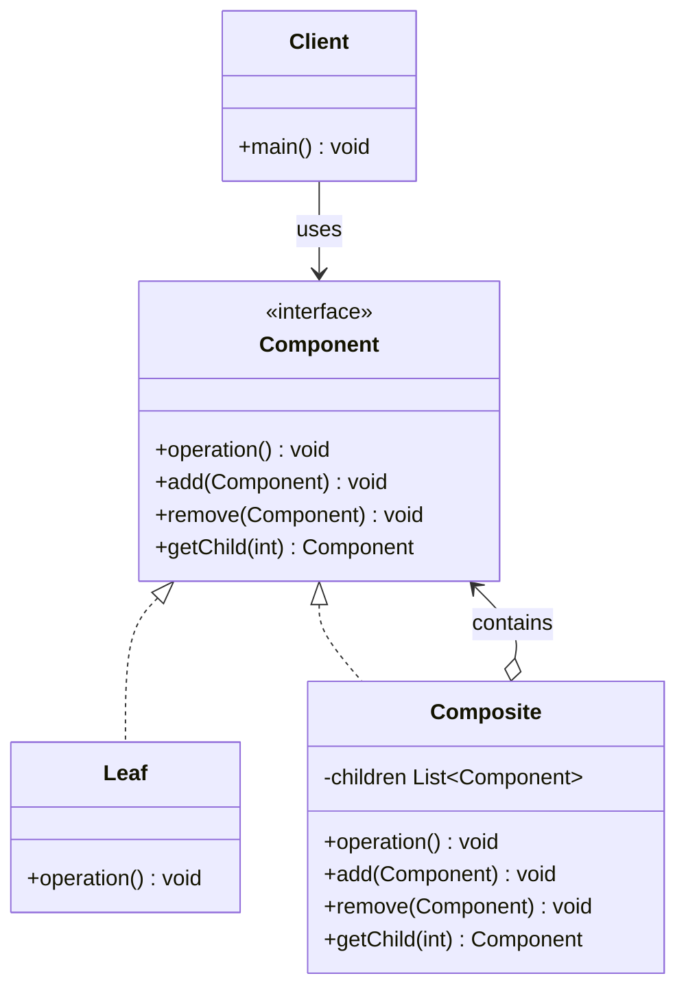

# Composite Pattern

The Composite pattern composes objects into tree structures to represent part-whole hierarchies. Clients treat individual objects and compositions uniformly.

---

## 📖 Overview

| Aspect | Description |
|--------|-------------|
| **Type** | Structural |
| **Intent** | Compose objects into trees; treat parts and wholes uniformly |
| **Problem** | Need to work with tree structures |
| **Solution** | Common interface for leaves and composites |

---

## 📊 Class Diagram



**Key Points:**
- **Component** declares interface for objects in composition (including child management)
- **Leaf** represents end objects with no children
- **Composite** stores child components and implements child-related operations
- Clients treat Leaf and Composite uniformly through Component interface

---

## 🏗️ Structure

```
┌─────────────────┐
│    Component    │◄────────────────────┐
│   (Interface)   │                     │
│ +operation()    │                     │
└────────┬────────┘                     │
         │                              │
    implements                          │
    ┌────┴─────┐                        │
    │          │                        │
┌───┴───┐  ┌───┴─────────────┐          │
│ Leaf  │  │    Composite    │──────────┘
│       │  │ - children[]    │ contains
└───────┘  │ +add(Component) │ Components
           │ +remove()       │
           │ +operation()    │
           └─────────────────┘
```

---

## 🎯 When to Use

1. **Tree structures**: File systems, organization charts
2. **Uniform treatment**: Same operations on parts and wholes
3. **Recursive composition**: Objects contain objects
4. **Client simplicity**: No special handling for leaves vs composites

---

## 📁 Implementations

| Version | Description | Java | Python | Key Learning |
|---------|-------------|------|--------|--------------|
| v1-basic | File system | [Java](./java/v1-basic/) | [Python](./python/v1-basic/) | Classic tree structure |
| v2-variant | Graphics groups | [Java](./java/v2-variant/) | [Python](./python/v2-variant/) | Same operations on shapes and grouped drawings |
| v3-advanced | Menu system | [Java](./java/v3-advanced/) | [Python](./python/v3-advanced/) | Recursive section/item hierarchy with rollups |

### Progression Notes

| Step | What Changes | Interview Signal |
|------|--------------|------------------|
| v1-basic | Files and directories expose the same size/display API | Explain part-whole trees and recursive aggregation |
| v2-variant | Drawing groups move, render, and calculate area like individual shapes | Show uniform client code across leaves and composites |
| v3-advanced | Menu sections provide counts, price totals, and availability filters | Discuss richer recursive operations without type checks |

---

## 📚 Real-World Examples

- File system (files and folders)
- GUI component hierarchies
- Organization charts
- Menu systems
- XML/JSON parsing
