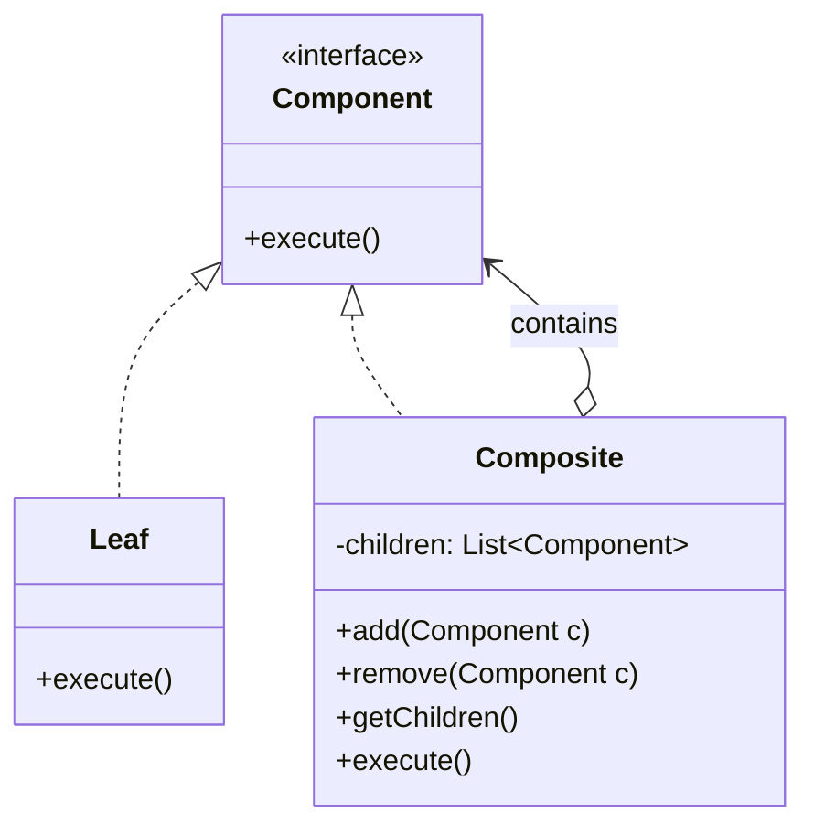
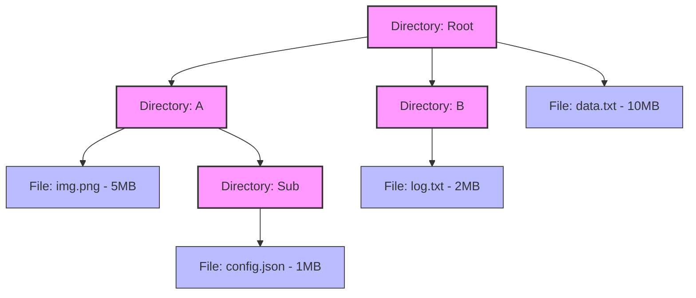

# Composite Pattern - Theory

## 📚 Core Concept

The Composite pattern is a structural design pattern that lets you compose objects into tree structures and then work with these structures as if they were individual objects.

It is particularly useful when the core model of your app can be represented as a tree. The pattern relies on the concept of uniform treatment, meaning that a client doesn't need to care whether it's dealing with a leaf node or a complex branch containing multiple sub-nodes.

### Key Components

1. **Component**: The interface that declares common operations for both simple and complex objects of a composition.
2. **Leaf**: A basic element of a tree that doesn't have sub-elements. It does the actual work.
3. **Composite (Container)**: An element that has sub-elements: leaves or other containers. A composite doesn't know the concrete classes of its children. It delegates work to its sub-elements, processes intermediate results, and returns the final result to the client.
4. **Client**: Works with all elements through the component interface.



## 🎯 Problem

You need to represent a part-whole hierarchy where clients should treat leaves and composites the same. 

For example, imagine you are building an order calculation system for an e-commerce platform. An order can contain simple `Product` objects (like a book or a phone), but it can also contain `Box` objects. A `Box` can contain other `Box` objects or `Product` objects. 

If you try to calculate the total price of the order without the Composite pattern, you have to write a complex recursive function that checks the class of each object. If it's a `Product`, get the price. If it's a `Box`, open it, iterate over its contents, and sum their prices, checking types all the way down. This makes the code brittle and highly coupled to concrete classes.

## 💡 Solution

The Composite pattern suggests that you work with `Product` and `Box` through a common interface which declares a method for calculating the total price.

1. Define a `Component` interface with common operations (`getPrice()`).
2. `Leaf` (`Product`) implements operations directly, returning its own price.
3. `Composite` (`Box`) implements the interface by iterating over its children (which can be products or smaller boxes), calling `getPrice()` on each, and combining the results.

```java
interface FileSystemItem {
    int getSize();
}

class File implements FileSystemItem {
    int size;
    public int getSize() { return size; }
}

class Directory implements FileSystemItem {
    List<FileSystemItem> children;
    public void add(FileSystemItem item) { children.add(item); }
    public int getSize() {
        return children.stream()
            .mapToInt(FileSystemItem::getSize)
            .sum();  // Recursive!
    }
}
```

## 📈 Worked Numeric Example

Consider a file system with millions of files and directories. We want to calculate the size of the root directory.

Let's assume an average directory tree depth of 5, and each directory contains 10 items (mix of files and folders).

If we do type checking (`instanceof`) at every level:
Type check takes ~2ns.
Virtual method call takes ~1ns.

For a tree of 100,000 files:
Without Composite (Manual Type Checking):
- 100,000 type checks = 200,000ns = 0.2ms
- 100,000 method calls = 100,000ns = 0.1ms
Total = ~0.3ms plus complex conditional branching which ruins CPU branch prediction.

With Composite:
- 100,000 virtual method calls (Uniformly polymorphic)
Total = 100,000ns = 0.1ms.
CPU branch prediction works optimally because it's a uniform interface call.

Furthermore, cyclomatic complexity for the client drops from O(TreeDepth * Branches) to O(1) – a single call to `root.getSize()`.



## 🎤 Interview Q&A

### Junior Level

### Q1: What kind of structure is the Composite pattern designed for?
**A:** It is designed for tree-like object structures (part-whole hierarchies) where you want clients to treat individual objects and compositions of objects uniformly.

### Q2: What are the main components of the Composite pattern?
**A:** Component (the common interface), Leaf (the end nodes that do the work), and Composite/Container (the branch nodes that contain children and delegate work to them).

### Mid Level

### Q3: How do you handle operations only valid for composites, like `addChild()`?
**A:** There are two main approaches:
1. **Transparency**: Put `addChild()` in the `Component` interface. It provides uniformity but sacrifices safety (Leaves might throw an `UnsupportedOperationException`).
2. **Safety**: Put `addChild()` only in the `Composite` class. It's safer but loses uniform treatment (clients must cast to `Composite` to add children).
Most frameworks prefer Transparency, throwing exceptions for Leaves.

### Q4: Composite vs Decorator?
**A:** 
| Composite | Decorator |
|-----------|-----------|
| Tree structure | Linear chain |
| Multiple children | Single wrapped object |
| Represents part-whole hierarchy | Adds behavior to an object dynamically |

### Q5: How do you optimize traversal in large composites?
**A:** You can use caching. If the `getSize()` of a large directory takes a long time, the `Composite` can cache the total size. The cache is invalidated when a child is added or removed. You can also implement parent references to propagate invalidation up the tree.

### Senior Level

### Q6: How does the Visitor pattern work with Composite?
**A:** The Composite pattern's structure makes it an ideal candidate for the Visitor pattern. Since adding new operations to the `Component` interface requires changing all classes, you can use the Visitor pattern to execute operations over a Composite tree without changing the component classes. The `Component` interface just needs an `accept(Visitor v)` method.

### Q7: What are the memory implications of deep Composite trees?
**A:** Deep trees can cause `StackOverflowError` if traversed recursively. In large-scale systems (like rendering a complex DOM tree), it's often better to convert recursive traversal into iterative traversal using an explicit Stack or Queue data structure to manage the tree exploration.

### Staff Level

### Q8: How would you store and query a Composite structure in a relational database?
**A:** Storing trees in an RDBMS is notoriously tricky. Common patterns include:
1. **Adjacency List**: Each row has a `parent_id`. Easy to write, hard to query (requires recursive CTEs).
2. **Path Enumeration**: Each row stores its full path (e.g., `/1/4/7/`). Easy to query descendants, harder to move subtrees.
3. **Nested Sets**: Stores `left` and `right` bounds for each node. Fast reads, extremely slow writes (requires updating half the table for an insert).
4. **Closure Table**: A separate table mapping all ancestor-descendant relationships. Very flexible and fast, but uses O(N^2) space.
In modern applications, a Graph Database (like Neo4j) is often preferred for massive Composite structures.

---

[← Back to Composite](./README.md)

---

## 🔗 Cross-References

- **LLD**: File managers, UI frameworks, DOM parsing
- **Related**: Decorator, Chain of Responsibility, Visitor

## Additional Considerations

When implementing the Composite pattern, you should pay close attention to how you manage child lifecycles. Since the Composite holds references to its children, it is generally responsible for their memory management (in languages without automatic garbage collection, like C++). Even in Java or Python, failing to clear child lists when a Composite is discarded can lead to significant memory leaks.

Another design decision is whether children should have references to their parents. Adding a parent pointer simplifies traversing up the tree and makes it much easier to implement features like cache invalidation (where a change in a leaf node needs to update cached values in all its ancestors). However, it does introduce a circular dependency, which can complicate serialization and debugging if not handled carefully.

Finally, consider the ordering of children. If the order matters (for example, in a UI layout engine where Z-order or rendering order is crucial), the Composite must use an ordered collection like a `List`. If order doesn't matter (like in a group of independent tasks), a `Set` might be more appropriate and can enforce uniqueness among children.

In domain-driven design (DDD), the Composite pattern often aligns with the concept of Aggregates. The root Composite acts as the Aggregate Root, ensuring consistency across its entire tree of child entities and value objects. All external interactions must go through the root, which delegates to the children internally.

The Composite pattern can also be combined beautifully with the Builder pattern. Constructing complex trees by manually instantiating and adding children at every level results in verbose and unreadable client code. A fluent Builder can encapsulate this complexity, allowing developers to define hierarchies using a clean, declarative syntax.

Overall, the Composite pattern is an essential tool for any system that deals with hierarchical data, providing a robust and extensible way to manipulate complex object graphs without duplicating conditional logic everywhere.

One last detail to keep in mind is thread safety. If a Composite tree is shared across multiple threads (for instance, a shared configuration tree), operations that add or remove children, or that mutate state during recursive calculations, must be properly synchronized. Using thread-safe collections for child lists or making the entire tree immutable after construction are common strategies to prevent concurrency issues.

Furthermore, the Composite pattern works well alongside the Command pattern in macro recording systems. A 'MacroCommand' is essentially a Composite that implements the Command interface and holds a list of simple Commands (Leaves). When the macro is executed, it just loops through its children and calls execute on each one, providing a very elegant way to group actions together.

Consider how these patterns layer together: You might have a Builder to construct the Composite tree, a Visitor to perform complex operations on it, and Decorators wrapping specific Leaf nodes to add ad-hoc behavior. This composability of patterns is what makes them so powerful.

Finally, remember that the uniform interface is the core promise of the Composite pattern. If your client code finds itself frequently casting objects to their concrete types or relying heavily on `instanceof` checks, the pattern is breaking down. The `Component` interface should be rich enough to handle the majority of client needs without exposing the underlying tree structure.

The goal is always to treat the part and the whole in exactly the same way. By keeping the interface robust and the traversal mechanisms efficient, you ensure that the system remains easy to extend and maintain, regardless of how large or deep the tree structure becomes.

Make sure you understand these nuances when answering system design questions. A naive implementation of a tree is easy, but an optimized, thread-safe, memory-efficient implementation using the Composite pattern shows seniority.

