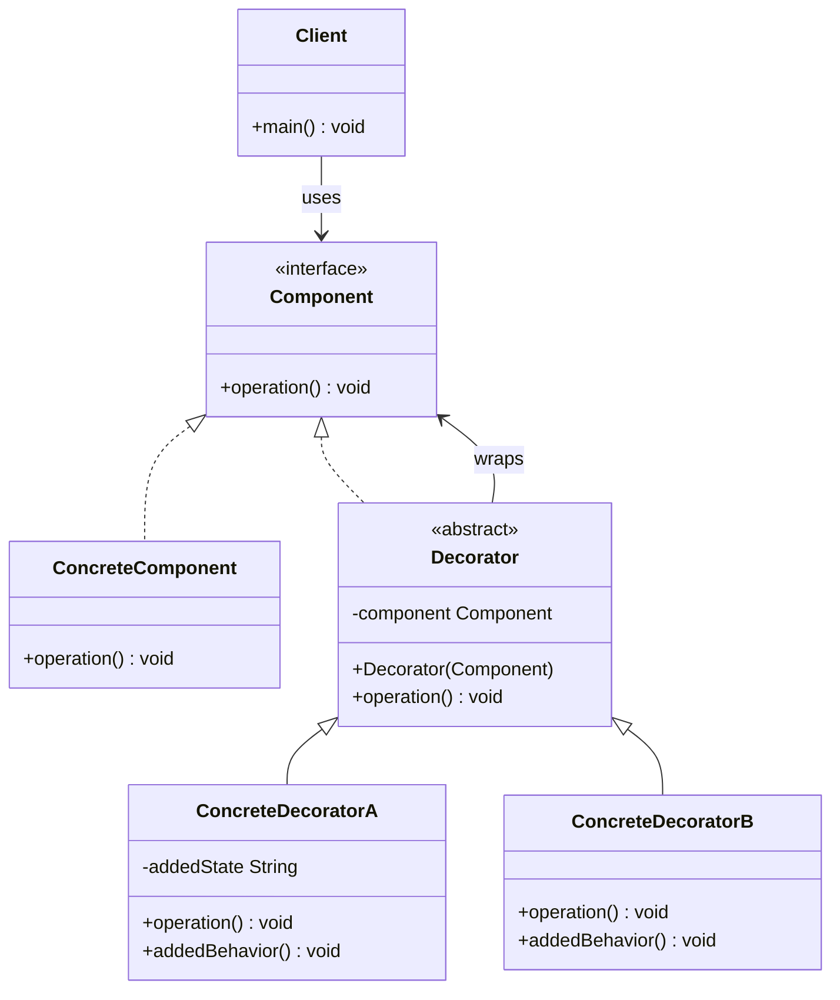

# Decorator Pattern

The Decorator pattern attaches additional responsibilities to an object dynamically, providing a flexible alternative to subclassing.

---

## 📖 Overview

| Aspect | Description |
|--------|-------------|
| **Type** | Structural |
| **Also Known As** | Wrapper |
| **Intent** | Add behavior to objects dynamically without affecting other objects |
| **Problem** | Need to add features without explosion of subclasses |
| **Solution** | Wrap objects with decorator objects that add behavior |

---

## 📊 Class Diagram



**Key Points:**
- **Component** defines the interface for objects that can have responsibilities added
- **Decorator** maintains a reference to a Component and conforms to Component's interface
- **ConcreteDecorators** add behavior before/after delegating to the wrapped component
- Decorators can be stacked for combined behavior

---

## 🎯 When to Use

1. **Add responsibilities dynamically**: Add features at runtime
2. **Avoid subclass explosion**: Too many feature combinations
3. **Open/Closed Principle**: Extend without modifying existing code
4. **Stack behaviors**: Combine multiple decorators

---

## 🏗️ Structure

```
┌─────────────────┐
│    Component    │◄──────────────────────────┐
│   (Interface)   │                           │
└────────┬────────┘                           │
         │                                    │
         │ implements                         │
    ┌────┴────┐                               │
    │         │                               │
┌───┴───┐ ┌───┴────────────────┐              │
│Concrete│ │     Decorator     │──────────────┘
│Component │ │  (Abstract)      │ wraps Component
└─────────┘ │ - component      │
            └────────┬─────────┘
                     │ extends
            ┌────────┴────────┐
            │                 │
    ┌───────┴──────┐  ┌───────┴──────┐
    │ ConcreteDecA │  │ ConcreteDecB │
    └──────────────┘  └──────────────┘
```

---

## 🔧 Key Characteristics

| Feature | Description |
|---------|-------------|
| **Same Interface** | Decorators and components share same interface |
| **Transparent** | Client doesn't know about decoration |
| **Stackable** | Multiple decorators can wrap each other |
| **Runtime** | Add/remove at runtime, not compile time |

---

## 📁 Implementations

| Version | Description | Key Learning |
|---------|-------------|--------------|
| [v1-basic](./java/v1-basic/) | Coffee shop beverages | Core pattern with stacking |
| [v2-variant](./java/v2-variant/) | Input/Output streams | Real-world I/O decorator chain |
| [v3-advanced](./java/v3-advanced/) | HTTP middleware | Request/response decoration |

---

## ⚖️ Decorator vs Inheritance

| Aspect | Decorator | Inheritance |
|--------|-----------|-------------|
| **When** | Runtime | Compile time |
| **Flexibility** | High | Low |
| **Combinations** | Easy to stack | Explosion of classes |
| **Single Responsibility** | Each decorator one job | Mixed responsibilities |

---

## 🔗 Related Patterns

| Pattern | Relationship |
|---------|--------------|
| **Adapter** | Changes interface; Decorator enhances same interface |
| **Composite** | Similar structure; different intent |
| **Strategy** | Changes guts; Decorator changes skin |
| **Chain of Responsibility** | Decorators can be seen as degenerate chain |

---

## 📚 Real-World Examples

- `java.io` streams (BufferedInputStream, DataInputStream)
- Spring's `@Transactional` (proxy-based decorator)
- Python's `@decorator` syntax
- Middleware in web frameworks
