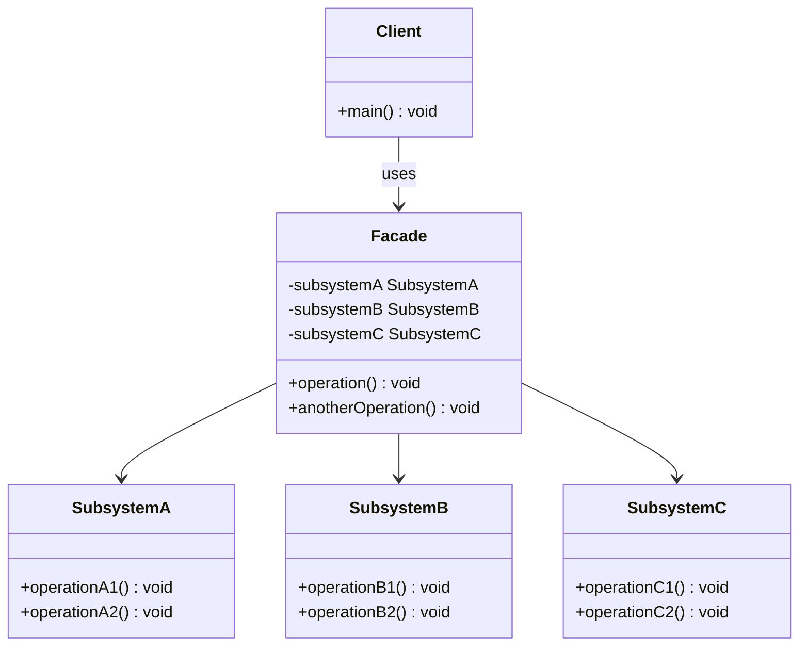

# Facade Pattern

The Facade pattern provides a simplified interface to a complex subsystem.

---

## 📖 Overview

| Aspect | Description |
|--------|-------------|
| **Type** | Structural |
| **Intent** | Provide a unified, high-level interface to a set of interfaces in a subsystem |
| **Problem** | Complex subsystem is hard to use |
| **Solution** | Create a simple facade that delegates to subsystem |

---

## 📊 Class Diagram



**Key Points:**
- **Facade** provides a simplified, unified interface to the subsystem
- **Subsystem classes** contain complex functionality
- Client only interacts with Facade, not subsystem classes
- Facade delegates to appropriate subsystem classes

---

## 🏗️ Structure

```
┌──────────────┐
│    Client    │
└──────┬───────┘
       │ uses
       ▼
┌──────────────┐
│    Facade    │ ← Simple interface
└──────┬───────┘
       │ delegates to
       ▼
┌──────────────────────────────────────┐
│           Complex Subsystem          │
│ ┌──────┐  ┌──────┐  ┌──────┐        │
│ │Class1│  │Class2│  │Class3│  ...   │
│ └──────┘  └──────┘  └──────┘        │
└──────────────────────────────────────┘
```

---

## 🎯 When to Use

1. **Simplify complex subsystems**: Provide easy entry point
2. **Reduce dependencies**: Client depends on facade, not subsystem
3. **Layer your system**: Facade per subsystem layer
4. **Wrap legacy code**: Simplify old API

---

## 📁 Implementations

| Version | Description | Java | Python | Key Learning |
|---------|-------------|------|--------|--------------|
| v1-basic | Home theater system | [Java](./java/v1-basic/) | [Python](./python/v1-basic/) | Multiple device coordination |
| v2-variant | E-commerce checkout | [Java](./java/v2-variant/) | [Python](./python/v2-variant/) | Inventory, payment, shipping, and notifications behind one API |
| v3-advanced | Cloud services SDK | [Java](./java/v3-advanced/) | [Python](./python/v3-advanced/) | Deployment and rollback over multiple cloud subsystems |

### Progression Notes

| Step | What Changes | Interview Signal |
|------|--------------|------------------|
| v1-basic | One method coordinates home theater devices | Explain how a facade reduces client setup knowledge |
| v2-variant | Checkout hides stock, payment, shipping, and email workflows | Discuss ordering, validation, and failure boundaries |
| v3-advanced | Deployment hides storage, compute, queue, monitoring, and rollback calls | Show how SDK facades contain subsystem churn |

---

## ⚖️ Facade vs Other Patterns

| Pattern | Difference |
|---------|------------|
| **Adapter** | Changes interface; Facade simplifies |
| **Decorator** | Adds behavior; Facade simplifies |
| **Singleton** | Often facades are singletons |

---

## 📚 Real-World Examples

- JDBC `DriverManager`
- SLF4J logging facade
- Spring's `JdbcTemplate`
- AWS SDK high-level clients
