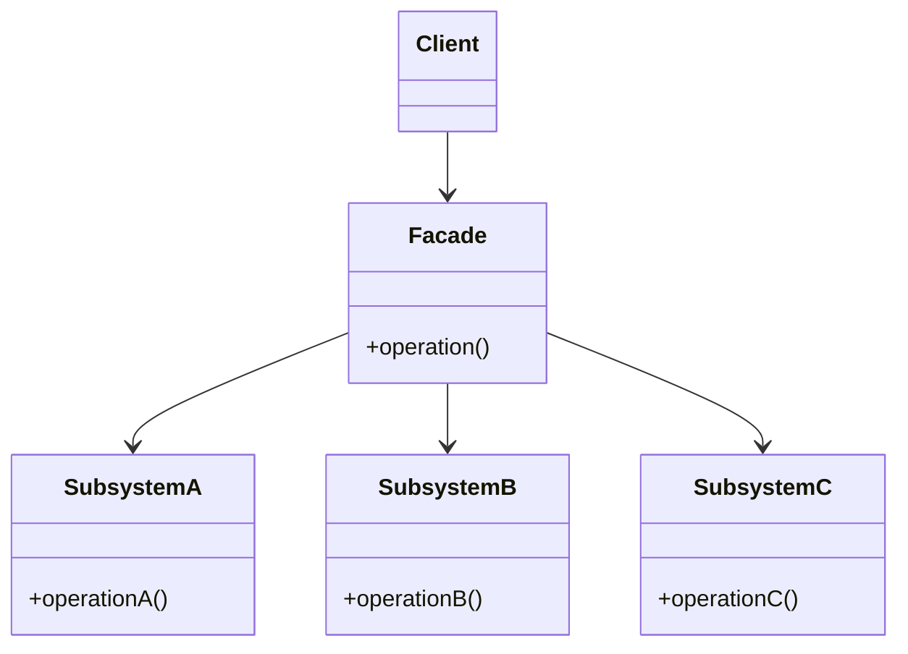
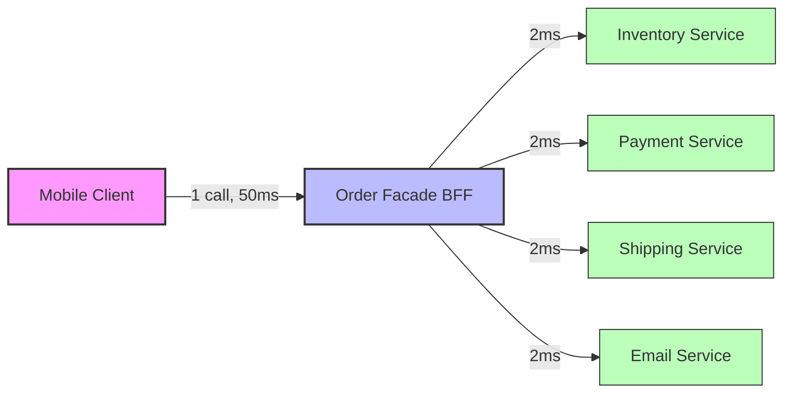

# Facade Pattern - Theory

## 📚 Core Concept

The Facade pattern is a structural design pattern that provides a simplified interface to a library, a framework, or any other complex set of classes. 

A facade is a class that provides a simple interface to a complex subsystem which contains dozens of features. A facade might provide limited functionality in comparison to working with the subsystem directly. However, it includes only those features that clients really care about.

### Key Components

1. **Facade**: Provides convenient access to a particular part of the subsystem's functionality. It knows where to direct the client's request and how to operate all the moving parts.
2. **Additional Facades (Optional)**: Can be created to prevent polluting a single facade with unrelated features that might make it yet another complex structure.
3. **Complex Subsystem**: Consists of dozens of various objects. To make them all do something meaningful, you have to dive deep into the subsystem's implementation details, such as initializing objects in the correct order and supplying them with data in the proper format.
4. **Client**: Uses the facade instead of calling the subsystem objects directly.



## 🎯 Problem

Imagine that you must make your code work with a broad set of objects that belong to a sophisticated library or framework. Ordinarily, you'd need to initialize all of those objects, keep track of dependencies, execute methods in the right order, and so on.

As a result, the business logic of your classes would become tightly coupled to the implementation details of third-party classes, making it hard to comprehend and maintain.

For example, uploading a video to YouTube requires encoding, adding audio, compressing, connecting to the API, authenticating, and finally uploading. A client that just wants to say `upload(videoFile)` would have to manage all of that complex logic directly.

## 💡 Solution

A facade is a simple class that provides an interface to a complex subsystem. It hides the complexity of the subsystem and provides a simpler interface to the client.

1. Create a `Facade` class.
2. The `Facade` class provides simple methods for common use cases.
3. It delegates the complex tasks to the appropriate subsystem classes.
4. The client interacts only with the `Facade`, remaining decoupled from the subsystem's complexity.

```java
// Subsystem classes
class VideoFile { /* ... */ }
class OggCompressionCodec { /* ... */ }
class MPEG4CompressionCodec { /* ... */ }
class CodecFactory { /* ... */ }
class BitrateReader { /* ... */ }
class AudioMixer { /* ... */ }

// Facade
class VideoConverter {
    public File convertVideo(String fileName, String format) {
        VideoFile file = new VideoFile(fileName);
        // ... hides 20 lines of complex initialization and conversion logic
        // ... BitrateReader.read(), AudioMixer.mix(), etc.
        return new File(fileName + "." + format);
    }
}

// Client
class Application {
    void main() {
        VideoConverter converter = new VideoConverter();
        File mp4 = converter.convertVideo("funny-cats.ogg", "mp4");
    }
}
```

## 📈 Worked Numeric Example

Consider an e-commerce checkout process. A checkout involves Inventory (check stock, reserve), Payment (validate card, charge), and Shipping (calculate rates, create label).

**Without Facade (Client manages orchestration):**
The client app (e.g., mobile app) must make 5 separate network calls to microservices.
Assuming average latency of 50ms per network hop.
Total Latency = 5 * 50ms = 250ms just for network transit.
Failure Probability: If each call has a 99% success rate, the probability of the checkout succeeding is `0.99^5 = ~95.1%`.

**With Facade (API Gateway/BFF approach):**
We introduce an `OrderFacade` on the backend. The mobile app makes 1 network call to the Facade.
Network Latency = 1 * 50ms = 50ms.
Internal backend network hops are much faster (e.g., 2ms each on the same VPC). Total internal latency = 5 * 2ms = 10ms.
Total Latency = 50ms + 10ms = 60ms (A massive 4x improvement).
Furthermore, the Facade can implement automatic retries for the sub-calls. If it retries failed internal calls transparently, the success rate for the single client call approaches `~99.9%`.



## 🎤 Interview Q&A

### Junior Level

### Q1: What is the main goal of the Facade pattern?
**A:** The main goal is to provide a simplified, higher-level interface to a complex subsystem, making it easier for clients to use while decoupling them from the subsystem's internal details.

### Q2: Does the Facade prevent clients from accessing the subsystem directly?
**A:** No, it doesn't. A Facade provides a simplified interface for common tasks, but it does not encapsulate or hide the subsystem classes completely. Power users who need fine-grained control can still bypass the Facade and use the subsystem classes directly.

### Mid Level

### Q3: When would you NOT use a Facade?
**A:** You should avoid it when:
- The subsystem is already simple and easy to use.
- The client absolutely needs fine-grained control over all aspects of the subsystem.
- The Facade would just be a dumb pass-through layer that adds no value (no simplification or orchestration).
- The performance overhead of an extra indirection layer matters (rare, but possible).

### Q4: Facade vs Adapter?
**A:** 
| Facade | Adapter |
|--------|---------|
| Simplifies a complex interface | Changes an existing interface into another |
| Usually wraps multiple classes | Usually wraps a single class |
| Defined before or during subsystem creation | Often created after to fix incompatibility |

### Q5: Can a Facade be harmful?
**A:** Yes, the primary risk is that the Facade can become a "God Object" coupled to every single class of an app. If a Facade gets too large and does too many things, it violates the Single Responsibility Principle.

### Senior Level

### Q6: How do you prevent a Facade from becoming a God Object?
**A:** If a Facade gets too large, you should split it into multiple, smaller, more cohesive Facades. For example, instead of a single `SystemFacade`, you might have a `BillingFacade` and a `ShippingFacade`. You can also ensure the Facade only does orchestration and delegates all actual business logic to the underlying subsystem.

### Q7: How does Facade relate to the API Gateway pattern in microservices?
**A:** An API Gateway is essentially the Facade pattern applied at the distributed system level (Network/Architecture level). Like a class-level Facade, an API Gateway provides a single, unified entry point for clients, hiding the complexity of the underlying microservices (routing, aggregation, authentication) and reducing client-to-service chatter.

### Staff Level

### Q8: How would you use a Facade to migrate a monolithic legacy system to microservices?
**A:** This is the core of the **Strangler Fig Pattern**.
1. We put a Facade in front of the legacy monolith's internal APIs. All clients now talk to the Facade.
2. We extract a small piece of functionality (e.g., Billing) from the monolith into a new microservice.
3. We update the Facade to route Billing requests to the new microservice, while routing everything else to the monolith.
4. Clients are unaware of the change.
5. We repeat this process, strangling the monolith, until all requests go to microservices and the monolith can be decommissioned. The Facade provides the necessary abstraction to do this safely and transparently.

---

[← Back to Facade](./README.md)

---

## Interview Lens

- Use when clients need a simple entry point into a complex subsystem.
- Keep Facade thin; avoid turning it into a god object.
- Mention that advanced callers can still access subsystem internals when required.

## Additional Details

The Facade pattern is one of the most frequently used patterns, even if developers don't explicitly know its name. Any time you create a helper class or a wrapper service to bundle up a series of complex operations, you are likely implementing a Facade.

It plays a critical role in layered architectures. In a standard n-tier application, the Service layer often acts as a Facade over the Data Access (Repository) layer. The Controllers (Web layer) don't need to know how to coordinate multiple repositories to complete a transaction; they just call a single method on the Service Facade, which handles the transaction boundaries and repository orchestration.

Another significant benefit of the Facade is improved compilation times in languages like C++. By keeping the client code decoupled from the complex subsystem headers, a change in the subsystem only requires recompiling the Facade and the subsystem itself, not the myriad of clients that depend on the Facade.

Furthermore, Facades are excellent tools for defining explicit boundaries between different bounded contexts in Domain-Driven Design (DDD). If the Shipping context needs to talk to the Inventory context, it shouldn't reach directly into the Inventory's internal models. Instead, the Inventory context should expose a Facade that provides exactly the methods Shipping needs, enforcing loose coupling.

One crucial aspect to remember is that a Facade should ideally be an interface itself, with a concrete implementation. This allows you to easily swap out the entire underlying subsystem with a different one (or a mock for testing) without affecting the clients.

In summary, use the Facade pattern whenever you find your code getting bogged down by the setup and orchestration of many lower-level objects. It is the ultimate tool for pushing complexity down the stack and keeping the higher levels of your application clean and expressive.

Be mindful that as a system evolves, a Facade might need to evolve with it. If the underlying subsystem gains massive new capabilities, the Facade shouldn't necessarily expose all of them—only those that align with the specific use case the Facade was designed for.

If a new use case arises that requires a completely different view of the subsystem, it's often better to create a second, parallel Facade rather than bloating the first one.

Ultimately, the test of a good Facade is whether it makes the client code significantly shorter, more readable, and less prone to errors related to improper subsystem usage.

The balance is between simplicity and flexibility; the Facade favors simplicity.


