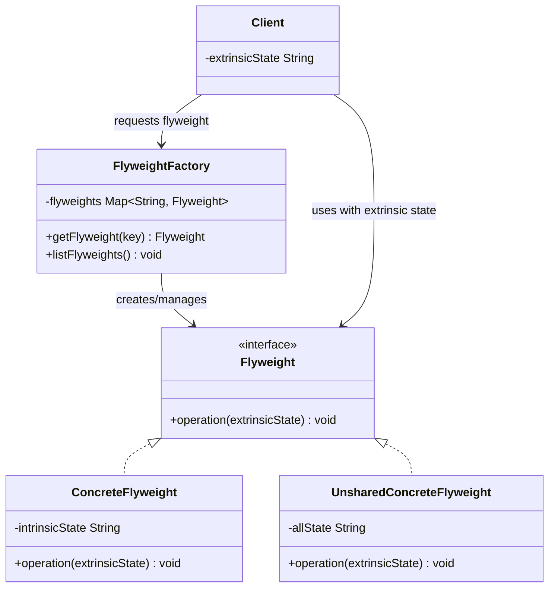

# Flyweight Pattern

The Flyweight pattern shares common state among multiple objects to minimize memory usage.

---

## 📖 Overview

| Aspect | Description |
|--------|-------------|
| **Type** | Structural |
| **Intent** | Use sharing to support large numbers of fine-grained objects |
| **Problem** | Too many similar objects consuming memory |
| **Solution** | Share intrinsic (immutable) state; pass extrinsic state |

---

## 📊 Class Diagram



**Key Points:**
- **Intrinsic state**: Shared, immutable data stored in flyweight (e.g., character font)
- **Extrinsic state**: Context-specific data passed by client (e.g., position)
- **FlyweightFactory** ensures flyweights are shared properly
- **UnsharedConcreteFlyweight** for cases where sharing isn't possible

---

## 🏗️ Structure

```
┌─────────────────┐
│     Client      │
└────────┬────────┘
         │ uses
         ▼
┌─────────────────┐        ┌─────────────────┐
│FlyweightFactory │───────▶│    Flyweight    │
│ - flyweights{}  │creates │ (shared state)  │
│ +getFlyweight() │        └────────┬────────┘
└─────────────────┘                 │
                           ┌────────┴────────┐
                    ┌──────┴──────┐   ┌──────┴──────┐
                    │ConcreteFly1 │   │ConcreteFly2 │
                    │ -intrinsic  │   │ -intrinsic  │
                    └─────────────┘   └─────────────┘

Note: Extrinsic state passed as parameter to operations
```

---

## 🎯 Key Concepts

| Type | Description | Example |
|------|-------------|---------|
| **Intrinsic** | Shared, immutable state | Character font, tree type |
| **Extrinsic** | Per-instance, context-dependent | Position, scale |

---

## 📁 Implementations

| Version | Description | Java | Python | Key Learning |
|---------|-------------|------|--------|--------------|
| v1-basic | Tree forest | [Java](./java/v1-basic/) | [Python](./python/v1-basic/) | Split shared tree type from per-tree coordinates |
| v2-variant | Text editor glyphs | [Java](./java/v2-variant/) | [Python](./python/v2-variant/) | Reuse immutable font/style state across many characters |
| v3-advanced | Icon system | [Java](./java/v3-advanced/) | [Python](./python/v3-advanced/) | Share loaded UI assets while keeping placement and state extrinsic |

Tests: [Java](./java/tests/) / [Python](./python/tests/)

### Version Progression

- **v1-basic:** introduces the canonical forest example: `TreeType` stores intrinsic name/color/texture, while each `Tree` keeps coordinates as extrinsic state.
- **v2-variant:** moves the same split into a text editor, where many glyphs share a small pool of immutable `CharacterStyle` instances.
- **v3-advanced:** applies Flyweight to UI resources, sharing icon assets while each toolbar button owns size, tint, position, and enabled state.

---

## 🎯 When to Use

1. **Large number of similar objects**
2. **Most state can be made extrinsic**
3. **Objects can be replaced by fewer shared ones**
4. **Application doesn't depend on object identity**

---

## 📚 Real-World Examples

- Java String interning
- Font characters in text editors
- Game particles and trees
- Icon/image caching
