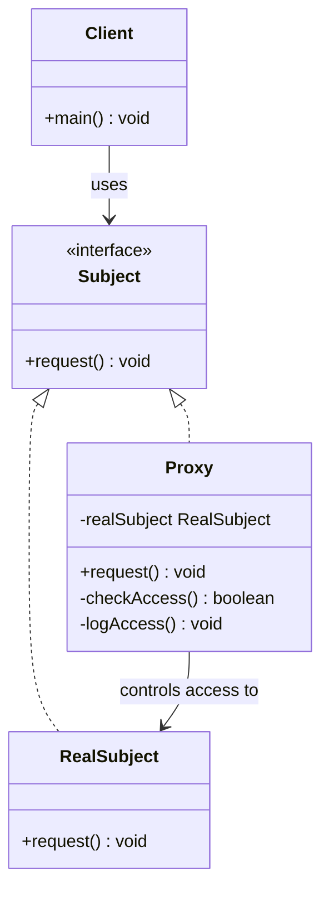

# Proxy Pattern

The Proxy pattern provides a surrogate or placeholder for another object to control access to it.

---

## 📖 Overview

| Aspect | Description |
|--------|-------------|
| **Type** | Structural |
| **Intent** | Provide a substitute to control access to another object |
| **Problem** | Need to control access without changing the object |
| **Solution** | Create a proxy with same interface that controls access |

---

## 📊 Class Diagram



**Key Points:**
- **Subject** defines the common interface for RealSubject and Proxy
- **RealSubject** is the real object that does the actual work
- **Proxy** controls access to RealSubject (lazy loading, access control, logging, caching)
- Client uses Subject interface, unaware whether it's using Proxy or RealSubject

---

## 🎯 Types of Proxies

| Type | Purpose | Example |
|------|---------|---------|
| **Virtual** | Lazy loading of expensive objects | Image loading on scroll |
| **Protection** | Access control | Role-based permissions |
| **Remote** | Network communication | RPC, REST clients |
| **Caching** | Cache results | Database query cache |
| **Logging** | Track operations | Method call logging |

---

## 🏗️ Structure

```
┌─────────────────┐
│     Subject     │◄──────────────────────┐
│   (Interface)   │                       │
└────────┬────────┘                       │
         │                                │
    implements                            │
    ┌────┴─────┐                          │
    │          │                          │
┌───┴───┐  ┌───┴────────────┐             │
│ Real  │  │     Proxy      │─────────────┘
│Subject│◄─│ - realSubject  │ controls access
└───────┘  │ + request()    │
           └────────────────┘
```

---

## 📁 Implementations

| Version | Java | Python | Description | Key Learning |
|---------|------|--------|-------------|--------------|
| v1-basic | [Java](./java/v1-basic/) | [Python](./python/v1-basic/) | Virtual proxy for images | Lazy loading |
| v2-variant | [Java](./java/v2-variant/) | [Python](./python/v2-variant/) | Protection proxy | Access control |
| v3-advanced | [Java](./java/v3-advanced/) | [Python](./python/v3-advanced/) | Caching proxy | Smart reference |

---

## ⚖️ Proxy vs Decorator

| Proxy | Decorator |
|-------|-----------|
| Controls access | Adds behavior |
| Same interface | Same interface |
| Client may not know | Client knows decorators |
| Single relationship | Stackable |

---

## 📚 Real-World Examples

- Spring `@Transactional` (transaction proxy)
- Hibernate lazy loading
- Java RMI stubs
- JavaScript Proxy object
