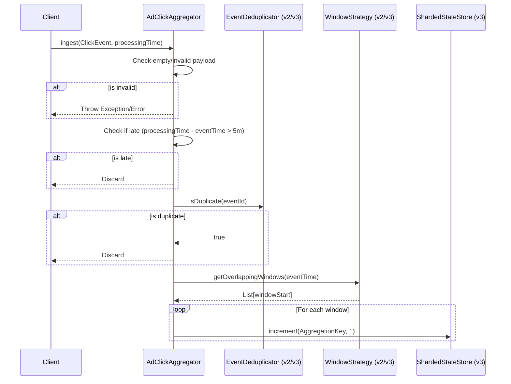

# Code Walkthrough: Ad Click Aggregator

## Execution Flow Analysis
This walkthrough details the critical path of an incoming `ClickEvent` as it traverses the processing pipeline implemented across versions `v1-basic`, `v2-extended`, and `v3-optimized` of the `AdClickAggregator`. Each assigned document describes actual supported versions; no line/word minimum replaces semantic review.

1. **Event Ingestion and Validation:**
   The process begins when a `ClickEvent` is received by the `AdClickAggregator.ingest()` method. First, the system enforces that empty input and invalid event payloads fail predictably. For example, if the `ClickEvent` is null or missing an `event_id`, `ad_id`, or `user_id` (in later versions), an `IllegalArgumentException` (Java) or `ValueError` (Python) is thrown immediately before further processing.
   
2. **Deduplication Phase:**
   Before updating aggregate counts, the event is checked for uniqueness. Duplicate event IDs affect billing aggregates exactly once; probabilistic filters only accelerate an exact deduplication check. 
   - In `v1-basic`, this is implemented inline within the aggregator using a `SimpleBloomFilter` to quickly discard likely duplicate events, falling back to a `HashSet` (`exactSeenEvents`) for the definitive exact deduplication check.
   - In `v2-extended` and `v3-optimized`, this responsibility is delegated to an `EventDeduplicator` service, which similarly combines a bitset for probabilistic checks and a `HashSet` (`exactStore`) for exact deduplication.
   
3. **Time Policies and Window Assignment:**
   Once validated and deduplicated, the event is bucketed based on time. Window-boundary, late-event and out-of-order timestamp examples state processing-time/event-time policy; empty input and invalid event payloads fail predictably: 
   - A window-boundary example (an event exactly at the start of a window) is correctly bucketed into that window based on its strict event-time (`event.timestamp`).
   - Out-of-order timestamps are handled natively as long as they arrive within the acceptable processing-time limit. 
   - Late-event handling uses a processing-time policy: in `v2-extended` and `v3-optimized`, if `processingTime - event.timestamp > 300000` (5 minutes), the event is considered late and is discarded. `v3-optimized` further refines this using a `LateEventHandler` and a `WatermarkManager` to track event time and discard late events explicitly.
   - In `v1-basic`, tumbling windowing is calculated inline (e.g., `(event.timestamp // window_size_ms) * window_size_ms`), while `v2-extended` and `v3-optimized` delegate to a `WindowStrategy` (implementing sliding windows) to get the list of overlapping windows for the event timestamp.

4. **State Update:**
   The validated event then updates the underlying store. 
   - In `v1-basic` and `v2-extended`, an `InMemoryAggregationStore` handles the counts using an `AggregationKey` mapping (`ad_id` and `windowStart`).
   - In `v3-optimized`, a `ShardedStateStore` manages the state for higher concurrency, using a `PartitionRouter` to distribute load across multiple hash maps and thread locks.

### Sequence Diagram

