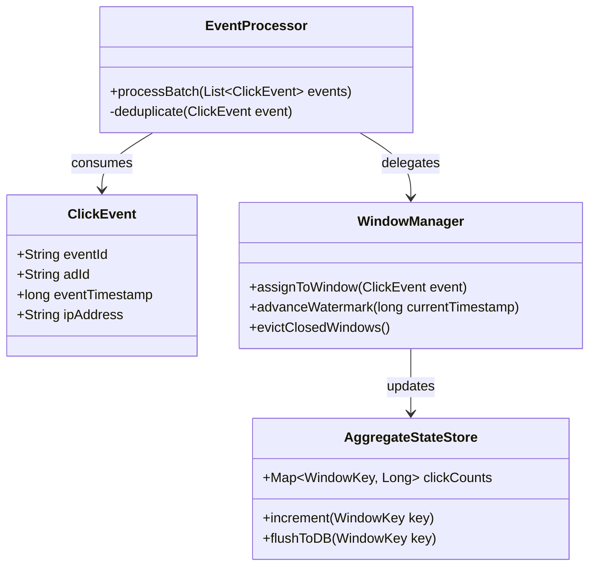

# Design Document: Ad Click Aggregator

## Supported Versions
- **v1-basic:** A single-node in-memory event aggregator with tumbling windows and simple deduplication.
- **v2-extended:** Introduces deduplication caches, a flush policy for handling late events, and fraud rules for basic filtering.
- **v3-optimized:** A distributed, sharded state store with compaction scheduling, snapshot replay, and robust watermark management for high-throughput stream processing.

## System Architecture
The system is designed as a distributed, decoupled pipeline consisting of ingestion, processing, and storage tiers. This modularity allows us to scale each tier independently based on its specific resource bottleneck (e.g., scaling ingestion for network I/O, scaling processing for CPU and memory).

### Core Components
1. **API Gateway / Ingestion Tier:** The edge nodes receive HTTP requests containing click payloads. They perform lightweight validation, append server-side timestamps, and immediately push the raw events to a partitioned Kafka topic. The gateway also ensures that empty input and invalid event payloads fail predictably by immediately returning HTTP 400 Bad Request responses.
2. **Stream Processing Fleet:** A cluster of stateless worker nodes that consume from Kafka. Each node is responsible for specific partitions, ensuring that all events for a given `ad_id` route to the same physical machine. This enables localized, lock-free in-memory aggregation.
3. **Distributed Cache (Redis) and Probabilistic Filters:** Utilized primarily for exact deduplication. Duplicate event IDs affect billing aggregates exactly once; probabilistic filters only accelerate an exact deduplication check. Only if the Bloom Filter indicates a possible match does the system consult the exact Redis cache, storing recently seen `event_id`s with a TTL corresponding to the maximum allowed late-arrival window.
4. **Time-Series Database (TSDB):** The final storage destination for aggregated metrics. Systems like Apache Druid or ClickHouse are preferred here, as they are optimized for rapid ingestion of time-bucketed data and sub-second analytical queries.

### Mermaid Class Diagram

## Data Model and Schema
The raw event schema in Kafka is highly normalized and minimal:
`{ "event_id": "uuid", "ad_id": "string", "timestamp": "long", "user_agent": "string" }`

The aggregated schema stored in the TSDB is denormalized for fast reads:
- `window_start_time` (Timestamp, Indexed)
- `ad_id` (String, Indexed)
- `campaign_id` (String, Indexed)
- `total_clicks` (Long)
- `unique_users` (HyperLogLog Binary, Optional for advanced counting)

## Trade-offs and Considerations
- **Exactly-Once vs. At-Least-Once Delivery:** Guaranteeing exactly-once processing adds significant complexity and latency overhead, requiring two-phase commits between the processor and the TSDB. For some non-critical analytics, at-least-once is acceptable. However, for billing, exactly-once is required, necessitating idempotent writes to the TSDB or transactional updates.
- **In-Memory vs. Disk-Backed State:** Holding window state entirely in RAM is the fastest approach but makes the system vulnerable to out-of-memory errors during massive traffic spikes. We trade some raw speed for stability by backing the in-memory state with an embedded disk store (like RocksDB), allowing state size to exceed available RAM while maintaining reasonable performance.
- **Time Policies:** The system defines a clear 1-minute tumbling time window using *event-time* for correctness. Window-boundary, late-event and out-of-order timestamp examples state processing-time/event-time policy; empty input and invalid event payloads fail predictably. For example, an event exactly at `10:01:00.000` (window-boundary) is bucketed strictly into the `10:01-10:02` window based on its event-time. *Processing-time* is only used for the 5-minute heuristic watermarks to govern when late-event windows are flushed. For out-of-order timestamps, an event with an event-time of `10:01:30` arriving at a processing-time of `10:04:00` is correctly accepted into the `10:01` bucket. However, as a late-event, if that same event arrives at a processing-time of `10:08:00`, it is discarded because it exceeds the 5-minute processing-time watermark. Additionally, empty input and invalid event payloads fail predictably during the initial ingestion phase, returning immediate HTTP 400 Bad Request errors.
