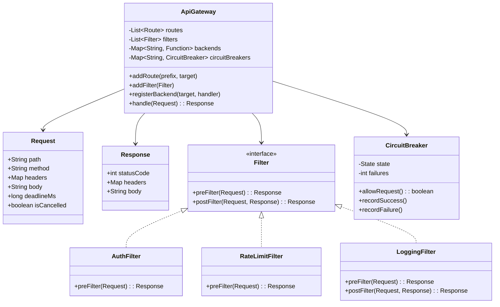

# Design: API Gateway

## Architecture Overview

The API Gateway intercepts client requests, passes them through a filter chain, matches the route, checks the circuit breaker, and dispatches the request to the appropriate backend service.

## Request Flow

1. **Client Request:** The gateway receives an incoming `Request` object (verifying bounded request body).
2. **Pre-Filters:** The request passes through all registered pre-filters sequentially.
   - **Exact Filter Order:** Authentication precedes protected routing.
   - If a filter (like `AuthFilter` or `RateLimitFilter`) fails the request, it short-circuits, returning a `Response` immediately and skipping routing and backend processing.
3. **Routing:** The request path is matched against registered routes. If no match is found (invalid route), a 404 is returned.
4. **Circuit Breaker Check:** The gateway consults the `CircuitBreaker` for the target backend. If `OPEN`, it returns a 503 immediately.
5. **Dispatching:** The request is passed to the backend handler with deadline propagation and checks for downstream cancellation. Duplicate retry eligibility is evaluated if failures occur.
6. **Backend Response:** The gateway receives the response (or catches an exception) and updates the `CircuitBreaker` accordingly.
7. **Post-Filters:** The response passes back through the filter chain in reverse order (e.g., `LoggingFilter` calculates duration and logs).
8. **Client Response:** The final `Response` object is returned to the client.

## State Management

- **Rate Limiting:** Managed per client ID using a sliding window algorithm, tracking request timestamps. Thread safety is achieved using locks.
- **Circuit Breaker:** State transitions (`CLOSED` -> `OPEN` -> `HALF_OPEN` -> `CLOSED`) are managed atomically, ensuring concurrent requests respect the failure thresholds and reset timeouts safely.

## Version-Specific APIs & Deterministic Fixtures

- **v1-basic:** Focuses on synchronous routing, exact filter order (auth before routing), and bounded bodies. Fixture inputs demonstrate successful downstream calls and short-circuit rejection (e.g., 401 Unauthorized for missing tokens).
- **v2-extended:** Adds rate limiting, logging post-filters, and duplicate retry eligibility testing using deterministic fake request inputs.
- **v3-optimized:** Introduces thread-safe circuit breakers, deadline propagation, and downstream cancellation, tested purely with mock/offline fixture states (no live servers).
