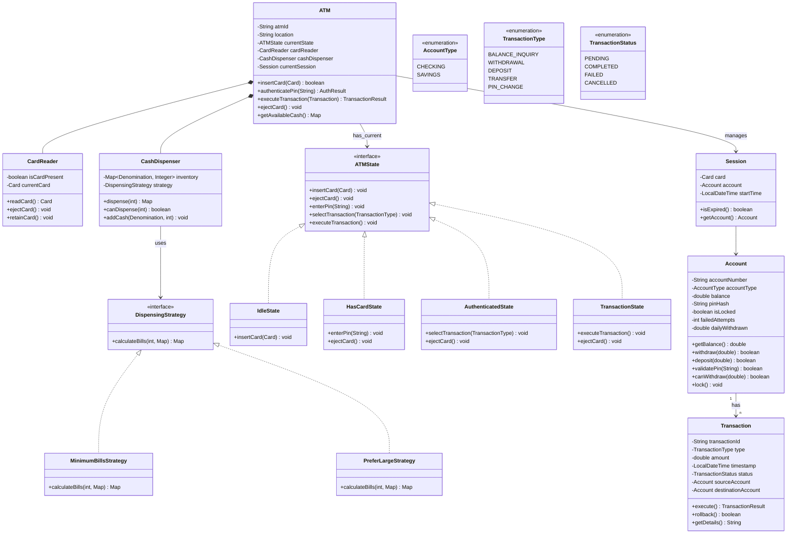
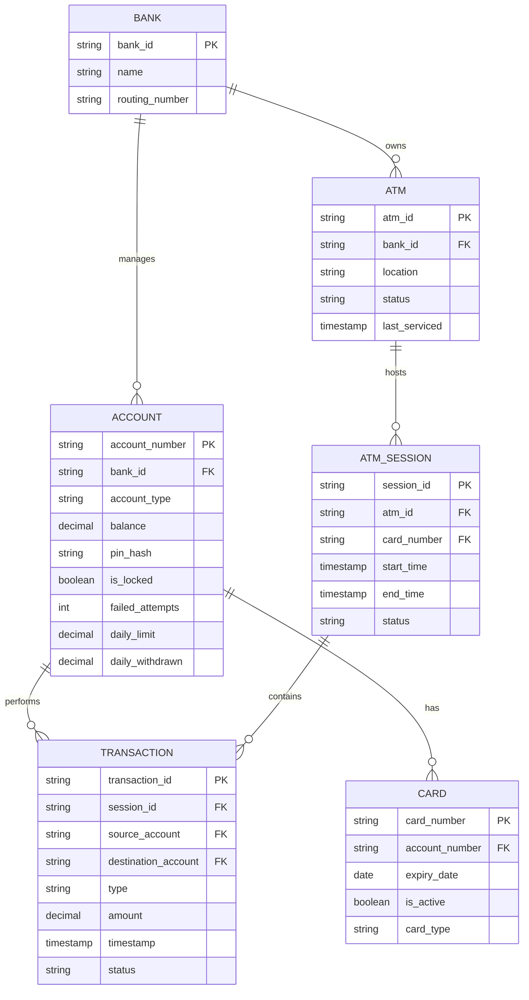

# Design for ATM System

## Mermaid Class Diagram



## Entity-Relationship Diagram



**Schema Notes:**
- `ACCOUNT` stores balance and PIN hash with security fields
- `ATM_SESSION` tracks each card insertion session
- `TRANSACTION` logs all operations with rollback support
- Daily limits tracked in `ACCOUNT` for withdrawal restrictions

---

## Class Diagram

```
┌─────────────────────────────────────────────────────────────────────────────┐
│                              ATM SYSTEM                                      │
└─────────────────────────────────────────────────────────────────────────────┘

┌─────────────────┐     ┌─────────────────┐     ┌─────────────────┐
│   <<enum>>      │     │   <<enum>>      │     │   <<enum>>      │
│ AccountType     │     │ TransactionType │     │ TransactionStatus│
├─────────────────┤     ├─────────────────┤     ├─────────────────┤
│ CHECKING        │     │ BALANCE_INQUIRY │     │ PENDING          │
│ SAVINGS         │     │ WITHDRAWAL      │     │ COMPLETED        │
└─────────────────┘     │ DEPOSIT         │     │ FAILED           │
                        │ TRANSFER        │     │ CANCELLED        │
                        │ PIN_CHANGE      │     └─────────────────┘
                        └─────────────────┘

┌───────────────────────────────────────────────────────────────────────┐
│                                 ATM                                    │
├───────────────────────────────────────────────────────────────────────┤
│ - atmId: String                                                        │
│ - location: String                                                     │
│ - currentState: ATMState                                               │
│ - cardReader: CardReader                                               │
│ - cashDispenser: CashDispenser                                         │
│ - currentSession: Session                                              │
├───────────────────────────────────────────────────────────────────────┤
│ + insertCard(card: Card): boolean                                      │
│ + authenticatePin(pin: String): AuthResult                             │
│ + executeTransaction(transaction: Transaction): TransactionResult      │
│ + ejectCard(): void                                                    │
│ + getAvailableCash(): Map<Denomination, Integer>                       │
└───────────────────────────────────────────────────────────────────────┘
          │                    │                    │
          │ contains           │ contains           │ has
          ▼                    ▼                    ▼
┌─────────────────┐  ┌─────────────────┐  ┌─────────────────┐
│   CardReader    │  │  CashDispenser  │  │     Session     │
├─────────────────┤  ├─────────────────┤  ├─────────────────┤
│ - isCardPresent │  │ - inventory     │  │ - card: Card    │
│ - currentCard   │  │ - strategy      │  │ - account       │
├─────────────────┤  ├─────────────────┤  │ - startTime     │
│ + readCard()    │  │ + dispense()    │  ├─────────────────┤
│ + ejectCard()   │  │ + canDispense() │  │ + isExpired()   │
│ + retainCard()  │  │ + addCash()     │  │ + getAccount()  │
└─────────────────┘  └─────────────────┘  └─────────────────┘

┌───────────────────────────────────────────────────────────────────────┐
│                               Account                                  │
├───────────────────────────────────────────────────────────────────────┤
│ - accountNumber: String                                                │
│ - accountType: AccountType                                             │
│ - balance: double                                                      │
│ - pinHash: String                                                      │
│ - isLocked: boolean                                                    │
│ - failedAttempts: int                                                  │
│ - dailyWithdrawn: double                                               │
├───────────────────────────────────────────────────────────────────────┤
│ + getBalance(): double                                                 │
│ + withdraw(amount: double): boolean                                    │
│ + deposit(amount: double): boolean                                     │
│ + validatePin(pin: String): boolean                                    │
│ + canWithdraw(amount: double): boolean                                 │
│ + lock(): void                                                         │
└───────────────────────────────────────────────────────────────────────┘
                              │
                              │ has many
                              ▼
┌───────────────────────────────────────────────────────────────────────┐
│                             Transaction                                │
├───────────────────────────────────────────────────────────────────────┤
│ - transactionId: String                                                │
│ - type: TransactionType                                                │
│ - amount: double                                                       │
│ - timestamp: LocalDateTime                                             │
│ - status: TransactionStatus                                            │
│ - sourceAccount: Account                                               │
│ - destinationAccount: Account (for transfers)                          │
├───────────────────────────────────────────────────────────────────────┤
│ + execute(): TransactionResult                                         │
│ + rollback(): boolean                                                  │
│ + getDetails(): String                                                 │
└───────────────────────────────────────────────────────────────────────┘

┌───────────────────────────────────────────────────────────────────────┐
│                        <<interface>> ATMState                          │
├───────────────────────────────────────────────────────────────────────┤
│ + insertCard(card: Card): void                                         │
│ + ejectCard(): void                                                    │
│ + enterPin(pin: String): void                                          │
│ + selectTransaction(type: TransactionType): void                       │
│ + executeTransaction(): void                                           │
└───────────────────────────────────────────────────────────────────────┘
          △
          │ implements
          │
    ┌─────┴─────┬─────────────┬─────────────┐
    │           │             │             │
┌───────────┐ ┌───────────┐ ┌───────────┐ ┌───────────┐
│ IdleState │ │HasCardState│ │Authenticated│ │Transaction│
│           │ │           │ │   State     │ │   State   │
└───────────┘ └───────────┘ └───────────┘ └───────────┘

┌───────────────────────────────────────────────────────────────────────┐
│                  <<interface>> DispensingStrategy                      │
├───────────────────────────────────────────────────────────────────────┤
│ + calculateBills(amount: int, inventory: Map): Map<Denomination, Int>  │
└───────────────────────────────────────────────────────────────────────┘
          △
          │ implements
          │
    ┌─────┴─────────────────┐
    │                       │
┌───────────────────┐ ┌───────────────────┐
│ MinimumBills      │ │ PreferLarge       │
│ Strategy          │ │ Strategy          │
└───────────────────┘ └───────────────────┘
```

## Core Classes

### ATM
- **Attributes**: atmId, location, currentState, cardReader, cashDispenser, currentSession
- **Methods**: insertCard(), authenticatePin(), executeTransaction(), ejectCard()
- **Patterns Used**: State Pattern (manages ATM states)

### Account
- **Attributes**: accountNumber, accountType, balance, pinHash, isLocked, failedAttempts
- **Methods**: getBalance(), withdraw(), deposit(), validatePin(), canWithdraw()
- **Patterns Used**: None (core domain entity)

### Transaction
- **Attributes**: transactionId, type, amount, timestamp, status, sourceAccount, destinationAccount
- **Methods**: execute(), rollback(), getDetails()
- **Patterns Used**: Command Pattern (each transaction is a command)

### CashDispenser
- **Attributes**: inventory (Map<Denomination, Integer>), strategy (DispensingStrategy)
- **Methods**: dispense(), canDispense(), addCash()
- **Patterns Used**: Strategy Pattern (pluggable dispensing algorithms)

### ATMState (Interface)
- **Implementations**: IdleState, HasCardState, AuthenticatedState, TransactionState
- **Methods**: insertCard(), ejectCard(), enterPin(), selectTransaction()
- **Patterns Used**: State Pattern

## Key Design Decisions

### 1. State Pattern for ATM States
**Decision**: Use State pattern to manage ATM lifecycle
**Rationale**: 
- Clear separation of behavior based on ATM state
- Easy to add new states (e.g., MaintenanceState)
- Prevents invalid operations (can't withdraw without card)
**Trade-off**: More classes, but cleaner code

### 2. Command Pattern for Transactions
**Decision**: Each transaction type is a Command object
**Rationale**:
- Encapsulates transaction logic
- Supports transaction history and rollback
- Easy to add new transaction types
**Trade-off**: Slight overhead for simple operations

### 3. Strategy Pattern for Cash Dispensing
**Decision**: Pluggable algorithm for bill calculation
**Rationale**:
- Different ATMs may have different policies
- Easy to optimize or change algorithm
**Trade-off**: Extra abstraction layer

### 4. PIN Hashing
**Decision**: Store PIN as hash, not plain text
**Rationale**: Security best practice
**Trade-off**: Cannot recover PIN, only reset

### 5. Daily Limit Tracking
**Decision**: Track daily withdrawals per account
**Rationale**: Bank policy compliance
**Trade-off**: Need to reset at midnight (timezone consideration)

## Sequence Diagrams

### Withdrawal Flow
```
User        ATM         State       Account     CashDispenser
 │           │            │            │              │
 │ insertCard│            │            │              │
 │──────────>│            │            │              │
 │           │ insertCard │            │              │
 │           │───────────>│            │              │
 │           │            │ setState   │              │
 │           │            │ (HasCard)  │              │
 │           │            │            │              │
 │ enterPIN  │            │            │              │
 │──────────>│ enterPIN   │            │              │
 │           │───────────>│ validatePin│              │
 │           │            │───────────>│              │
 │           │            │   valid    │              │
 │           │            │<───────────│              │
 │           │ setState   │            │              │
 │           │ (Auth)     │            │              │
 │           │            │            │              │
 │ withdraw  │            │            │              │
 │ $200      │            │            │              │
 │──────────>│ withdraw   │ canWithdraw│              │
 │           │───────────>│───────────>│              │
 │           │            │   true     │ canDispense? │
 │           │            │<───────────│──────────────>
 │           │            │            │    true      │
 │           │            │ withdraw   │<─────────────│
 │           │            │───────────>│   dispense   │
 │           │            │   success  │──────────────>
 │           │<───────────│            │    bills     │
 │  cash     │            │            │              │
 │<──────────│            │            │              │
```

## Complexity Analysis

### Time Complexity
| Operation | Complexity | Notes |
|-----------|------------|-------|
| Balance Inquiry | O(1) | Direct account access |
| Withdrawal | O(D) | D = number of denominations |
| Deposit | O(1) | Simple balance update |
| Transfer | O(1) | Two balance updates |
| Transaction History | O(N) | N = number of transactions |
| PIN Validation | O(1) | Hash comparison |

### Space Complexity
| Component | Complexity | Notes |
|-----------|------------|-------|
| Account | O(T) | T = transaction history size |
| CashDispenser | O(D) | D = denomination types |
| Session | O(1) | Fixed session data |
| Transaction Log | O(N) | N = total transactions |

## Error Handling

### Exception Hierarchy
```
ATMException (base)
├── AuthenticationException
│   ├── InvalidPinException
│   └── CardLockedException
├── TransactionException
│   ├── InsufficientBalanceException
│   ├── InsufficientCashException
│   └── DailyLimitExceededException
├── CardException
│   ├── InvalidCardException
│   └── ExpiredCardException
└── SystemException
    ├── NetworkException
    └── HardwareException
```

## Concurrency Considerations (v3)

### Thread Safety
1. **Account Balance**: Use ReentrantLock for atomic operations
2. **Cash Inventory**: ConcurrentHashMap for thread-safe access
3. **Daily Limit Counter**: AtomicReference for thread-safe updates

### Race Conditions to Handle
1. **Double Withdrawal**: Lock account during transaction
2. **Cash Inventory**: Synchronized dispensing
3. **PIN Attempts**: Atomic increment for failed attempts

```java
// Thread-safe withdrawal
public synchronized boolean withdraw(double amount) {
    if (canWithdraw(amount)) {
        this.balance -= amount;
        this.dailyWithdrawn += amount;
        return true;
    }
    return false;
}
```
