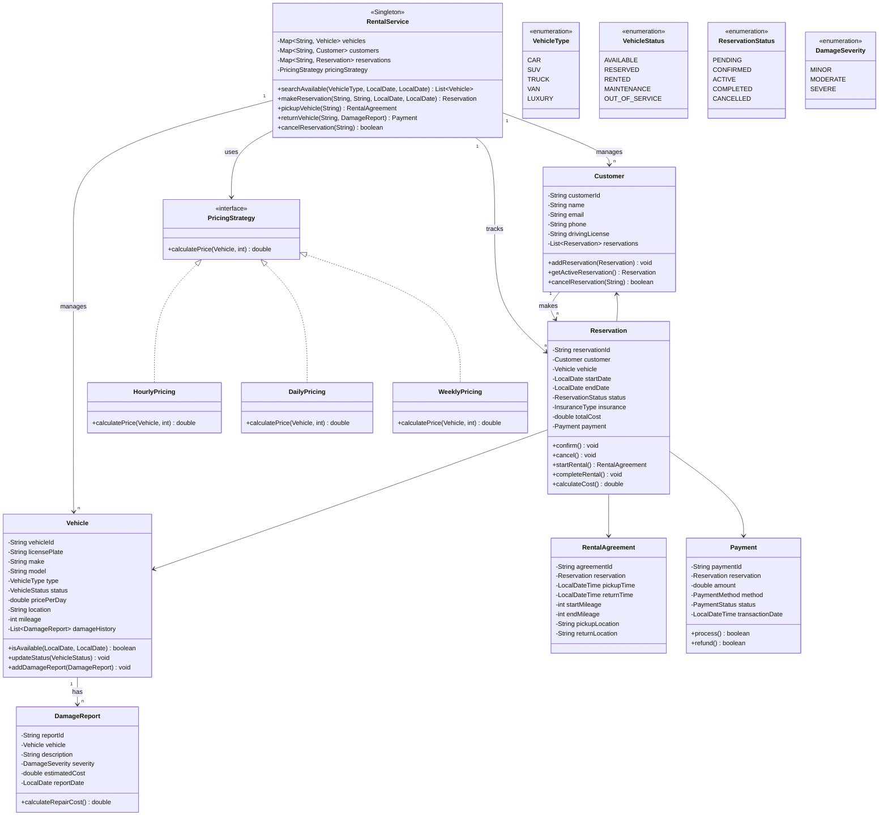
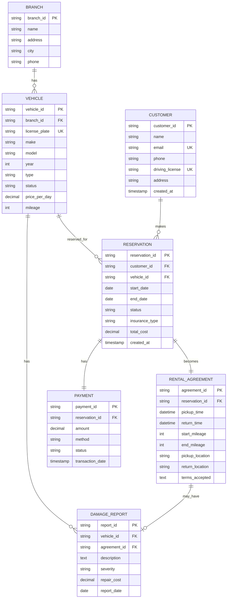

# Design for Car Rental System

## Mermaid Class Diagram



## Entity-Relationship Diagram



**Schema Notes:**
- `BRANCH` supports multi-location rental operations
- `RESERVATION` tracks booking before actual rental
- `RENTAL_AGREEMENT` captures pickup/return details
- `DAMAGE_REPORT` can be linked to specific rental or general vehicle history

---

## Class Diagram

```
┌─────────────────┐     ┌─────────────────┐     ┌─────────────────┐
│    Customer     │     │   Reservation   │     │     Vehicle     │
├─────────────────┤     ├─────────────────┤     ├─────────────────┤
│ - customerId    │     │ - reservationId │     │ - vehicleId     │
│ - name          │1   *│ - startDate     │*   1│ - licensePlate  │
│ - email         │────▶│ - endDate       │────▶│ - make          │
│ - drivingLicense│     │ - status        │     │ - model         │
│ - reservations  │     │ - insurance     │     │ - type          │
└─────────────────┘     │ - totalCost     │     │ - status        │
                        └────────┬────────┘     │ - location      │
                                 │              └────────┬────────┘
                                 │                       │
                        ┌────────▼────────┐     ┌────────▼────────┐
                        │    Payment      │     │  DamageReport   │
                        ├─────────────────┤     ├─────────────────┤
                        │ - paymentId     │     │ - reportId      │
                        │ - amount        │     │ - description   │
                        │ - status        │     │ - severity      │
                        │ - method        │     │ - repairCost    │
                        └─────────────────┘     └─────────────────┘

┌─────────────────────────────────────────────────────────────────┐
│                      PricingStrategy                             │
├─────────────────────────────────────────────────────────────────┤
│ + calculatePrice(vehicle, duration): double                      │
└─────────────────────────────────────────────────────────────────┘
                              △
          ┌───────────────────┼───────────────────┐
          │                   │                   │
┌─────────▼─────────┐ ┌───────▼───────┐ ┌─────────▼─────────┐
│  HourlyPricing    │ │ DailyPricing  │ │  WeeklyPricing    │
├───────────────────┤ ├───────────────┤ ├───────────────────┤
│ + calculatePrice()│ │+ calculatePrice│ │ + calculatePrice()│
└───────────────────┘ └───────────────┘ └───────────────────┘
```

## Core Classes

### Vehicle
- **Attributes**: vehicleId, licensePlate, make, model, type, status, pricePerDay, location, mileage
- **Methods**: isAvailable(startDate, endDate), updateStatus(), addDamageReport()
- **Patterns Used**: Factory pattern for creation

### VehicleType (Enum)
- CAR, SUV, TRUCK, VAN, LUXURY

### VehicleStatus (Enum)
- AVAILABLE, RESERVED, RENTED, MAINTENANCE, OUT_OF_SERVICE

### Customer
- **Attributes**: customerId, name, email, phone, drivingLicense, reservations
- **Methods**: addReservation(), getActiveReservation(), cancelReservation()

### Reservation
- **Attributes**: reservationId, customer, vehicle, startDate, endDate, status, insurance, totalCost, payment
- **Methods**: confirm(), cancel(), startRental(), completeRental(), calculateCost()
- **Patterns Used**: State pattern for status management

### ReservationStatus (Enum)
- PENDING, CONFIRMED, ACTIVE, COMPLETED, CANCELLED

### PricingStrategy (Interface)
- **Methods**: calculatePrice(vehicle, durationHours)
- **Implementations**: HourlyPricing, DailyPricing, WeeklyPricing

### DamageReport
- **Attributes**: reportId, vehicle, description, severity, estimatedCost, reportDate
- **Methods**: calculateRepairCost()

### DamageSeverity (Enum)
- MINOR, MODERATE, SEVERE

### Payment
- **Attributes**: paymentId, reservation, amount, status, method, transactionDate
- **Methods**: process(), refund()

### PaymentStatus (Enum)
- PENDING, COMPLETED, REFUNDED, FAILED

### RentalService (Singleton)
- **Attributes**: vehicles, customers, reservations
- **Methods**: searchAvailable(), makeReservation(), pickupVehicle(), returnVehicle()
- **Patterns Used**: Singleton, Facade

## Key Design Decisions

1. **Factory for Vehicles**: Allows easy creation of different vehicle types with appropriate base pricing
2. **Strategy for Pricing**: Enables flexible pricing (hourly for short, weekly for long rentals)
3. **State for Reservations**: Clean state transitions with validation
4. **Singleton for Service**: Single point of access, ensures consistency

## Trade-offs

| Decision | Pros | Cons |
|----------|------|------|
| In-memory storage | Fast, simple | Not persistent |
| Date-based availability | Accurate | Complex overlap checks |
| Lock per vehicle | Fine-grained | Memory overhead |

## Complexity Analysis

- **Search available**: O(V) where V = vehicles
- **Make reservation**: O(1) with HashMap
- **Return vehicle**: O(1)
- **Space**: O(V + R + C) for vehicles, reservations, customers
