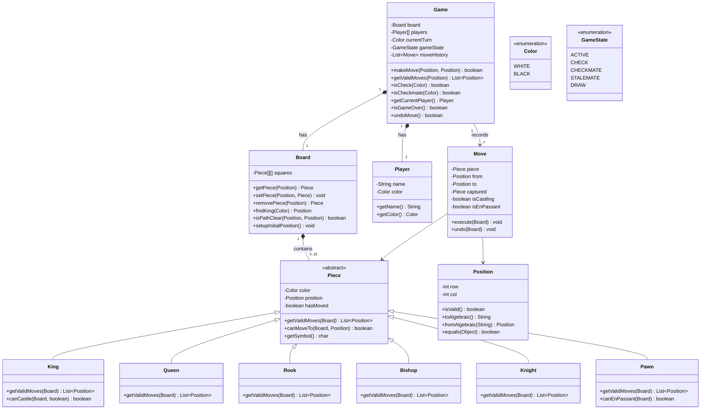
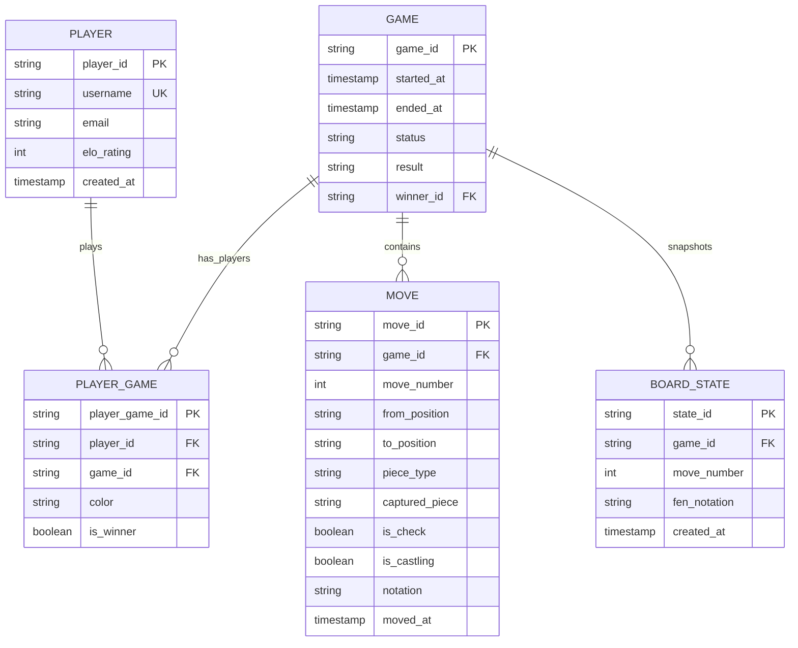

# Design for Chess Game

Complete class design with diagrams, relationships, and key decisions.

---

## Mermaid Class Diagram



## Entity-Relationship Diagram



**Schema Notes:**
- `PLAYER_GAME` is a junction table for game participants
- `MOVE` stores move history in algebraic notation
- `BOARD_STATE` optionally stores FEN for position analysis
- `elo_rating` in `PLAYER` for matchmaking

---

## Class Diagram

```
┌─────────────────────────────────────────────────────────────────────┐
│                              Game                                   │
├─────────────────────────────────────────────────────────────────────┤
│ - board: Board                                                      │
│ - players: Player[2]                                                │
│ - currentTurn: Color                                                │
│ - gameState: GameState                                              │
│ - moveHistory: List<Move>                                           │
├─────────────────────────────────────────────────────────────────────┤
│ + makeMove(from: Position, to: Position): boolean                   │
│ + getValidMoves(position: Position): List<Position>                 │
│ + isCheck(color: Color): boolean                                    │
│ + isCheckmate(color: Color): boolean                                │
│ + getCurrentPlayer(): Player                                        │
│ + isGameOver(): boolean                                             │
└───────────────────────────────┬─────────────────────────────────────┘
                                │ has
          ┌─────────────────────┼─────────────────────┐
          ▼                     ▼                     ▼
┌───────────────────┐  ┌───────────────────┐  ┌───────────────────┐
│      Board        │  │     Player        │  │      Move         │
├───────────────────┤  ├───────────────────┤  ├───────────────────┤
│ - squares[8][8]   │  │ - name: String    │  │ - piece: Piece    │
├───────────────────┤  │ - color: Color    │  │ - from: Position  │
│ + getPiece()      │  ├───────────────────┤  │ - to: Position    │
│ + setPiece()      │  │ + getColor()      │  │ - captured: Piece │
│ + removePiece()   │  └───────────────────┘  ├───────────────────┤
│ + findKing()      │                         │ + execute()       │
│ + isPathClear()   │                         │ + undo()          │
└────────┬──────────┘                         └───────────────────┘
         │ contains
         ▼
┌─────────────────────────────────────────────────────────────────────┐
│                     Piece <<abstract>>                              │
├─────────────────────────────────────────────────────────────────────┤
│ - color: Color                                                      │
│ - position: Position                                                │
│ - hasMoved: boolean                                                 │
├─────────────────────────────────────────────────────────────────────┤
│ + getValidMoves(board: Board): List<Position> <<abstract>>          │
│ + canMoveTo(board: Board, target: Position): boolean                │
│ + getSymbol(): char                                                 │
└───────────────────────────────┬─────────────────────────────────────┘
                                │
    ┌───────────┬───────────┬───┴───┬───────────┬───────────┐
    ▼           ▼           ▼       ▼           ▼           ▼
┌───────┐  ┌───────┐  ┌───────┐  ┌───────┐  ┌───────┐  ┌───────┐
│ King  │  │ Queen │  │ Rook  │  │ Bishop│  │ Knight│  │ Pawn  │
└───────┘  └───────┘  └───────┘  └───────┘  └───────┘  └───────┘


┌─────────────────────┐        ┌─────────────────────────────────────┐
│     Position        │        │          Color <<enum>>             │
├─────────────────────┤        ├─────────────────────────────────────┤
│ - row: int (0-7)    │        │ WHITE                               │
│ - col: int (0-7)    │        │ BLACK                               │
├─────────────────────┤        └─────────────────────────────────────┘
│ + isValid(): boolean│
│ + toAlgebraic()     │        ┌─────────────────────────────────────┐
└─────────────────────┘        │       GameState <<enum>>            │
                               ├─────────────────────────────────────┤
                               │ ACTIVE, CHECK, CHECKMATE, STALEMATE │
                               └─────────────────────────────────────┘
```

---

## Piece Movement Rules

### King
```
Movement: 1 square in any direction (8 possible moves)
Special: Castling (with rook, neither has moved, path clear, not through check)

Valid moves pattern:
  x x x
  x K x
  x x x
```

### Queen
```
Movement: Any number of squares in any direction (horizontal, vertical, diagonal)
Special: None

Valid moves pattern:
  x   x   x
    x x x
  x x Q x x
    x x x
  x   x   x
```

### Rook
```
Movement: Any number of squares horizontally or vertically
Special: Part of castling

Valid moves pattern:
      x
      x
  x x R x x
      x
      x
```

### Bishop
```
Movement: Any number of squares diagonally
Special: None

Valid moves pattern:
  x       x
    x   x
      B
    x   x
  x       x
```

### Knight
```
Movement: L-shape (2 squares in one direction, 1 perpendicular)
Special: Can jump over other pieces

Valid moves pattern:
    x   x
  x       x
      N
  x       x
    x   x
```

### Pawn
```
Movement: 1 forward (2 from starting position)
Capture: Diagonally forward
Special: En passant, promotion to any piece at last rank
```

---

## Core Classes

### Game
- **Attributes**:
  - `board: Board` - The chess board
  - `players: Player[]` - White and Black players
  - `currentTurn: Color` - Who's turn it is
  - `gameState: GameState` - Current state
  - `moveHistory: List<Move>` - All moves made
- **Methods**:
  - `makeMove(Position, Position): boolean` - Execute a move
  - `getValidMoves(Position): List<Position>` - Get legal moves for piece
  - `isCheck(Color): boolean` - Is king in check
  - `isCheckmate(Color): boolean` - Is king checkmated
  - `undoMove(): boolean` - Undo last move

### Board
- **Attributes**:
  - `squares: Piece[8][8]` - 2D array of pieces
- **Methods**:
  - `getPiece(Position): Piece` - Get piece at position
  - `setPiece(Position, Piece): void` - Place piece
  - `removePiece(Position): Piece` - Remove and return piece
  - `findKing(Color): Position` - Find king's position
  - `isPathClear(from, to): boolean` - Check if path is unobstructed
  - `setupInitialPosition(): void` - Place pieces for new game

### Piece (Abstract)
- **Attributes**:
  - `color: Color` - White or Black
  - `position: Position` - Current position
  - `hasMoved: boolean` - For castling/pawn double move
- **Methods**:
  - `getValidMoves(Board): List<Position>` - All valid destinations
  - `canMoveTo(Board, Position): boolean` - Can reach specific position
  - `getSymbol(): char` - For display

### Position
- **Attributes**:
  - `row: int` - 0-7 (rank)
  - `col: int` - 0-7 (file)
- **Methods**:
  - `isValid(): boolean` - Within board bounds
  - `toAlgebraic(): String` - e.g., "e4"
  - `fromAlgebraic(String): Position` - Parse "e4"
  - `equals(Position): boolean` - Compare positions

---

## Key Design Decisions

### Decision 1: 2D Array for Board
**Rationale**: 
- O(1) access by position
- Natural representation of chess board
- Easy to iterate and visualize

**Trade-off**:
- Fixed 8x8 size (not extensible)
- Null checks needed for empty squares

**Alternative**: 
- Map<Position, Piece> for sparse representation

---

### Decision 2: Abstract Piece with Polymorphism
**Rationale**:
- Each piece has unique movement rules
- Common interface for board operations
- Factory pattern for creation

**Trade-off**:
- Multiple subclasses to maintain
- Movement logic spread across classes

**Alternative**:
- Strategy pattern with MovementStrategy interface

---

### Decision 3: Position as Immutable Value Object
**Rationale**:
- Thread-safe
- Can be used as map keys
- Natural model for board coordinates

**Trade-off**:
- New object for each position reference
- Can use flyweight pattern for optimization

---

### Decision 4: Move as Command Object
**Rationale**:
- Encapsulates entire move operation
- Natural undo support
- Can serialize for game history

**Trade-off**:
- More objects created per move
- Need to track captured pieces

---

## Complexity Analysis

### Time Complexity

| Operation | Complexity | Notes |
|-----------|------------|-------|
| Get piece at position | O(1) | Direct array access |
| Get valid moves (piece) | O(n) | n = possible moves |
| Check detection | O(p × m) | p = pieces, m = moves each |
| Checkmate detection | O(p × m × m) | All pieces, all moves, simulate each |
| Make move | O(1) | Array operations |

### Space Complexity

| Component | Space | Notes |
|-----------|-------|-------|
| Board | O(64) | Fixed 8x8 |
| Pieces | O(32) | Max 32 pieces |
| Move history | O(m) | m = moves played |
| **Total** | O(m) | Dominated by history |

---

## Check/Checkmate Detection (v3)

### Check Detection Algorithm
```
isCheck(color):
    1. Find king of given color
    2. For each opponent piece:
       - Check if piece can attack king's position
       - If any can, king is in check
    3. Return result
    
    Time: O(opponent_pieces × max_moves_per_piece)
```

### Checkmate Detection Algorithm
```
isCheckmate(color):
    1. If not in check, return false
    2. For each piece of given color:
       - For each valid move of that piece:
         - Simulate the move
         - Check if still in check
         - Undo the move
         - If any move escapes check, not checkmate
    3. If no escaping move found, return true
    
    Time: O(my_pieces × my_moves × opponent_pieces × opponent_moves)
```

### Stalemate Detection
```
isStalemate(color):
    1. If in check, return false
    2. For each piece of given color:
       - If piece has any valid move that doesn't result in check
       - Return false
    3. Return true (no legal moves, but not in check)
```

---

## Extension Points

| Feature | Where to Add | Pattern |
|---------|--------------|---------|
| Different piece types | PieceFactory | Factory |
| New movement rules | Piece subclasses | Strategy |
| Game variants (Chess960) | Board setup | Strategy |
| AI opponent | AIPlayer class | Strategy |
| Network play | GameServer | Observer |
| Game persistence | GameSerializer | Memento |
