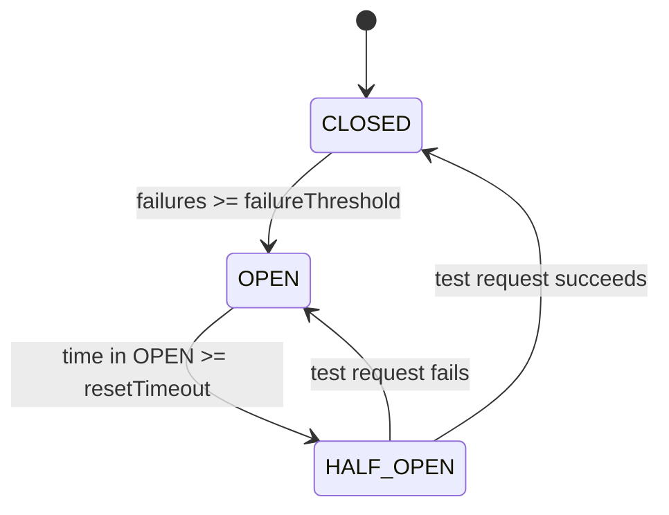

# Design: Circuit Breaker & Resilience Engine

## Architectural Patterns

The core of the Circuit Breaker Engine relies on three main design patterns to separate concerns, ensure extensibility, and maintain clean state management.

### 1. State Pattern
The State pattern is used to encapsulate the varying behavior of the circuit breaker depending on whether it is `Closed`, `Open`, or `Half-Open`. 

*   **`State` Interface/Abstract Class**: Defines methods like `acquirePermission()` (can we execute the call?) and `recordResult(success)`.
*   **`ClosedState`**: Allows all executions. On failure, increments the failure counter. If the counter reaches the threshold, transitions the context to `OpenState`. On success, resets the counter.
*   **`OpenState`**: Rejects all executions (fails fast) until the reset timeout expires. If the timeout has expired, it transitions the context to `HalfOpenState`.
*   **`HalfOpenState`**: Allows a limited number of test executions. If a test execution succeeds, transitions to `ClosedState`. If it fails, transitions back to `OpenState`.

### 2. Proxy / Decorator Pattern
To seamlessly integrate the circuit breaker into existing code, we use a Proxy or Decorator pattern.

*   **`CircuitBreaker` class**: Acts as a proxy around the underlying callable action. When a client invokes the action through the circuit breaker, the circuit breaker first checks the current state (`acquirePermission`). If permitted, it executes the action, catches any exceptions, and then calls `recordResult` on the current state to update metrics and potentially trigger state transitions.

### 3. Strategy Pattern
The Strategy pattern provides flexibility for handling failures and implementing additional resilience mechanisms.

*   **`FallbackStrategy`**: Defines what action to take when the circuit is OPEN or when the primary action fails (e.g., return a default value, read from a cache).
*   **`RetryStrategy`**: Defines how to handle transient failures before they are counted against the circuit breaker (e.g., immediate retry, exponential backoff).

## State Machine Diagram

The following diagram illustrates the transitions between the three states.

## Core Components and Responsibilities

1.  **`CircuitBreakerConfig`**: Holds immutable configuration settings (thresholds, timeouts).
2.  **`CircuitBreakerContext` (or just `CircuitBreaker`)**: 
    *   Holds the current `State` object.
    *   Provides synchronization mechanisms (e.g., Atomic references, locks) to ensure thread-safe state transitions.
    *   Exposes the `execute(Callable/Runnable)` API to clients.
3.  **States (`Closed`, `Open`, `HalfOpen`)**: Implement the specific logic for allowing execution and reacting to successes/failures.
4.  **`ExecutionWrapper`**: Combines the Circuit Breaker with Retry and Fallback strategies to form a cohesive Resilience Engine.

## Concurrency Handling

Since multiple threads may attempt to execute calls through the circuit breaker simultaneously, state transitions must be thread-safe.

*   **State Reference**: The reference to the current state in the context should be managed using atomic operations (e.g., `AtomicReference` in Java or thread-safe variable assignment in Python) to avoid race conditions during transitions.
*   **Metrics**: Counters (like consecutive failures) within states should use atomic integer operations to ensure accurate counting without heavy locking.
*   **Timeouts**: The `OpenState` needs a thread-safe way to check if the `resetTimeout` has passed based on the timestamp when it was entered.

This design ensures minimal overhead during normal operation (Closed state) while providing robust protection during failure scenarios.