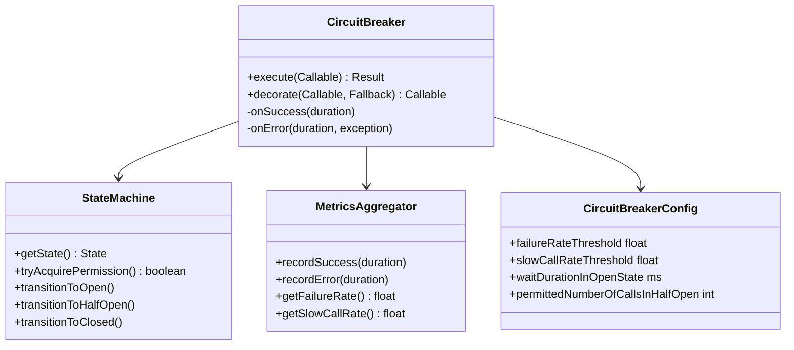

# System Design

## Architecture

The Circuit Breaker consists of several core components interacting together:

1. **CircuitBreaker**: The main facade exposing the `execute` or `decorate` methods.
2. **StateMachine**: Manages the transitions between `CLOSED`, `OPEN`, and `HALF_OPEN`.
3. **MetricsAggregator**: Tracks successes, failures, and slow calls over a sliding window.
4. **Configuration**: Holds thresholds, window sizes, and timeout settings.

When a client makes a call, the `CircuitBreaker` checks the `StateMachine`. If `OPEN`, it immediately throws an exception or returns a fallback. If `CLOSED` or `HALF_OPEN` (and permits remain), it allows the call.

After the call completes, the result (success, failure, duration) is reported back to the `CircuitBreaker`, which updates the `MetricsAggregator` and triggers the `StateMachine` to evaluate thresholds.

## Mermaid Diagram



## Data Models and Metrics

The `MetricsAggregator` needs to store aggregated data efficiently. For a count-based window, an array of boolean flags or short integers (for status) suffices.

For a time-based window, we use an array of `Bucket` objects:

```java
class Bucket {
    long startTime;
    int successCount;
    int failureCount;
    int slowCallCount;
    // ...
}
```

The aggregator maintains a circular array of these buckets, advancing the current bucket based on the current timestamp.

## Thread Safety Strategy

To handle high concurrency:
- **State Updates**: We use an `AtomicReference` for the current state to allow lock-free reads and compare-and-swap updates.
- **Metrics**: We use atomic counters (like `LongAdder` or `AtomicInteger`) within each bucket to minimize contention during writes.
- **Window Management**: Shifting buckets in a time-based window requires synchronization, which can be protected by a lightweight lock or implemented lock-free using atomic references to the bucket array.

## Contract and Acceptance Constraints

The system adheres to specific behavioral invariants to satisfy exact acceptance criteria:

1. **Deterministic Tracing**: An injected monotonic time source is required to drive `closed→open→half-open→closed/open` traces, ensuring threshold/window semantics and allowed half-open probes are exact.
2. **Concurrency Bounds**: Exactly bounded probes mean even if eight contenders try to pass during a `HALF_OPEN` state, they cannot exceed the configured half-open probe bound.
3. **Stale Callback Protection**: Stale success/failure callbacks from completed calls must not overwrite a later breaker generation's state.
4. **Scope**: Version-specific APIs and deterministic fixture inputs/expected outputs are fixed before implementation; no production/security promise is inferred.
