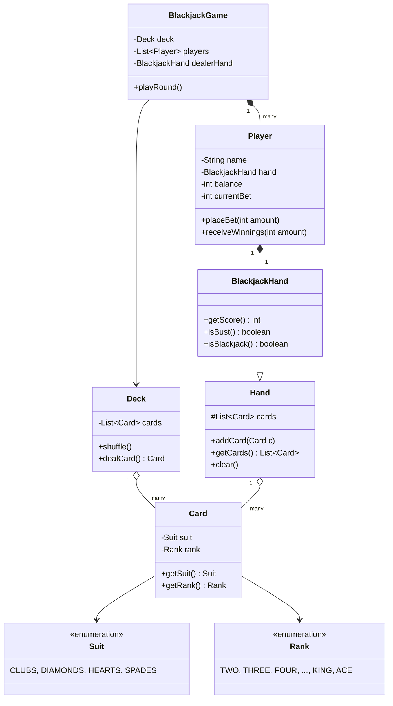
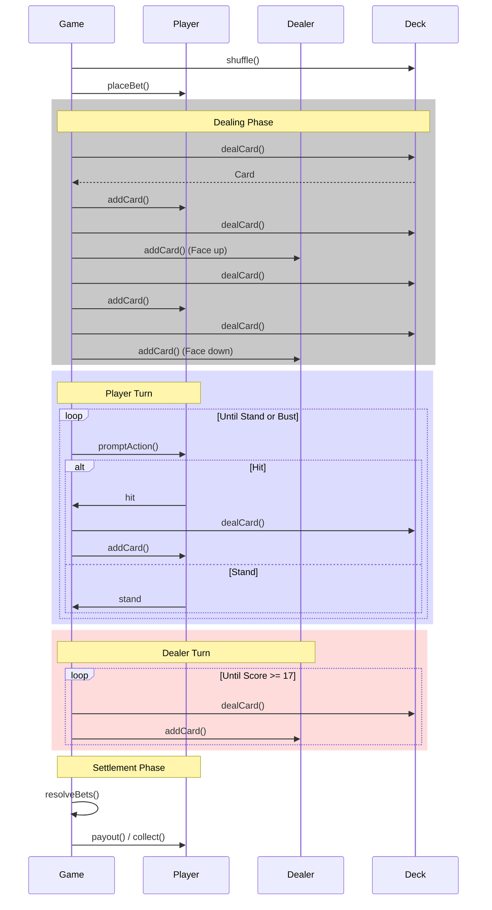

# Deck of Cards and Blackjack Game - Design

## Cross-links
* [Problem Definition](PROBLEM.md)
* [Approach](APPROACH.md)
* [Code Walkthrough](CODE-WALKTHROUGH.md)

## System Architecture

The core architecture separates the generic card components from the Blackjack-specific rules.

* **Core Models**: `Suit`, `Rank`, `Card`, `Deck`, `Hand`.
* **Game Specific**: `BlackjackHand`, `Player`, `Dealer`, `BlackjackGame`.

## Class Diagram

## Sequence Diagram (Full Round)

## Patterns
* **State Pattern**: The `BlackjackGame` naturally flows through states (Betting, Dealing, PlayerTurns, DealerTurn, Settlement). Although simple implementations might use sequential methods, complex multi-player flows benefit from a State machine.
* **Template Method Pattern**: A base `Game` class could define the skeleton `play()` algorithm, delegating specific rules (like `checkWinCondition`) to subclasses like `BlackjackGame` or `PokerGame`.
* **Strategy Pattern**: Dealer AI uses a fixed strategy (Hit until 17). Players could theoretically be automated using strategies.
