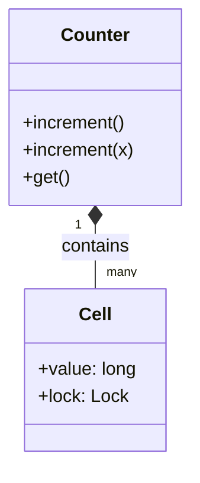
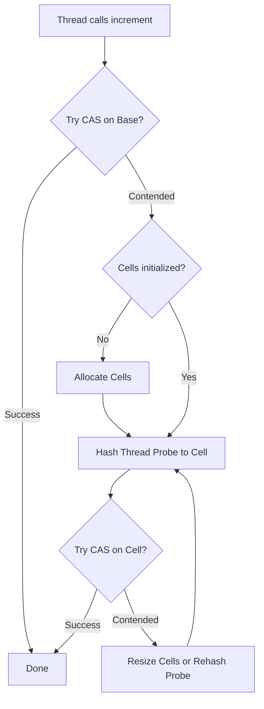

# Design

## Counter Contract
- **Non-Atomic Concurrent Sum:** In striped implementations (`v2` and `v3`), a concurrent sum is not an atomic snapshot. It is unsuitable for strict quota limits.
- **Quiescence:** A completed fixed update set sums exactly after quiescence.
- **Local State:** This design preserves local state (not a network-distributed counter contract). Overflow, negative-update policies, and shard lifecycles adhere strictly to this local constraint.

## Architecture

The system consists of a `Counter` class that manages access to underlying `Cell` objects.

## Flow for v3-optimized

