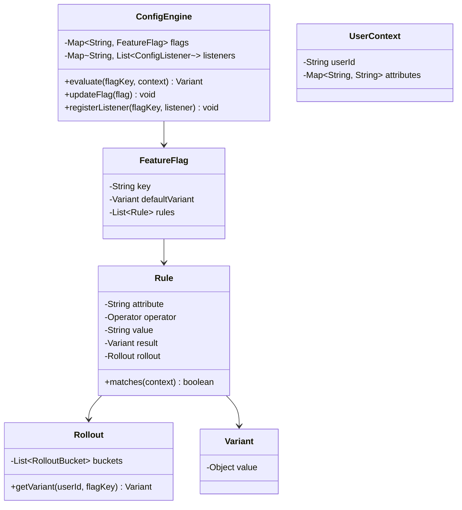

# Design: Dynamic Feature Flag Engine

## Architecture

## Pattern Explanations

1. **Strategy Pattern**: The `Operator` (equals, in, matches) within rules acts as a strategy for evaluating segments.
2. **Observer Pattern**: The engine notifies registered listeners when a `FeatureFlag` is updated.
3. **Immutable Configuration**: Replacing entire `FeatureFlag` objects ensures lock-free evaluations.

## Version-Specific APIs and Exact Fixtures

Version-specific APIs and deterministic fixture inputs/expected outputs are explicitly defined for each version before implementation. Exact testing fixtures are used to guarantee parity across languages for scenarios such as:
- Atomic immutable config snapshots.
- Version rollback and stale updates.
- Missing flags and invalid percentage handling.
- Tenant override precedence.
- Deterministic cross-language rollout evaluation.

No production/security promise is inferred.
