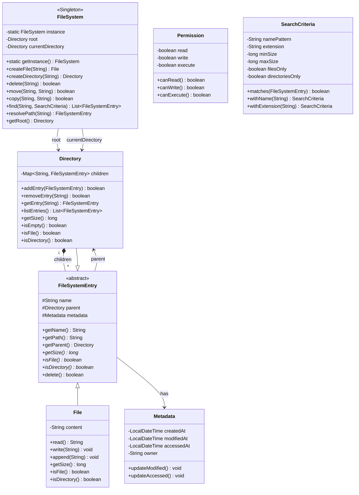
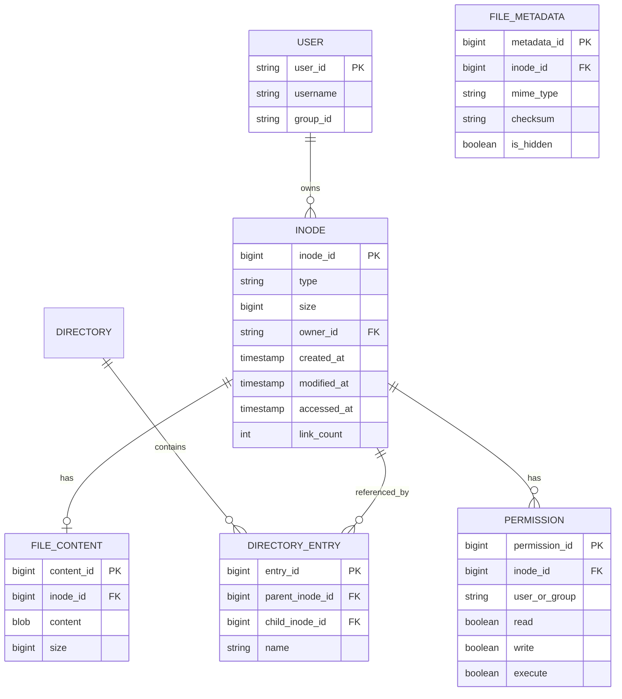

# Design for File System

Complete class design with diagrams, relationships, and key decisions.

---

## Mermaid Class Diagram



## Entity-Relationship Diagram



**Schema Notes:**
- `INODE` represents filesystem entries (Unix-style)
- `DIRECTORY_ENTRY` links parent directories to children
- `FILE_CONTENT` stores actual file data (could be external blob storage)
- `PERMISSION` supports Unix-style permissions per user/group

---

## Class Diagram

```
┌─────────────────────────────────────────────────────────────────────────┐
│                            FileSystem                                    │
│                           <<Singleton>>                                  │
├─────────────────────────────────────────────────────────────────────────┤
│ - instance: FileSystem                                                   │
│ - root: Directory                                                        │
│ - currentDirectory: Directory                                            │
├─────────────────────────────────────────────────────────────────────────┤
│ + getInstance(): FileSystem                                              │
│ + createFile(path: String): File                                         │
│ + createDirectory(path: String): Directory                               │
│ + delete(path: String): boolean                                          │
│ + move(src: String, dest: String): boolean                               │
│ + copy(src: String, dest: String): boolean                               │
│ + find(path: String, criteria: SearchCriteria): List<FileSystemEntry>   │
│ + resolvePath(path: String): FileSystemEntry                             │
│ + getRoot(): Directory                                                   │
└───────────────────────────────┬─────────────────────────────────────────┘
                                │ manages
                                ▼
┌─────────────────────────────────────────────────────────────────────────┐
│                    FileSystemEntry <<abstract>>                          │
│                       <<Composite Component>>                            │
├─────────────────────────────────────────────────────────────────────────┤
│ # name: String                                                           │
│ # parent: Directory                                                      │
│ # metadata: Metadata                                                     │
├─────────────────────────────────────────────────────────────────────────┤
│ + getName(): String                                                      │
│ + getPath(): String                                                      │
│ + getParent(): Directory                                                 │
│ + getSize(): long {abstract}                                             │
│ + isFile(): boolean {abstract}                                           │
│ + isDirectory(): boolean {abstract}                                      │
│ + delete(): boolean                                                      │
└───────────────────────────────┬─────────────────────────────────────────┘
                                │
            ┌───────────────────┴───────────────────┐
            ▼                                       ▼
┌───────────────────────────┐          ┌────────────────────────────────┐
│         File              │          │          Directory             │
│     <<Composite Leaf>>    │          │     <<Composite Composite>>    │
├───────────────────────────┤          ├────────────────────────────────┤
│ - content: String         │          │ - children: Map<String, Entry> │
├───────────────────────────┤          ├────────────────────────────────┤
│ + read(): String          │          │ + addEntry(entry): boolean     │
│ + write(content): void    │          │ + removeEntry(name): boolean   │
│ + append(content): void   │          │ + getEntry(name): Entry        │
│ + getSize(): long         │          │ + listEntries(): List<Entry>   │
│ + isFile(): boolean=true  │          │ + getSize(): long              │
│ + isDirectory(): boolean  │          │ + isFile(): boolean=false      │
│   = false                 │          │ + isDirectory(): boolean=true  │
└───────────────────────────┘          └────────────────────────────────┘


┌─────────────────────────┐     ┌─────────────────────────────────┐
│       Metadata          │     │    Permission (v3)              │
├─────────────────────────┤     ├─────────────────────────────────┤
│ - createdAt: DateTime   │     │ - read: boolean                 │
│ - modifiedAt: DateTime  │     │ - write: boolean                │
│ - accessedAt: DateTime  │     │ - execute: boolean              │
│ - owner: String         │     ├─────────────────────────────────┤
├─────────────────────────┤     │ + canRead(): boolean            │
│ + updateModified()      │     │ + canWrite(): boolean           │
│ + updateAccessed()      │     │ + canExecute(): boolean         │
└─────────────────────────┘     └─────────────────────────────────┘


┌─────────────────────────────────────────────────────────────────────────┐
│                     SearchCriteria (v2)                                  │
├─────────────────────────────────────────────────────────────────────────┤
│ - namePattern: String                                                    │
│ - extension: String                                                      │
│ - minSize: long                                                          │
│ - maxSize: long                                                          │
│ - filesOnly: boolean                                                     │
│ - directoriesOnly: boolean                                               │
├─────────────────────────────────────────────────────────────────────────┤
│ + matches(entry: FileSystemEntry): boolean                               │
│ + withName(pattern: String): SearchCriteria                              │
│ + withExtension(ext: String): SearchCriteria                             │
│ + withSizeRange(min: long, max: long): SearchCriteria                    │
└─────────────────────────────────────────────────────────────────────────┘
```

---

## Core Classes

### FileSystem (Singleton)
- **Attributes**:
  - `instance: FileSystem` - Static singleton instance
  - `root: Directory` - Root directory ("/")
  - `currentDirectory: Directory` - Current working directory
- **Methods**:
  - `getInstance(): FileSystem` - Get singleton instance
  - `createFile(String): File` - Create file at path
  - `createDirectory(String): Directory` - Create directory at path
  - `delete(String): boolean` - Delete entry at path
  - `move(String, String): boolean` - Move entry
  - `copy(String, String): boolean` - Copy entry
  - `find(String, SearchCriteria): List` - Search entries
  - `resolvePath(String): FileSystemEntry` - Resolve path to entry
- **Patterns Used**: Singleton

### FileSystemEntry (Abstract - Composite Component)
- **Attributes**:
  - `name: String` - Entry name
  - `parent: Directory` - Parent directory (null for root)
  - `metadata: Metadata` - Timestamps and owner
- **Methods**:
  - `getName(): String` - Get entry name
  - `getPath(): String` - Get full absolute path
  - `getParent(): Directory` - Get parent directory
  - `getSize(): long` - Get size (abstract)
  - `isFile(): boolean` - Check if file (abstract)
  - `isDirectory(): boolean` - Check if directory (abstract)
  - `delete(): boolean` - Remove entry
- **Patterns Used**: Composite (Component)

### File (Composite Leaf)
- **Attributes**:
  - `content: String` - File content
- **Methods**:
  - `read(): String` - Read file content
  - `write(String): void` - Overwrite content
  - `append(String): void` - Append to content
  - `getSize(): long` - Returns content length
  - `isFile(): boolean` - Returns true
  - `isDirectory(): boolean` - Returns false
- **Patterns Used**: Composite (Leaf)

### Directory (Composite Composite)
- **Attributes**:
  - `children: Map<String, FileSystemEntry>` - Child entries
- **Methods**:
  - `addEntry(FileSystemEntry): boolean` - Add child
  - `removeEntry(String): boolean` - Remove child by name
  - `getEntry(String): FileSystemEntry` - Get child by name
  - `listEntries(): List<FileSystemEntry>` - List all children
  - `getSize(): long` - Sum of children sizes
  - `isEmpty(): boolean` - Check if no children
- **Patterns Used**: Composite (Composite)

### Metadata
- **Attributes**:
  - `createdAt: LocalDateTime` - Creation timestamp
  - `modifiedAt: LocalDateTime` - Last modification
  - `accessedAt: LocalDateTime` - Last access
  - `owner: String` - Owner username
- **Methods**:
  - `updateModified(): void` - Update modification time
  - `updateAccessed(): void` - Update access time

### SearchCriteria (v2)
- **Attributes**:
  - `namePattern: String` - Name pattern to match
  - `extension: String` - File extension filter
  - `minSize: long` - Minimum size filter
  - `maxSize: long` - Maximum size filter
- **Methods**:
  - `matches(FileSystemEntry): boolean` - Check if entry matches
  - Builder methods for fluent API

---

## Key Design Decisions

### Decision 1: Composite Pattern for File/Directory
**Rationale**: 
- Files and directories share common operations (getName, getPath, delete)
- Directory can contain both files and other directories
- Enables recursive operations naturally (size calculation, search)
- Follows the "treat individual objects and compositions uniformly" principle

**Trade-off**:
- Some operations only apply to files (read, write) or directories (list)
- Need isFile()/isDirectory() checks before certain operations

**Alternative**: 
- Separate hierarchies with interface

---

### Decision 2: HashMap for Directory Children
**Rationale**:
- O(1) lookup of children by name
- Unique names enforced naturally
- Efficient for add/remove operations

**Trade-off**:
- Unordered (can sort on list if needed)
- Memory overhead for hash table

---

### Decision 3: Path as String (not class in v1)
**Rationale**:
- Simpler implementation for basic version
- Easy to understand and use
- Path parsing done in FileSystem

**Alternative (v2/v3)**:
- Create Path class for validation and manipulation
- Cache parsed path components

---

### Decision 4: Parent Reference in Entry
**Rationale**:
- Enables getPath() without passing context
- Easy navigation to ancestors
- Simplifies move/copy operations

**Trade-off**:
- Bidirectional reference (must keep in sync)
- Extra memory per entry

---

## Complexity Analysis

### Time Complexity

| Operation | Complexity | Notes |
|-----------|------------|-------|
| Create file/dir | O(d) | d = path depth |
| Delete | O(n) | n = subtree size for directory |
| Read file | O(1) | Direct content access |
| Write file | O(c) | c = content size |
| List directory | O(k) | k = children count |
| Get entry by name | O(1) | HashMap lookup |
| Resolve path | O(d) | d = path depth |
| Search | O(n) | n = total entries in subtree |
| Get size (dir) | O(n) | Sum all children (can cache) |

### Space Complexity

| Component | Complexity | Notes |
|-----------|------------|-------|
| File | O(c) | c = content size |
| Directory | O(k) | k = children count |
| Full tree | O(n + C) | n = entries, C = total content |
| Path cache | O(d) | d = max depth |

---

## Thread Safety (v3)

### Critical Sections:
1. **Directory modification** - Adding/removing children
2. **File content** - Read while write in progress
3. **Metadata updates** - Concurrent timestamp updates
4. **Path resolution** - Tree structure changes during traversal

### Synchronization Strategy:
```java
// Read-write lock for file content
private final ReadWriteLock contentLock = new ReentrantReadWriteLock();

// Lock for directory children modifications
private final Lock childrenLock = new ReentrantLock();

// For concurrent directory operations
private final ConcurrentHashMap<String, FileSystemEntry> children;
```

---

## Extension Points

| Feature | Where to Add | Pattern |
|---------|--------------|---------|
| Symbolic links | New SymbolicLink class | Composite leaf |
| Hard links | Reference counting | Flyweight |
| File compression | CompressionDecorator | Decorator |
| Access logging | FileSystemObserver | Observer |
| Undo operations | FileSystemCommand | Command |
| Custom file types | FileFactory | Factory |
