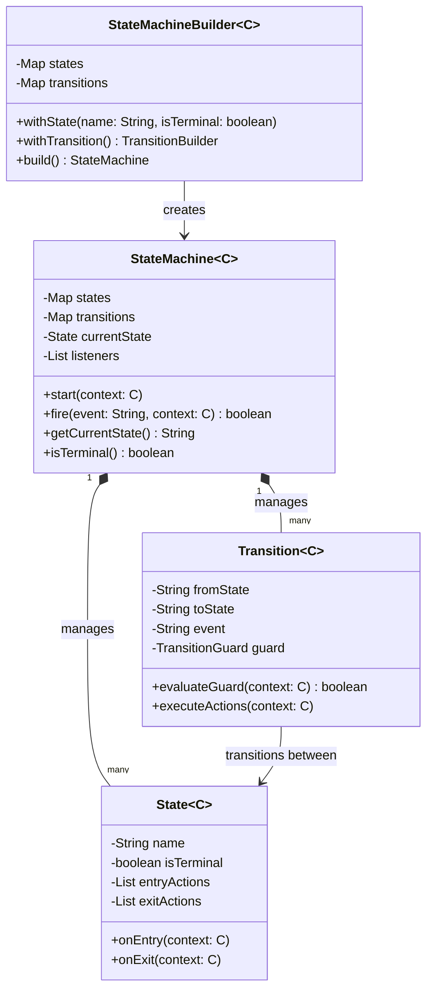
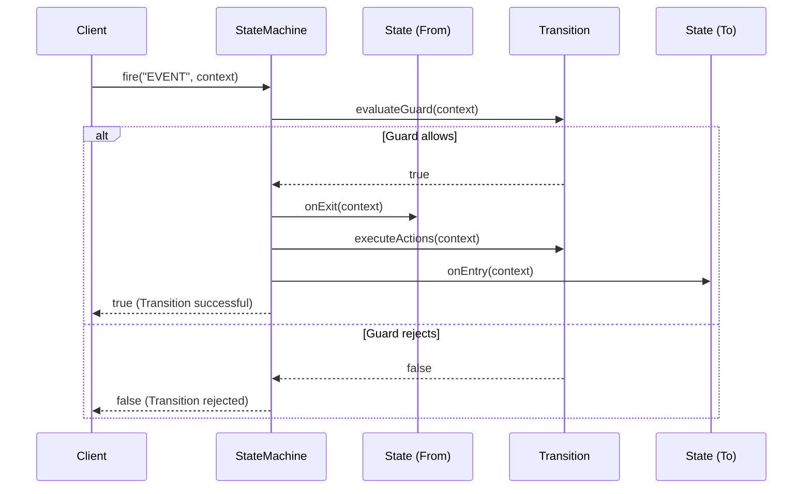

# Finite State Machine - Design

## System Architecture

The FSM Engine utilizes the Builder Pattern to construct the state transitions and encapsulate the runtime state inside a `StateMachine` instance. The design heavily relies on parameterized Generics (e.g. `<C> Context`) to remain domain-agnostic. 

We utilize the Observer Pattern to push transition notifications via `StateChangeListener`.

## Class Diagram

## Sequence Diagram: Event Firing Lifecycle

## Cross-links
- [Problem Statement](./PROBLEM.md)
- [Approach](./APPROACH.md)
- [Code Walkthrough](./CODE-WALKTHROUGH.md)
