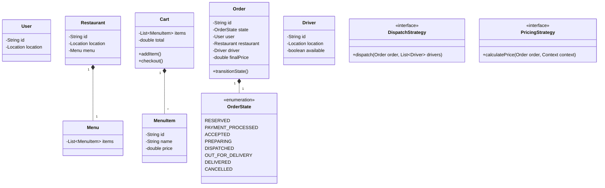

# Design: Food Delivery Platform

## Class Diagram

## Core Components

1.  **Cart & Menu**: Manage the selection of items.
2.  **Order Manager**: Coordinates the creation and state transitions of orders.
3.  **Dispatch Engine**: Evaluates available drivers and assigns the optimal one using a `DispatchStrategy`.
4.  **Pricing Engine**: Calculates the final cost, applying a `PricingStrategy` (e.g., base fee + distance fee + surge multiplier).
