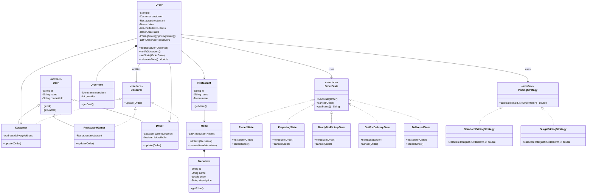
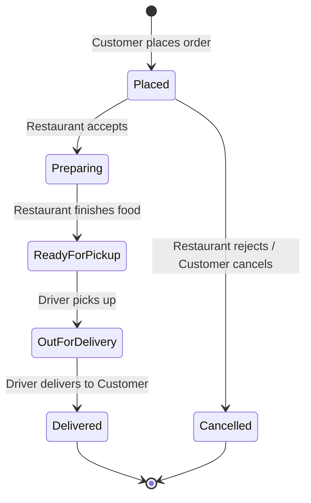

# Food Delivery System Design

## Class Diagram

Below is the class diagram illustrating the core entities and the application of Strategy, State, and Observer patterns.

## State Diagram

This state diagram shows the lifecycle of an `Order`.

