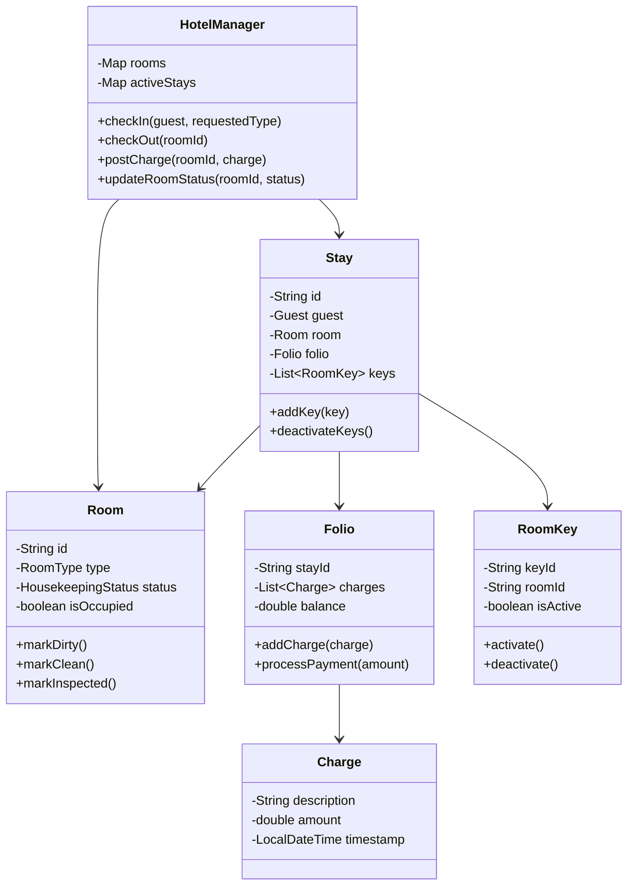

# Design

## Architecture

The Hotel Management System is centered around the operational flow of managing rooms and guest stays.

## Data Model

- **HousekeepingStatus (Enum)**: `DIRTY`, `CLEAN`, `INSPECTED`
- **Room**: `id` (String), `type` (Enum), `housekeepingStatus` (HousekeepingStatus), `isOccupied` (boolean)
- **Folio**: `stayId` (String), `charges` (Thread-safe List), `balance` (AtomicDouble or protected by lock)
- **Charge**: `id` (String), `amount` (double), `description` (String), `timestamp` (Date)
- **RoomKey**: `keyId` (String), `roomId` (String), `isActive` (boolean)

## Concurrency Strategy
- **Room Assignment Lock**: A global reentrant lock or `ConcurrentHashMap.compute()` is used when assigning a room during check-in to prevent double-booking.
- **Folio Lock**: Each `Folio` instance maintains its own lock to synchronize `addCharge()` and `processPayment()` operations, preventing data races if a guest visits the restaurant while the minibar is being restocked and charged.

## Versions & Iterations

### v1-basic
- **Goal:** Minimal viable implementation of room management and single-thread folio processing.
- **Features:** 
  - Basic `HousekeepingStatus` state machine (`DIRTY`, `CLEAN`, `INSPECTED`).
  - Standard check-in and check-out workflows in a single-threaded environment.
  - Simple `Folio` list of charges without concurrency controls.

### v2-extended
- **Goal:** Add thread safety and support overlapping stay bookings using half-open date ranges.
- **Features:**
  - Concurrent `Folio` charges: Multiple threads can post charges (e.g., restaurant, minibar) via synchronized blocks or ReentrantLocks preserving integer-minor-unit balances.
  - Thread-safe room allocation avoiding double-assignment.
  - Half-open dates `[start, end)` for stay duration checking.

### v3-optimized
- **Goal:** Performance optimizations and lock-free/striped concurrency.
- **Features:**
  - Striped locking or `ConcurrentHashMap.compute()` for atomic room assignment.
  - Optimized financial calculations.
