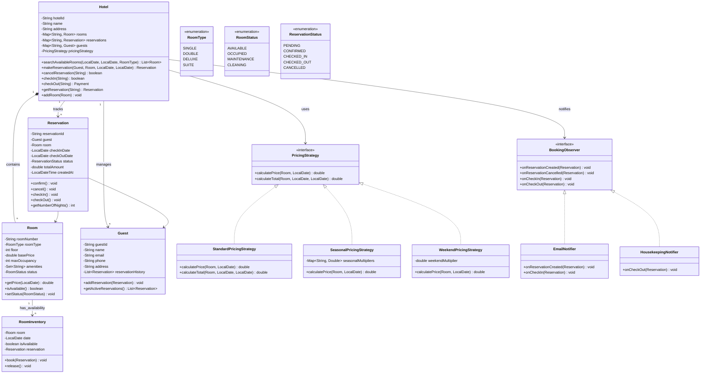
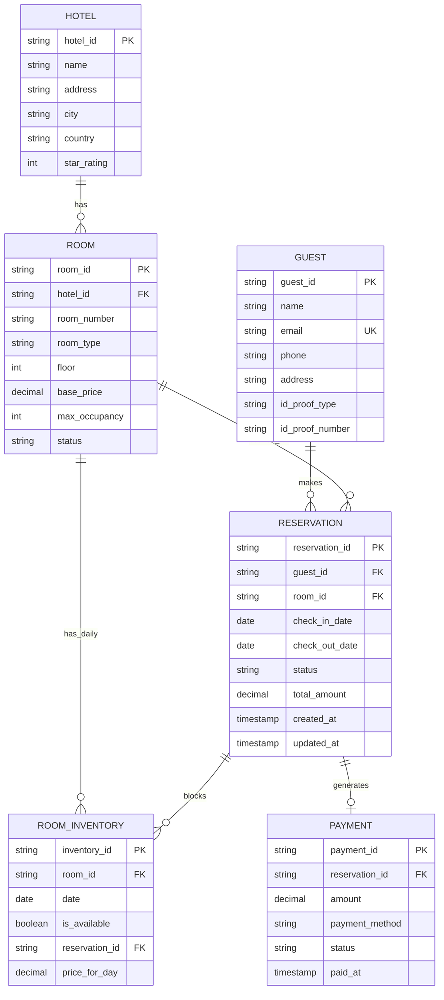

# Design for Hotel Reservation System

## Mermaid Class Diagram



## Entity-Relationship Diagram



**Schema Notes:**
- `ROOM_INVENTORY` provides day-by-day availability tracking
- `RESERVATION` links guest to room for date range
- `PAYMENT` tracks payment details with multiple method support
- Room pricing can vary by day via `ROOM_INVENTORY.price_for_day`

---

## Class Diagram

```
┌─────────────────────────────────────────────────────────────────────────────┐
│                         HOTEL RESERVATION SYSTEM                             │
└─────────────────────────────────────────────────────────────────────────────┘

┌─────────────────┐     ┌─────────────────┐     ┌─────────────────┐
│   <<enum>>      │     │   <<enum>>      │     │   <<enum>>      │
│   RoomType      │     │ ReservationStatus│     │   RoomStatus    │
├─────────────────┤     ├─────────────────┤     ├─────────────────┤
│ SINGLE          │     │ PENDING          │     │ AVAILABLE       │
│ DOUBLE          │     │ CONFIRMED        │     │ OCCUPIED        │
│ DELUXE          │     │ CHECKED_IN       │     │ MAINTENANCE     │
│ SUITE           │     │ CHECKED_OUT      │     │ CLEANING        │
└─────────────────┘     │ CANCELLED        │     └─────────────────┘
                        └─────────────────┘

┌───────────────────────────────────────────────────────────────────────┐
│                               Hotel                                    │
├───────────────────────────────────────────────────────────────────────┤
│ - hotelId: String                                                      │
│ - name: String                                                         │
│ - address: String                                                      │
│ - rooms: Map<String, Room>                                             │
│ - reservations: Map<String, Reservation>                               │
│ - guests: Map<String, Guest>                                           │
│ - pricingStrategy: PricingStrategy                                     │
├───────────────────────────────────────────────────────────────────────┤
│ + searchAvailableRooms(checkIn, checkOut, type): List<Room>            │
│ + makeReservation(guest, room, checkIn, checkOut): Reservation         │
│ + cancelReservation(reservationId): boolean                            │
│ + checkIn(reservationId): boolean                                      │
│ + checkOut(reservationId): Payment                                     │
│ + getReservation(reservationId): Reservation                           │
│ + addRoom(room): void                                                  │
└───────────────────────────────────────────────────────────────────────┘
          │                                           │
          │ contains                                  │ tracks
          ▼                                           ▼
┌─────────────────────────┐              ┌─────────────────────────┐
│         Room            │              │      Reservation        │
├─────────────────────────┤              ├─────────────────────────┤
│ - roomNumber: String    │              │ - reservationId: String │
│ - roomType: RoomType    │              │ - guest: Guest          │
│ - floor: int            │              │ - room: Room            │
│ - basePrice: double     │              │ - checkInDate: LocalDate│
│ - maxOccupancy: int     │              │ - checkOutDate: LocalDate│
│ - amenities: Set<String>│              │ - status: ReservationStatus│
│ - status: RoomStatus    │              │ - totalAmount: double   │
├─────────────────────────┤              │ - createdAt: LocalDateTime│
│ + getPrice(date): double│              ├─────────────────────────┤
│ + isAvailable(): boolean│              │ + confirm(): void       │
│ + setStatus(status)     │              │ + cancel(): void        │
└─────────────────────────┘              │ + checkIn(): void       │
                                         │ + checkOut(): void      │
                                         │ + getNumberOfNights(): int│
                                         └─────────────────────────┘
                                                    │
                                                    │ for
                                                    ▼
┌───────────────────────────────────────────────────────────────────────┐
│                               Guest                                    │
├───────────────────────────────────────────────────────────────────────┤
│ - guestId: String                                                      │
│ - name: String                                                         │
│ - email: String                                                        │
│ - phone: String                                                        │
│ - address: String                                                      │
│ - reservationHistory: List<Reservation>                                │
├───────────────────────────────────────────────────────────────────────┤
│ + addReservation(reservation): void                                    │
│ + getActiveReservations(): List<Reservation>                           │
└───────────────────────────────────────────────────────────────────────┘

┌───────────────────────────────────────────────────────────────────────┐
│                     RoomInventory (Daily Availability)                 │
├───────────────────────────────────────────────────────────────────────┤
│ - room: Room                                                           │
│ - date: LocalDate                                                      │
│ - isAvailable: boolean                                                 │
│ - reservation: Reservation                                             │
├───────────────────────────────────────────────────────────────────────┤
│ + book(reservation): void                                              │
│ + release(): void                                                      │
└───────────────────────────────────────────────────────────────────────┘

┌───────────────────────────────────────────────────────────────────────┐
│                  <<interface>> PricingStrategy                         │
├───────────────────────────────────────────────────────────────────────┤
│ + calculatePrice(room: Room, date: LocalDate): double                  │
│ + calculateTotal(room: Room, checkIn: LocalDate, checkOut: LocalDate)  │
└───────────────────────────────────────────────────────────────────────┘
          △
          │ implements
          │
    ┌─────┴─────────────────┬─────────────────────┐
    │                       │                     │
┌───────────────────┐ ┌───────────────────┐ ┌───────────────────┐
│ StandardPricing   │ │ SeasonalPricing   │ │ WeekendPricing    │
│ Strategy          │ │ Strategy          │ │ Strategy          │
├───────────────────┤ ├───────────────────┤ ├───────────────────┤
│ Uses base price   │ │ Adjusts by season │ │ Higher weekend    │
│ without changes   │ │ (peak/off-peak)   │ │ rates             │
└───────────────────┘ └───────────────────┘ └───────────────────┘

┌───────────────────────────────────────────────────────────────────────┐
│                  <<interface>> BookingObserver                         │
├───────────────────────────────────────────────────────────────────────┤
│ + onReservationCreated(reservation: Reservation): void                 │
│ + onReservationCancelled(reservation: Reservation): void               │
│ + onCheckIn(reservation: Reservation): void                            │
│ + onCheckOut(reservation: Reservation): void                           │
└───────────────────────────────────────────────────────────────────────┘
          △
          │ implements
          │
    ┌─────┴───────────────┬───────────────────┐
    │                     │                   │
┌──────────────────┐ ┌──────────────────┐ ┌──────────────────┐
│ EmailNotifier    │ │ HousekeepingNotif│ │ RevenueTracker   │
└──────────────────┘ └──────────────────┘ └──────────────────┘
```

## Core Classes

### Hotel
- **Attributes**: hotelId, name, rooms, reservations, guests, pricingStrategy
- **Methods**: searchAvailableRooms(), makeReservation(), cancelReservation(), checkIn(), checkOut()
- **Patterns Used**: Singleton (optional), Observer (for notifications)

### Room
- **Attributes**: roomNumber, roomType, floor, basePrice, maxOccupancy, amenities, status
- **Methods**: getPrice(), isAvailable(), setStatus()
- **Patterns Used**: Factory (for creation based on type)

### Reservation
- **Attributes**: reservationId, guest, room, checkInDate, checkOutDate, status, totalAmount
- **Methods**: confirm(), cancel(), checkIn(), checkOut(), getNumberOfNights()
- **Patterns Used**: State (for status transitions)

### PricingStrategy (Interface)
- **Implementations**: StandardPricingStrategy, SeasonalPricingStrategy, WeekendPricingStrategy
- **Methods**: calculatePrice(), calculateTotal()
- **Patterns Used**: Strategy

### BookingObserver (Interface)
- **Implementations**: EmailNotifier, HousekeepingNotifier, RevenueTracker
- **Methods**: onReservationCreated(), onCheckIn(), onCheckOut()
- **Patterns Used**: Observer

## Key Design Decisions

### 1. Room Inventory Approach
**Decision**: Use date-based inventory tracking instead of calendar-per-room
**Rationale**: 
- Faster availability queries
- Easy to handle partial bookings
- Better for concurrent access
**Trade-off**: More storage, but better query performance

### 2. Reservation Status Machine
**Decision**: Use explicit state transitions with validation
**Rationale**:
- Prevents invalid state transitions
- Clear business logic
- Audit trail friendly
**Trade-off**: More code, but safer

### 3. Strategy Pattern for Pricing
**Decision**: Pluggable pricing algorithms
**Rationale**:
- Easy to add new pricing rules
- Supports seasonal adjustments
- Can combine strategies
**Trade-off**: Slight complexity increase

### 4. Observer for Notifications
**Decision**: Decouple notification from booking logic
**Rationale**:
- Easy to add new notification channels
- Non-blocking notifications
- Single responsibility
**Trade-off**: Indirect flow, harder to debug

## Sequence Diagrams

### Make Reservation Flow
```
Guest       Hotel         Room        Inventory     Reservation
  │           │            │              │              │
  │ search    │            │              │              │
  │──────────>│ getAvailable              │              │
  │           │───────────────────────────>              │
  │           │            │   available  │              │
  │           │<───────────────────────────              │
  │  rooms    │            │              │              │
  │<──────────│            │              │              │
  │           │            │              │              │
  │ select    │            │              │              │
  │ room 201  │            │              │              │
  │──────────>│ makeReservation           │              │
  │           │───────────────────────────> block        │
  │           │            │              │              │
  │           │            │              │  create      │
  │           │───────────────────────────────────────────>
  │           │            │              │              │
  │  confirm  │            │              │              │
  │<──────────│            │              │              │
```

### Check-in Flow
```
Guest       Hotel       Reservation     Room
  │           │              │            │
  │ check-in  │              │            │
  │──────────>│ getReservation            │
  │           │──────────────>            │
  │           │   reservation │            │
  │           │<──────────────            │
  │           │ validate      │            │
  │           │──────────────>            │
  │           │   CONFIRMED  │            │
  │           │<──────────────            │
  │           │ checkIn()    │            │
  │           │──────────────>            │
  │           │              │ setStatus  │
  │           │              │──────────> │
  │           │              │  OCCUPIED  │
  │           │              │<───────────│
  │  key card │              │            │
  │<──────────│              │            │
```

## Complexity Analysis

### Time Complexity
| Operation | Complexity | Notes |
|-----------|------------|-------|
| Search Available Rooms | O(R × D) | R=rooms, D=days in range |
| Make Reservation | O(D) | D=days to block |
| Cancel Reservation | O(D) | D=days to release |
| Check-in | O(1) | Status update |
| Check-out | O(1) | Status update |
| Calculate Price | O(D) | D=nights |

### Space Complexity
| Component | Complexity | Notes |
|-----------|------------|-------|
| Room Inventory | O(R × 365) | Per room per day for year |
| Reservations | O(N) | N=total reservations |
| Guest History | O(G × Avg) | G=guests × average bookings |

## Concurrency Considerations (v3)

### Thread Safety
1. **Room Inventory**: ReadWriteLock for availability queries vs booking
2. **Reservation**: Synchronized status transitions
3. **Hotel**: ConcurrentHashMap for room and reservation storage

### Race Condition Prevention
```java
// Use optimistic locking for booking
public Reservation makeReservation(Guest guest, Room room, 
                                   LocalDate checkIn, LocalDate checkOut) {
    inventoryLock.writeLock().lock();
    try {
        // Double-check availability
        if (!isRoomAvailable(room, checkIn, checkOut)) {
            throw new RoomNotAvailableException();
        }
        // Block room and create reservation
        return createReservation(guest, room, checkIn, checkOut);
    } finally {
        inventoryLock.writeLock().unlock();
    }
}
```

### Preventing Overbooking
1. Lock room inventory during booking
2. Validate availability before confirmation
3. Use database transactions in production

## Error Handling

### Exception Hierarchy
```
HotelException (base)
├── RoomException
│   ├── RoomNotAvailableException
│   ├── RoomNotFoundException
│   └── InvalidRoomException
├── ReservationException
│   ├── ReservationNotFoundException
│   ├── InvalidDateRangeException
│   ├── InvalidCancellationException
│   └── InvalidStatusTransitionException
├── GuestException
│   ├── GuestNotFoundException
│   └── InvalidGuestDataException
└── PaymentException
    ├── PaymentFailedException
    └── RefundFailedException
```
