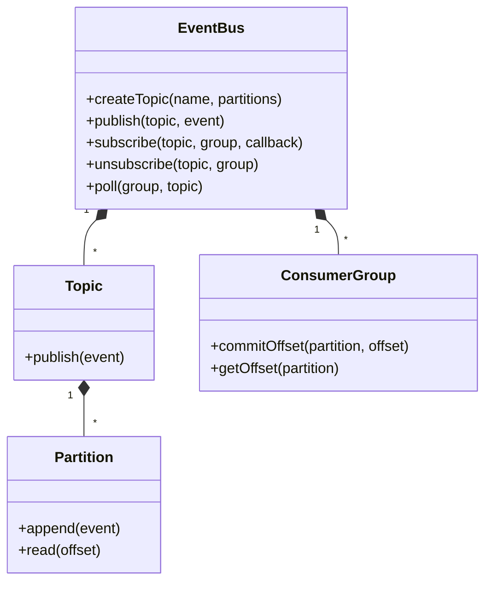
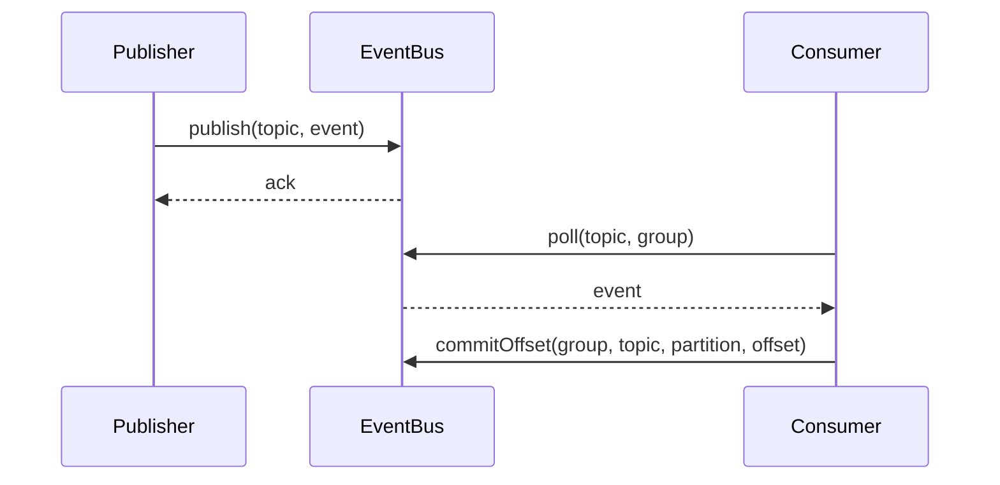

# In-Memory Event Bus - Design

## Architecture
- **EventBus**: Central manager for topics and routing.
- **Topic**: Contains one or more partitions.
- **Partition**: Thread-safe event store maintaining a deterministic, ordered sequence of events.
- **ConsumerGroup**: Tracks offsets per partition for its members.

## Class Diagram (Mermaid)

## Sequence Diagram

## Versioned Behavior Contracts
- **v1-basic**: Core `publish(topic, event)` and simple subscription. No advanced concurrency limits.
- **v2-extended**: Multi-partition, Consumer Groups (`commitOffset`).
- **v3-optimized**: Bounded queues (block/drop/reject on publish/poll), Retry/DLQ routing.
