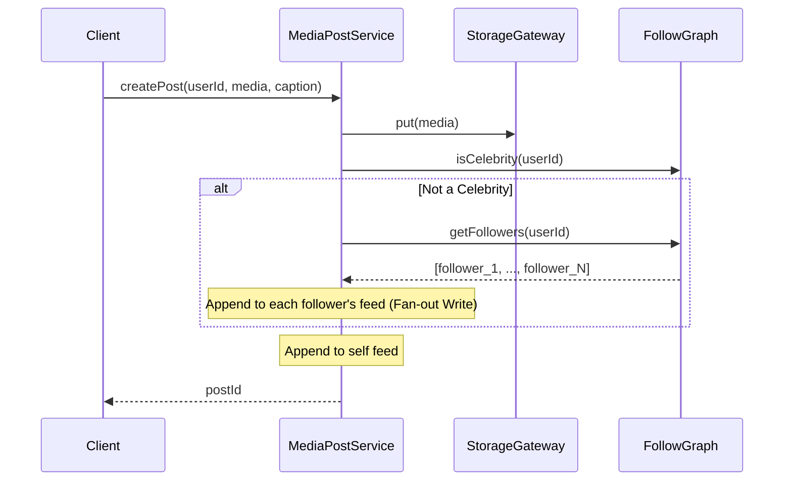

# Code Walkthrough: Instagram Core

## Execution Flow Analysis
This walkthrough focuses on the actual in-memory core implementations provided in `v1-basic`, `v2-extended`, and `v3-optimized`. The system uses a hybrid fan-out approach implemented synchronously via standard data structures.

1. **Storage and Metadata Creation:**
   The `MediaPostService` (`v2-extended` / `v3-optimized`) first uploads media bytes to a storage gateway and generates a `post_id`. A `PostMetadata` object is created with a strict, incrementing timestamp via `AtomicLong` (Java) or an incremented variable (Python).
2. **Fan-out on Write:**
   The service queries `FollowGraphService` for the author's followers. The `MediaPostService` uses an abstract teaching assumption (e.g. checking a flag for celebrity status) to control the flow. If the author is NOT a celebrity, the post is directly appended to the `userFeeds` of every follower. In Java, this is backed by a `ConcurrentHashMap<String, List<PostMetadata>>` with `CopyOnWriteArrayList` values to prevent `ConcurrentModificationException` during iteration.
3. **Transaction Rollback:**
   If any part of the fan-out fails, the system provides a best-effort rollback in a `catch` block, explicitly removing the post from the global `posts` map and removing the specific `PostMetadata` object from all updated user feeds to maintain consistency.

### Sequence Diagram


## Handling the Pull Model (Celebrity Fan-out)
To avoid enormous write amplification for users with millions of followers, celebrity posts are NOT fanned out on write. The complexity is shifted to the read path via `FeedComposer`.

When a user requests their feed:
1. `FeedComposer` retrieves their standard, pre-computed fan-out feed.
2. It queries `FollowGraphService` to filter this feed and discard posts from users they've unfollowed.
3. It determines which celebrities the user is currently following.
4. It iterates over all posts in the system (`postService.getAllPosts()`), selects posts authored by those celebrities, and merges them with the standard feed.
5. Finally, the combined list is sorted in descending order based on timestamp and post ID for stability.

## Cursor Pagination and State Transitions
- **Deterministic Feed Pagination:** Small follow graph yields deterministic fanout-write/read feeds with stable cursor ordering and no duplicate posts between pages. The system uses a compound cursor (`timestamp_postId`) to guarantee stability even if multiple posts share the exact same timestamp.

**Java Reference Implementation:**
```java
// FeedComposer.java
if (cursor != null && !cursor.isEmpty()) {
    String[] parts = cursor.split("_");
    long cursorTimestamp = Long.parseLong(parts[0]);
    String cursorPostId = parts[1];

    List<PostMetadata> filtered = new ArrayList<>();
    for (PostMetadata p : allPosts) {
        if (p.getTimestamp() < cursorTimestamp || 
           (p.getTimestamp() == cursorTimestamp && p.getPostId().compareTo(cursorPostId) < 0)) {
            filtered.add(p);
        }
    }
    allPosts = filtered;
}
```

**Python Reference Implementation:**
```python
# feed_composer.py
if cursor is not None:
    parts = cursor.split("_")
    cursor_timestamp = int(parts[0])
    cursor_post_id = parts[1]
    
    filtered = []
    for p in all_posts:
        if p.timestamp < cursor_timestamp or (p.timestamp == cursor_timestamp and p.post_id < cursor_post_id):
            filtered.append(p)
    all_posts = filtered
```

- **State Transitions and Authorization:** Unfollow/delete/privacy transitions remove unauthorized posts; celebrity threshold is an explicit configurable teaching assumption.

**Java Reference Implementation:**
```java
// MediaPostServiceV2.java
public void deletePost(String postId) {
    PostMetadata post = posts.remove(postId);
    if (post != null) {
        for (List<PostMetadata> feed : userFeeds.values()) {
            feed.remove(post);
        }
    }
}
```

**Python Reference Implementation:**
```python
# media_post_service_v2.py
def delete_post(self, post_id: str) -> None:
    post = self.posts.pop(post_id, None)
    if post:
        # Remove from all user feeds
        for feed in self.user_feeds.values():
            try:
                feed.remove(post)
            except ValueError:
                pass
```
