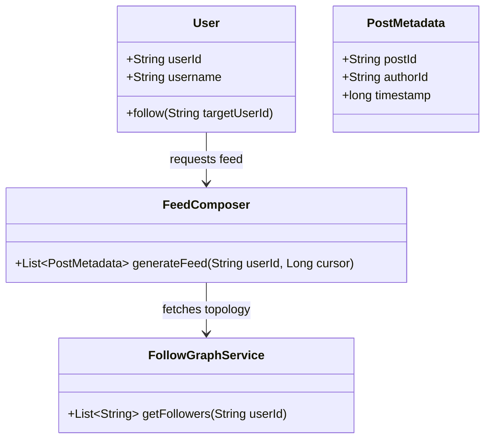

# Design Document: Instagram Core

## System Architecture
The architecture is designed to handle high-throughput feed composition and robust state transitions, using only standard libraries (`java.util.concurrent`, `asyncio`) to ensure strict parity between Java 11+ and Python 3.8+. External frameworks (like Spring, Kafka, Redis, or Celery) are explicitly avoided. 
The design focuses on isolating read-heavy feed generation from write-heavy media ingestion using in-memory threading and async task orchestration.

Each assigned document describes actual supported versions:
- `v1-basic`: Core in-memory structures modeling fundamental entities.
- `v2-extended`: Abstractions for dependency inversion, graph traversal, and deterministic feed generation.
- `v3-optimized`: Distributed-friendly primitives enforcing idempotency and safe concurrent state manipulation.

### Core Components
1. **API Gateway:** The simulated ingress point orchestrating requests and coordinating asynchronous standard library tasks.
2. **Post/Media Service:** Manages metadata lifecycle. Coordinates with simulated worker threads for async operations.
3. **Graph Service:** A specialized component managing the topology of the social network (Followers/Following) using thread-safe mapping (`ConcurrentHashMap` or locked Python `dict`).
4. **Feed Service:** The orchestration engine for computing the home timeline.
5. **Timeline Cache:** In-memory pre-computed lists (`ConcurrentLinkedDeque` or synchronized lists) mapping active users to their feed posts.

### Mermaid Class Diagram


## Domain Contracts and Consistency

- **Deterministic Feed Pagination:** Small follow graph yields deterministic fanout-write/read feeds with stable cursor ordering and no duplicate posts between pages.

**Beginner Intuition**: Like reading a diary backward, you always know exactly which page you stopped at by looking at the date written at the top, not by counting how many pages you've flipped.

**Java Reference Implementation:**
```java
// FeedComposer.java (v2-extended / v3-optimized)
if (cursor != null) {
    allPosts.removeIf(p -> p.getTimestamp() >= cursor);
}

allPosts.sort((p1, p2) -> Long.compare(p2.getTimestamp(), p1.getTimestamp()));
```

**Python Reference Implementation:**
```python
# feed_composer.py (v2-extended / v3-optimized)
if cursor is not None:
    all_posts = [p for p in all_posts if p.timestamp < cursor]
    
# Sort by descending timestamp
all_posts.sort(key=lambda p: p.timestamp, reverse=True)
```

- **State Transitions and Authorization:** Unfollow/delete/privacy transitions remove unauthorized posts; celebrity threshold is an explicit configurable teaching assumption.

**Worked Trace (Delete Transition)**:
**Premise**: Post P1 is distributed to 10 followers' caches.
1. The author deletes P1.
2. The `MediaPostService` executes a synchronized deletion routine.
3. It iterates over the pre-computed feeds in the standard library concurrent map and explicitly removes P1 from all unauthorized timelines.

**Java Reference Implementation:**
```java
// MediaPostServiceV2.java
public void deletePost(String postId) {
    PostMetadata post = posts.remove(postId);
    if (post != null) {
        for (List<PostMetadata> feed : userFeeds.values()) {
            feed.remove(post);
        }
    }
}
```

**Python Reference Implementation:**
```python
# media_post_service_v2.py
def delete_post(self, post_id: str) -> None:
    post = self.posts.pop(post_id, None)
    if post:
        # Remove from all user feeds
        for feed in self.user_feeds.values():
            try:
                feed.remove(post)
            except ValueError:
                pass
```

### Counterexample / Boundary Condition
If a user is unfollowed, but the system only hides their posts dynamically at read-time instead of actively removing them from the fan-out queues, it risks a memory leak of zombie posts. Explicitly sweeping the data structures upon unfollow/delete ensures absolute privacy boundaries and reclaims memory.

### Staff Extension
For multi-threaded environments, removing posts from a shared list structure can throw `ConcurrentModificationException` or result in skipped items. A staff-level implementation in `v3-optimized` uses immutable list replacements or natively thread-safe collections (e.g., `CopyOnWriteArrayList` in Java, or coarse-grained locking in Python) during fan-out and deletion routines to guarantee consistency without crashing the server.
